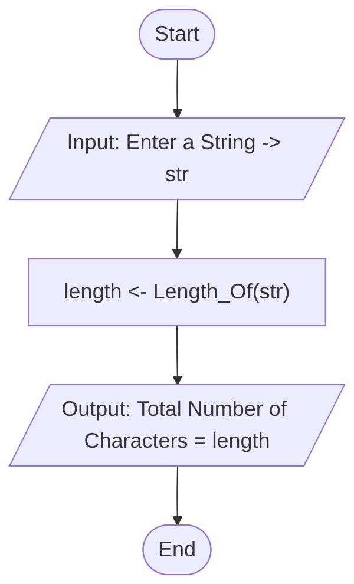
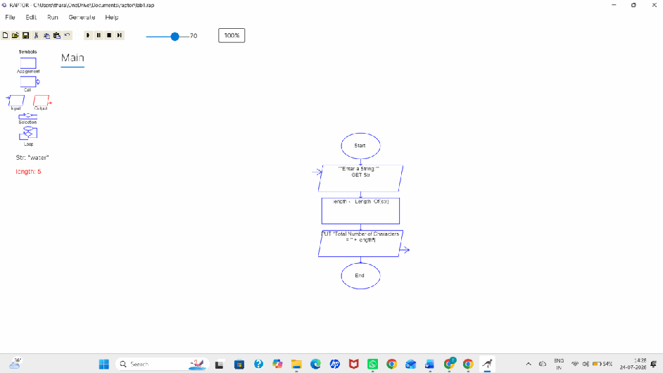
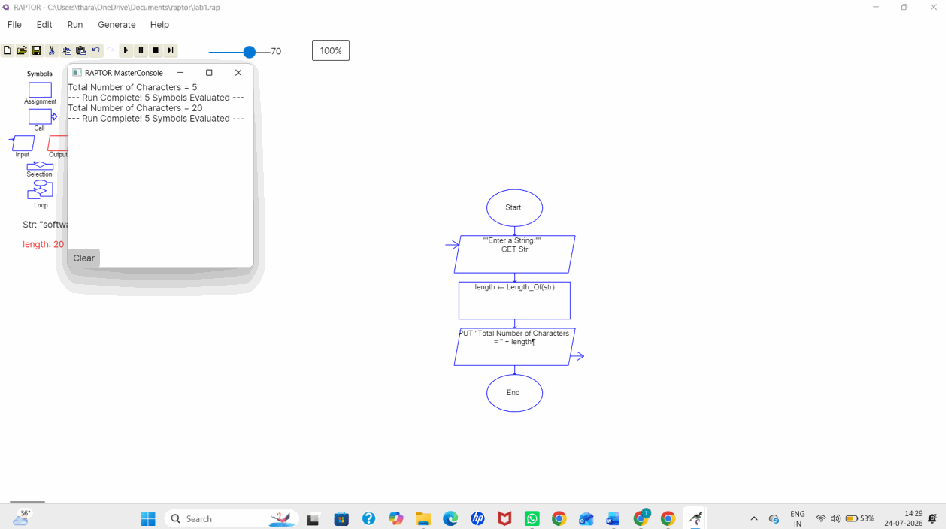
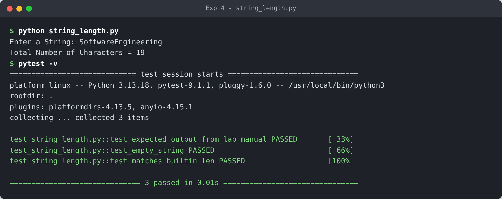

# Experiment 4: Flowchart To Find The Length Of A String Using RAPTOR

 

> **Course:** CSA10 - Software Engineering &nbsp;|&nbsp; **Tools used:** Raptor &nbsp;|&nbsp; **Course outcome:** CO1

---

## Problem Statement


The string is a sequence of characters placed in double quotes (” “). Performing different operations on string data is called String Handling. Strings are immutable. Whenever a change to a String is made, an entirely new String is created. If we want to store a group of characters we can use a char array. String provides various methods to perform different operations on strings. Using Raptor draw a flowchart to display the total number of characters in the string and returns it.


## Aim


To draw and execute a flowchart in RAPTOR that reads a string from the user, calculates the total number of characters in the string and displays it.


## Software / Tools Required

- RAPTOR (Rapid Algorithmic Prototyping Tool for Ordered Reasoning)
- Windows PC

## Theory


A string is a sequence of characters enclosed in double quotes. Strings are immutable – any change creates a new string. String handling means performing operations such as finding the length, concatenation, comparison and searching.

RAPTOR is a flowchart-based programming environment. Programs are built by connecting symbols, and the flowchart can be executed directly, which helps students visualise algorithms.

| RAPTOR Symbol | Purpose |
|---|---|
| Assignment | Stores a value in a variable (x ← expression) |
| Call | Calls a procedure |
| Input | Reads a value from the user |
| Output | Displays a value |
| Selection | Decision (if–else) |
| Loop | Repetition until a condition is true |

The built-in function **Length_Of(str)** returns the number of characters in the string str.

**Algorithm:** 1. Start 2. Read str 3. length ← Length_Of(str) 4. Display length 5. Stop


## Diagram

<p align="center"><br><sub><em>RAPTOR flowchart - string length</em></sub></p>

<sub>Source: [`diagrams/raptor-flowchart.mmd`](diagrams/raptor-flowchart.mmd) (Mermaid)</sub>

## Procedure


### Step 1: Launch RAPTOR and Create a New Flowchart

- Open the RAPTOR application from the desktop or Start menu.
- Select File → New to create a new flowchart.
- A blank workspace with Start and End symbols will be displayed.

### Step 2: Accept the String from the User

- Drag an Input symbol between the Start and End symbols.
- Enter a prompt such as "Enter a String:".
- Store the input in a string variable named str.

### Step 3: Calculate the Number of Characters

- Drag an Assignment symbol below the Input symbol.
- Create an integer variable named length.
- Assign the length of the entered string using the string length function.
- Example:

```
length ← Length_Of(str)
```

### Step 4: Display the Character Count

- Drag an Output symbol below the Assignment symbol.
- Display the message "Total Number of Characters =" along with the value stored in the length variable.

### Step 5: Connect and Validate the Flowchart

- Connect the symbols in the sequence Start → Input → Assignment → Output → End.
- Check that all symbols are connected properly and the flowchart logic is correct.

### Step 6: Execute the Flowchart

- Click the Run button to execute the flowchart.
- Enter a sample string when prompted.
- Verify that the output displays the correct total number of characters in the entered string.

<p align="center"><br><sub><em>Figure 4.1 – Execute the Flowchart</em></sub></p>

<p align="center"><br><sub><em>Figure 4.2 – Execute the Flowchart</em></sub></p>


## Code

All source files for this experiment are in the [`code/`](code/) folder:

- [`string_length.py`](code/string_length.py)
- [`test_string_length.py`](code/test_string_length.py)

## Output

Output captured by running the code in [`code/`](code/) (terminal text is also saved in [`output/`](output/)).

<p align="center"><br><sub><em>Program run - input <code>SoftwareEngineering</code> returns 19, and the unit tests pass</em></sub></p>

Lab screenshots from the original run are in [`screenshots/`](screenshots/) (2 images, shown in the Procedure above).

### Expected Output

- Input: Enter a String: SoftwareEngineering
- Output: Total Number of Characters = 19

## Result


Thus the flowchart to find the length of a given string was drawn, executed and verified using RAPTOR.


## Viva Voce Questions

1. **What is RAPTOR?**
   **Ans:** A flowchart-based visual programming tool used to design and run algorithms.

2. **Which function returns the length of a string in RAPTOR?**
   **Ans:** Length_Of().

3. **What does immutable string mean?**
   **Ans:** Its contents cannot be changed after creation; any modification creates a new string.

4. **Name the six basic RAPTOR symbols.**
   **Ans:** Assignment, Call, Input, Output, Selection and Loop.

5. **How is the flowchart executed in RAPTOR?**
   **Ans:** Using the Run (Execute to Completion) button or step-by-step execution.


---
[Back to all experiments](../README.md)
