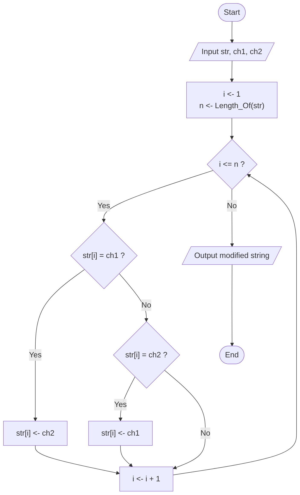
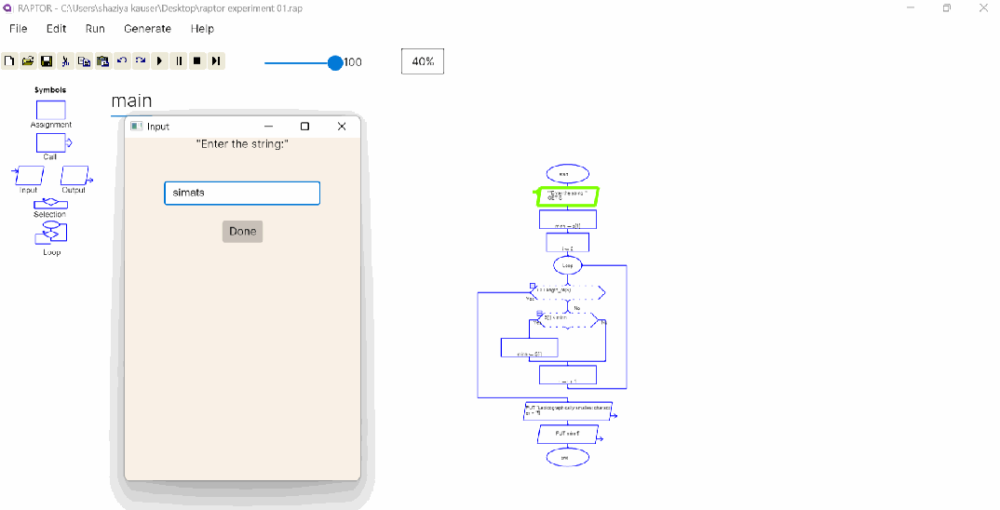
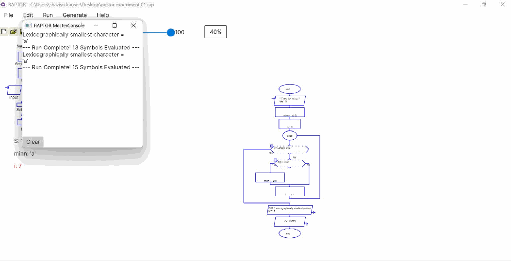
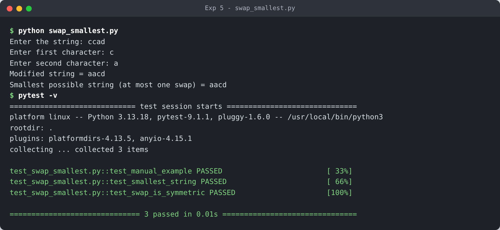

# Experiment 5: Lexicographically Smallest String By Swapping Two Characters Using RAPTOR

 

> **Course:** CSA10 - Software Engineering &nbsp;|&nbsp; **Tools used:** Raptor &nbsp;|&nbsp; **Course outcome:** CO1

---

## Problem Statement


Using Raptor – Draw and validate a flowchart for a given string of lower case English alphabets. One can choose any two characters in the string and replace all the occurrences of the first character with the second character and replace all the occurrences of the second character with the first character. Using Raptor draw and validate the flowchart lexicographically smallest string that can be obtained by doing this operation at most once.


## Aim


To draw and validate a RAPTOR flowchart that, for a given string of lower-case letters, chooses two characters and swaps all their occurrences at most once, so that the lexicographically smallest string is obtained.


## Software / Tools Required

- RAPTOR
- Windows PC

## Theory


A string A is lexicographically smaller than string B if, at the first position where they differ, A has the smaller character (dictionary order).

The allowed operation chooses two characters x and y and replaces every x with y and every y with x. To obtain the smallest string, scan from left to right and find the first character str[i] for which a smaller character exists later in the string; swap it with the smallest such character. If no such character exists the string is already the smallest.

**Algorithm:**

- Read the string str and the two characters ch1 and ch2 (ch1 = the first character that can be improved, ch2 = the smallest character after it).
- Set i ← 1 and n ← Length_Of(str).
- Loop while i <= n: if str[i] = ch1 replace it with ch2; else if str[i] = ch2 replace it with ch1.
- Increment i and repeat; finally display the modified string.

Example: str = “ccad”. The first character ‘c’ has a smaller character ‘a’ after it, so swap ‘c’ ↔ ‘a’ → “aacd”, which is the smallest possible string.


## Diagram

<p align="center"><br><sub><em>RAPTOR flowchart - swap characters</em></sub></p>

<sub>Source: [`diagrams/raptor-flowchart.mmd`](diagrams/raptor-flowchart.mmd) (Mermaid)</sub>

## Procedure


### Step 1: Launch RAPTOR

- Open the RAPTOR software from the desktop or Start menu.
- Create a new flowchart by selecting File → New.
- The flowchart initially contains only the Start and End symbols.

### Step 2: Insert Input Symbols

- Add three Input symbols between the Start and End symbols.
- Read the required inputs from the user:
  - Input the string (str).
  - Input the first character (ch1) to be swapped.
  - Input the second character (ch2) to be swapped.
- These inputs are required to perform the character swapping operation.

### Step 3: Initialize Variables

- Insert an Assignment symbol after the input symbols.
- Initialize the variables required for processing the string.
- Set the loop counter to the first character of the string:

```
i ← 1
```

- Find the total number of characters in the string:

```
n ← Length_Of(str)
```

- These variables help in traversing the entire string.

### Step 4: Create a Loop for String Traversal

- Insert a Loop symbol after the assignment symbol.
- Specify the loop condition:

```
i <= n
```

- The loop ensures that every character in the string is examined one by one until the last character is reached.

### Step 5: Compare the Current Character with the First Selected Character

- Inside the loop, insert a Selection symbol.
- Compare the current character of the string with the first selected character (ch1).
- If the comparison is true, replace that character with the second selected character (ch2).
- If the comparison is false, proceed to check the second character.

### Step 6: Compare the Current Character with the Second Selected Character

- Insert another Selection symbol.
- Compare the current character with the second selected character (ch2).
- If they are equal, replace that character with the first selected character (ch1).
- Otherwise, retain the character without making any changes.
- This step completes the swapping of the selected characters throughout the string.

### Step 7: Increment the Loop Counter

- Insert an Assignment symbol after the comparison process.
- Increase the loop counter by one:

```
i ← i + 1
```

- Connect this symbol back to the loop condition so that the next character is processed.

### Step 8: Display the Modified String

- Once the loop terminates, insert an Output symbol.
- Display the modified string obtained after swapping all occurrences of the selected characters.
- This string represents the resulting string after performing the operation once.

### Step 9: Validate the Flowchart

- Execute the flowchart using the Run option available in RAPTOR.
- Enter sample input values when prompted.
- Verify whether the output matches the expected result.

<p align="center"><br><sub><em>Figure 5.1 – Validate the Flowchart</em></sub></p>

<p align="center"><br><sub><em>Figure 5.2 – Validate the Flowchart</em></sub></p>


## Code

All source files for this experiment are in the [`code/`](code/) folder:

- [`swap_smallest.py`](code/swap_smallest.py)
- [`test_swap_smallest.py`](code/test_swap_smallest.py)

## Output

Output captured by running the code in [`code/`](code/) (terminal text is also saved in [`output/`](output/)).

<p align="center"><br><sub><em>Program run - <code>ccad</code>, <code>c</code>, <code>a</code> gives <code>aacd</code>, and the unit tests pass</em></sub></p>

Lab screenshots from the original run are in [`screenshots/`](screenshots/) (2 images, shown in the Procedure above).

### Expected Output

- Input: str = ccad, ch1 = c, ch2 = a
- Output: Modified string = aacd

## Result


Thus the flowchart to obtain the lexicographically smallest string by swapping all occurrences of two characters at most once was drawn and validated using RAPTOR.


## Viva Voce Questions

1. **What is lexicographic order?**
   **Ans:** Dictionary order – strings are compared character by character from the left.

2. **Why is the operation done at most once?**
   **Ans:** The problem allows only one swap of a pair of characters; all their occurrences are swapped together.

3. **How do you access the i-th character of a string in RAPTOR?**
   **Ans:** Using str[i]; indexing starts at 1.

4. **What is the time complexity of the scan?**
   **Ans:** O(n) for the replacement loop (O(26·n) including finding the pair).

5. **Which RAPTOR symbol is used for if-else?**
   **Ans:** The Selection symbol.


---
[Back to all experiments](../README.md)
