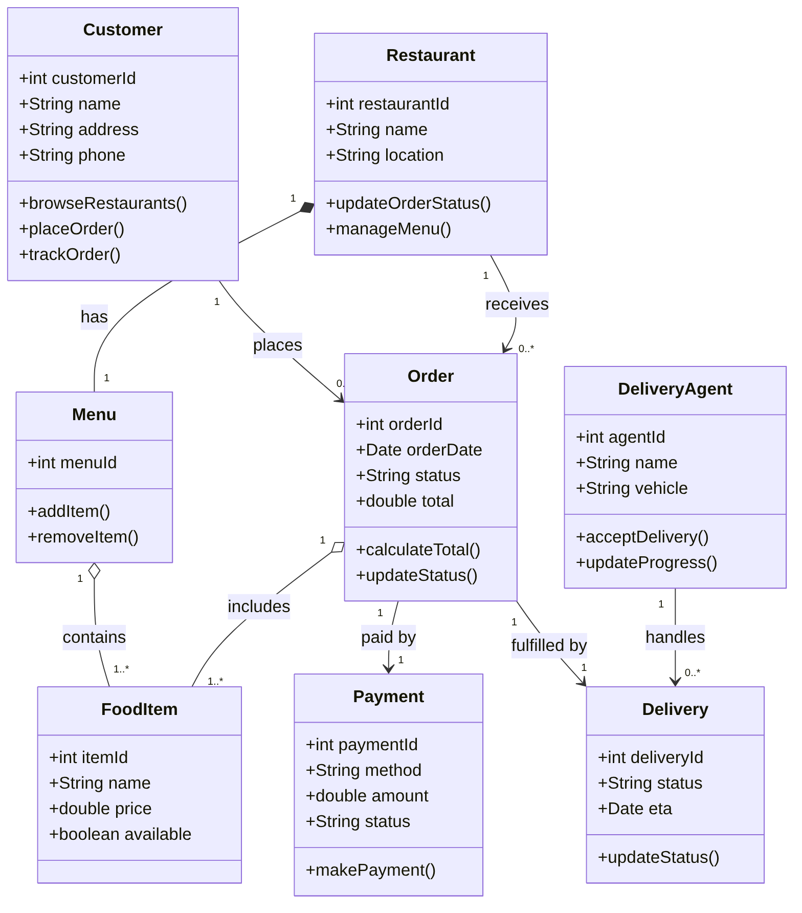
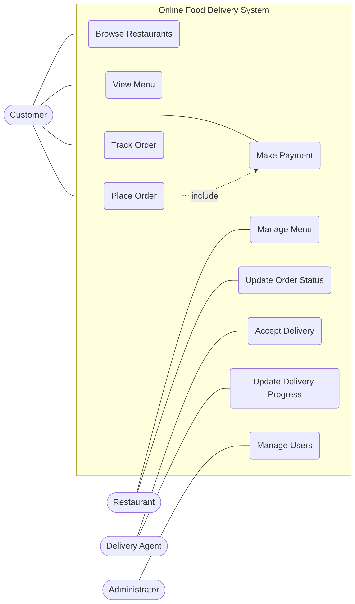
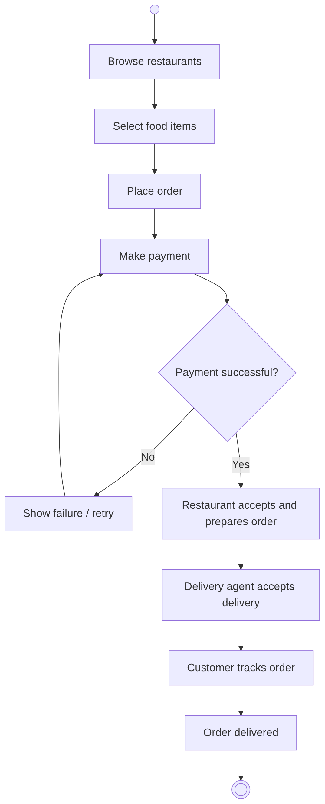
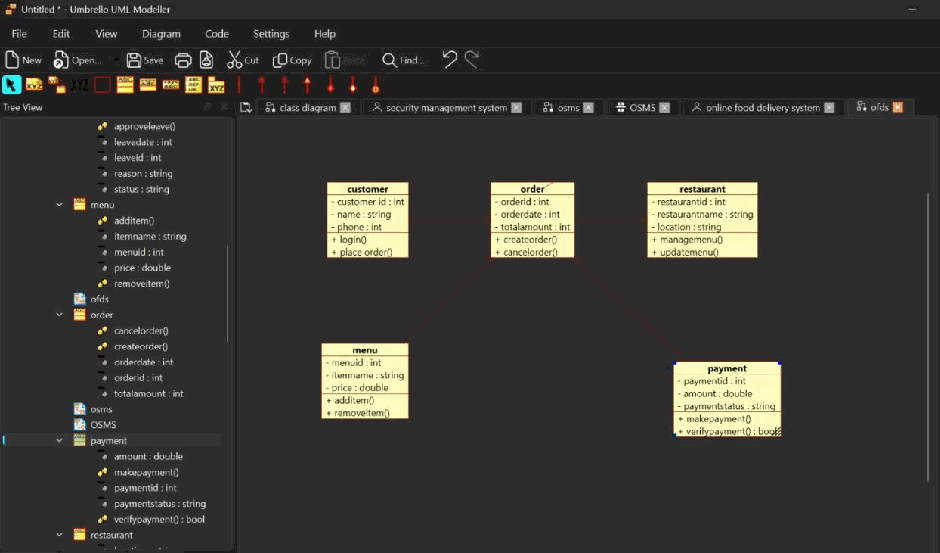
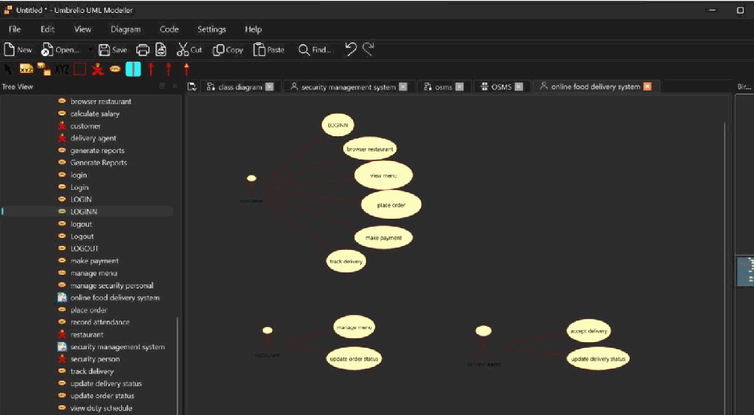
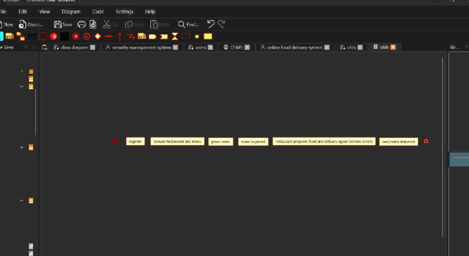

# Experiment 6: UML Class, Use Case And Activity Diagrams For An Online Food Delivery System

 

> **Course:** CSA10 - Software Engineering &nbsp;|&nbsp; **Tools used:** Umbrello &nbsp;|&nbsp; **Course outcome:** CO1

---

## Problem Statement

An online food delivery platform enables customers to browse restaurants, view menus, place food orders, make online payments, and track delivery status. Restaurants use the system to manage their menus and update order status, while delivery agents are responsible for accepting delivery requests and updating delivery progress. Design a Class Diagram, Use case Diagram and Activity Diagram for the Online Food Delivery System showing the relevant classes, their attributes, methods, and relationships.

## Aim

To design the Class diagram, Use Case diagram and Activity diagram for an Online Food Delivery System showing the relevant classes, attributes, methods, actors and workflow.

## Software / Tools Required

- Umbrello UML Modeller / StarUML
- Windows / Linux PC

## Theory

The Unified Modelling Language (UML) is a standard visual language for specifying, constructing and documenting software systems. UML diagrams are of two types – structural (Class, Object, Component, Deployment) and behavioural (Use Case, Activity, Sequence, State).

- **Class diagram** – shows classes with attributes and operations and the relationships between them: association, aggregation (hollow diamond), composition (filled diamond), generalization (hollow triangle) and dependency.
- **Use Case diagram** – shows actors (users or external systems) and the use cases (functions) they perform, inside a system boundary. Relationships: association, «include», «extend» and generalization.
- **Activity diagram** – shows the flow of control from activity to activity using an initial node, action states, decision/merge nodes, fork/join bars and a final node.

For the food delivery system the main actors are Customer, Restaurant, Delivery Agent and Administrator; the main classes are Customer, Restaurant, Menu, FoodItem, Order, Payment, DeliveryAgent and Delivery.

## Diagram

 <em>Class diagram - Online Food Delivery</em>

Source: [`diagrams/class-diagram.mmd`](diagrams/class-diagram.mmd) (Mermaid)

 <em>Use case diagram - Online Food Delivery</em>

Source: [`diagrams/use-case-diagram.mmd`](diagrams/use-case-diagram.mmd) (Mermaid)

 <em>Activity diagram - Order a meal</em>

Source: [`diagrams/activity-diagram.mmd`](diagrams/activity-diagram.mmd) (Mermaid)

## Procedure

### Step 1: Launch the UML Modeling Tool

- Open StarUML or any UML modeling software.
- Create a new project.
- Save the project with the name "Online Food Delivery System."

### Step 2: Analyze the Problem Statement

- Read the given problem carefully.
- Identify the main functionalities of the system.
- List the actors, classes, and activities required for the system.
- Plan the diagrams before creating them.

### Step 3: Create the Class Diagram

- Add a new Class Diagram to the project.
- Create the required classes such as Customer, Restaurant, Menu, Food Item, Order, Payment, Delivery Agent, and Delivery.
- Add suitable attributes for each class.
- Add appropriate methods for each class.
- Connect the classes using suitable relationships such as association, aggregation, composition, and inheritance.
- Verify that the relationships correctly represent the system.

 <em>Figure 6.1 – Create the Class Diagram</em>

### Step 4: Create the Use Case Diagram

- Add a new Use Case Diagram.
- Create the actors such as Customer, Restaurant, Delivery Agent, and Administrator.
- Add the use cases including Browse Restaurants, View Menu, Place Order, Make Payment, Track Order, Manage Menu, Update Order Status, Accept Delivery Request, and Update Delivery Status.
- Connect each actor with the corresponding use cases using association relationships.

 <em>Figure 6.2 – Create the Use Case Diagram</em>

### Step 5: Create the Activity Diagram

- Add a new Activity Diagram.
- Insert the Initial Node to represent the start of the process.
- Create the activities in sequence, including browsing restaurants, selecting food items, placing an order, making payment, restaurant confirmation, assigning a delivery agent, tracking delivery, and completing the order.
- Use decision nodes wherever conditions are required.
- Connect all activities using control flow arrows.
- End the process using the Final Node.

 <em>Figure 6.3 – Create the Activity Diagram</em>

### Step 6: Verify the Class Diagram

- Check whether all classes contain the required attributes and methods.
- Ensure that all relationships are connected correctly.
- Verify that the diagram satisfies the given requirements.

### Step 7: Verify the Use Case Diagram

- Ensure that all actors are connected to the appropriate use cases.
- Verify that all system functionalities are included.
- Check the correctness of the associations.

### Step 8: Verify the Activity Diagram

- Review the sequence of activities.
- Check the decision points and control flow.
- Ensure that the workflow represents the food delivery process correctly.

### Step 9: Save the UML Project

- Save all the diagrams in the project.
- Store the project with an appropriate file name.

### Step 10: Export the Diagrams

- Export the Class Diagram, Use Case Diagram, and Activity Diagram as image or PDF files.
- Verify that all diagrams are complete and ready for submission.

## Output

Lab screenshots from the original run are in [`screenshots/`](screenshots/) (3 images, shown in the Procedure above).

### Expected Output

- Class diagram with classes Customer, Restaurant, Menu, FoodItem, Order, Payment, DeliveryAgent, Delivery and their relationships.
- Use Case diagram with actors Customer, Restaurant, Delivery Agent, Administrator and use cases such as Browse Restaurants, Place Order, Make Payment, Track Order, Manage Menu, Accept Delivery.
- Activity diagram from browsing restaurants to order completion with decision nodes for payment success.

## Result

Thus the Class, Use Case and Activity diagrams for the Online Food Delivery System were designed using the UML tool and verified successfully.

## Viva Voce Questions

1. **What is UML?**
   **Ans:** Unified Modelling Language – a standard graphical notation to model software systems.

2. **Differentiate aggregation and composition.**
   **Ans:** Aggregation is a weak whole–part relationship (parts can exist independently); composition is strong (parts are destroyed with the whole).

3. **What is an actor?**
   **Ans:** A role played by a user or external system that interacts with the system.

4. **What is the difference between «include» and «extend»?**
   **Ans:** «include» is mandatory reuse of behaviour; «extend» adds optional behaviour under a condition.

5. **What is a fork node in an activity diagram?**
   **Ans:** A bar that splits one flow into concurrent parallel flows.

---
[Back to all experiments](../README.md)
