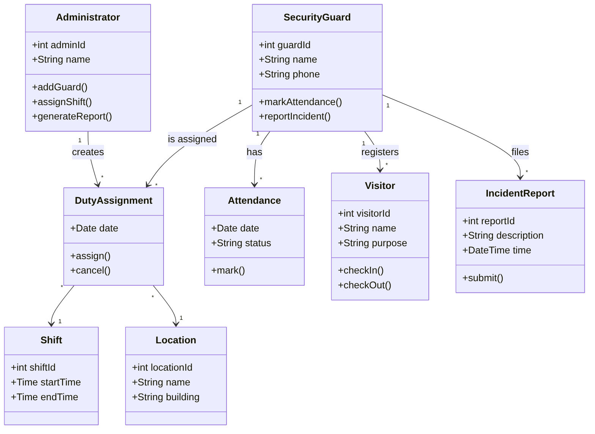
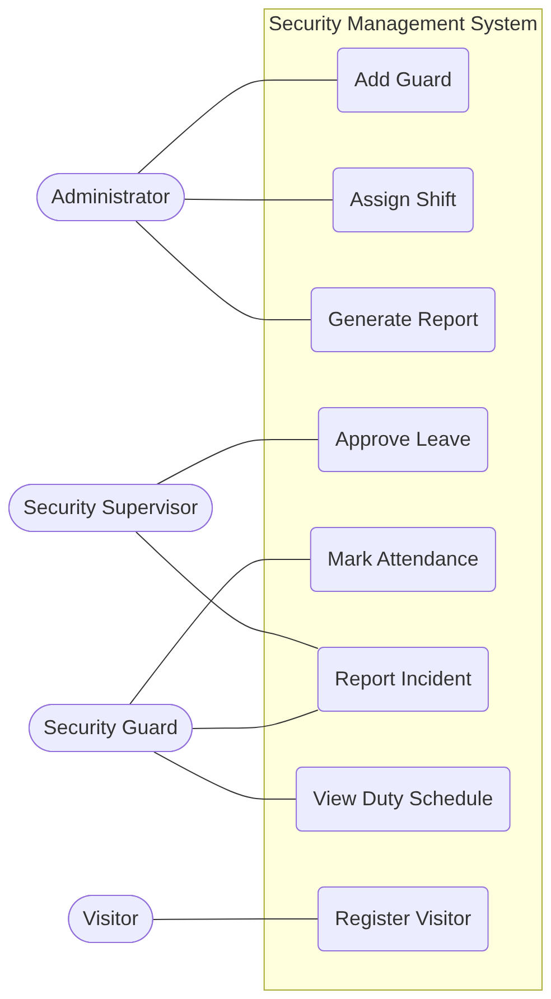
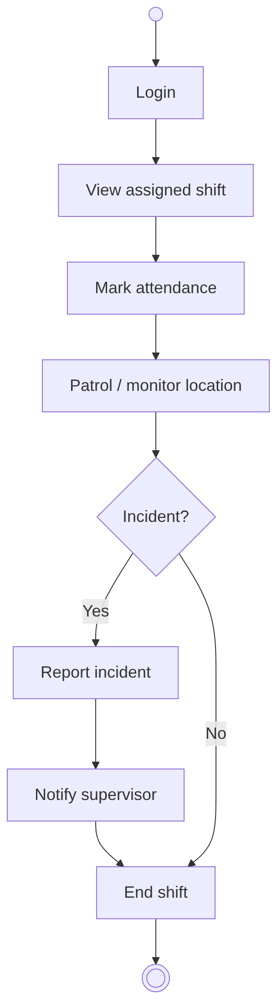
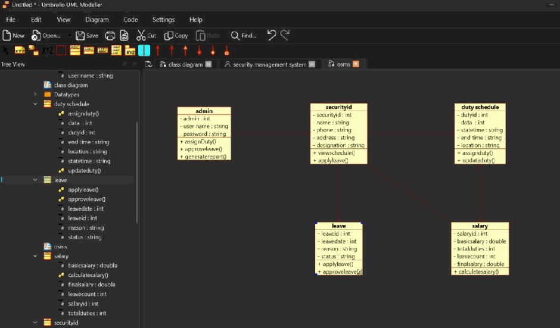
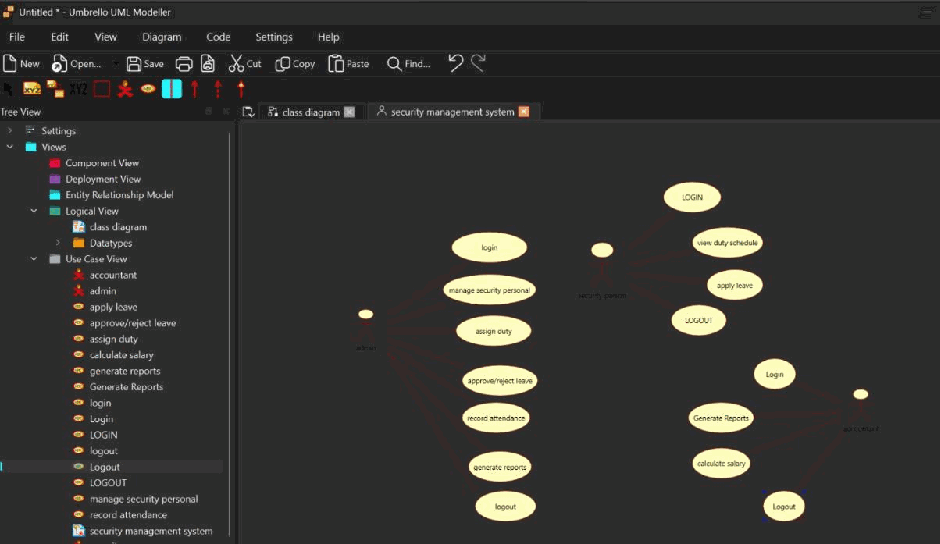
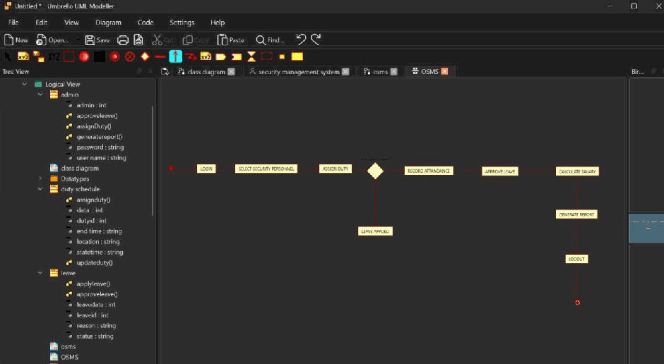

# Experiment 7: UML Diagrams For A College Security Management System

 

> **Course:** CSA10 - Software Engineering &nbsp;|&nbsp; **Tools used:** Umbrello &nbsp;|&nbsp; **Course outcome:** CO1

---

## Problem Statement

A college employs a large number of security personnel who are assigned duties at various locations across the campus. Each security person follows a duty schedule that includes date, duty start time, duty end time, and assigned location, ensuring that every campus location is covered. If a security person takes leave, it is recorded manually, and at the end of each month, salaries are calculated based on duties performed and leaves taken. Since manual handling of duty allocation, leave management, and salary calculation is time-consuming and complex, the college plans to develop an Online Security Management System to automate these activities. Develop Class Diagram, Use case Diagram and Activity Diagram to represent the workflow of the Online Security Management System.

## Aim

To design the Class diagram, Use Case diagram and Activity diagram for a Security Management System that manages the security personnel of a college.

## Software / Tools Required

- Umbrello UML Modeller / StarUML
- Windows / Linux PC

## Theory

A college employs many security personnel who work in shifts at different locations. A Security Management System records guard details, assigns duties and shifts, tracks attendance, records visitor entries and incidents, and generates reports for the administrator.

The three UML views give complementary information:

- **Static view (Class diagram)** – classes such as Administrator, SecurityGuard, Shift, DutyAssignment, Location, Attendance, Visitor and IncidentReport with their attributes and methods.
- **Functional view (Use Case diagram)** – actors Administrator, Security Supervisor, Security Guard and Visitor with use cases like Add Guard, Assign Shift, Mark Attendance, Register Visitor, Report Incident and Generate Report.
- **Dynamic view (Activity diagram)** – the duty workflow: login → view assigned shift → mark attendance → patrol/monitor → decision (incident?) → report incident → end shift.

Multiplicity (1, 0..1, 1..*, *) is written at association ends to show how many objects participate in the relationship.

## Diagram

 <em>Class diagram - Security Management System</em>

Source: [`diagrams/class-diagram.mmd`](diagrams/class-diagram.mmd) (Mermaid)

 <em>Use case diagram - Security Management System</em>

Source: [`diagrams/use-case-diagram.mmd`](diagrams/use-case-diagram.mmd) (Mermaid)

 <em>Activity diagram - Duty and incident workflow</em>

Source: [`diagrams/activity-diagram.mmd`](diagrams/activity-diagram.mmd) (Mermaid)

## Procedure

### Step 1: Launch the UML Modeling Tool

- Open Umbrello UML Modeller.
- Create a new UML project.
- Save the project with the name "Online Security Management System."

### Step 2: Analyze the Problem Statement

- Read the given problem carefully.
- Identify the main functionalities of the system.
- Determine the actors, classes, and activities involved.
- Plan the structure of the required UML diagrams.

### Step 3: Create the Class Diagram

- Add a new Class Diagram to the project.
- Create the required classes such as Security Personnel, Duty Schedule, Campus Location, Leave, Salary, Administrator, and Attendance.
- Add suitable attributes for each class.
- Add appropriate methods for each class.
- Establish relationships such as association, aggregation, composition, and inheritance wherever required.
- Verify that the diagram represents the Online Security Management System accurately.

 <em>Figure 7.1 – Create the Class Diagram</em>

### Step 4: Create the Use Case Diagram

- Add a new Use Case Diagram.
- Create the actors such as Administrator, Security Personnel, and Accounts Officer.
- Add use cases including Login, Assign Duty, View Duty Schedule, Apply Leave, Approve Leave, Record Attendance, Update Duty Status, Calculate Salary, Generate Salary Report, and Logout.
- Connect each actor with the corresponding use cases using association relationships.
- Verify that all required system functionalities are included.

 <em>Figure 7.2 – Create the Use Case Diagram</em>

### Step 5: Create the Activity Diagram

- Add a new Activity Diagram.
- Insert the Initial Node to represent the start of the workflow.
- Create activities such as Login, Assign Duty, View Duty Schedule, Perform Duty, Apply Leave, Approve Leave, Record Attendance, Calculate Salary, Generate Salary Report, and Logout.
- Add decision nodes wherever necessary to represent conditions such as leave approval.
- Connect all activities using control flow arrows.
- End the workflow using the Final Node.

 <em>Figure 7.3 – Create the Activity Diagram</em>

### Step 6: Verify the Class Diagram

- Check that all classes contain the required attributes and methods.
- Ensure that all relationships between classes are correctly represented.
- Verify that the diagram satisfies the system requirements.

### Step 7: Verify the Use Case Diagram

- Ensure that all actors are connected to the appropriate use cases.
- Verify that every major functionality is represented.
- Check that all associations are correctly connected.

### Step 8: Verify the Activity Diagram

- Review the sequence of activities from login to salary generation.
- Verify the control flow and decision nodes.
- Ensure that the workflow accurately represents the Online Security Management System.

### Step 9: Save the UML Project

- Save all the created diagrams.
- Store the project with an appropriate file name for future reference and submission.

### Step 10: Export the Diagrams

- Export the Class Diagram, Use Case Diagram, and Activity Diagram as image or PDF files.
- Verify that all diagrams

## Output

Lab screenshots from the original run are in [`screenshots/`](screenshots/) (3 images, shown in the Procedure above).

### Expected Output

- Class diagram of the Security Management System with attributes, methods and associations.
- Use Case diagram with all actors and use cases inside the system boundary.
- Activity diagram showing the duty and incident-reporting workflow.

## Result

Thus the Class, Use Case and Activity diagrams for the College Security Management System were designed and verified using the UML modelling tool.

## Viva Voce Questions

1. **What is multiplicity?**
   **Ans:** The number of instances of one class that can be associated with one instance of another class, e.g. 1..*.

2. **What is a system boundary?**
   **Ans:** A rectangle in a use case diagram that separates the system’s use cases from external actors.

3. **Which diagram shows the static structure of a system?**
   **Ans:** The Class diagram.

4. **What is a swimlane?**
   **Ans:** A partition in an activity diagram that groups activities by the actor responsible.

5. **What is generalization?**
   **Ans:** An inheritance relationship where a child class/actor specialises a parent.

---
[Back to all experiments](../README.md)
