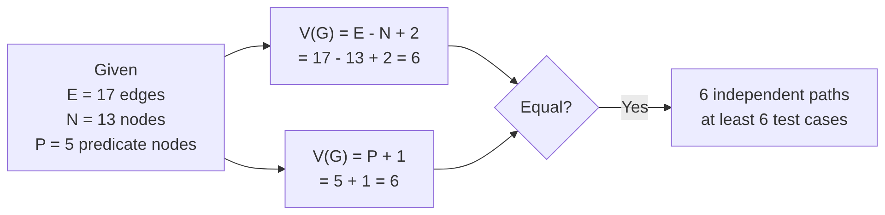
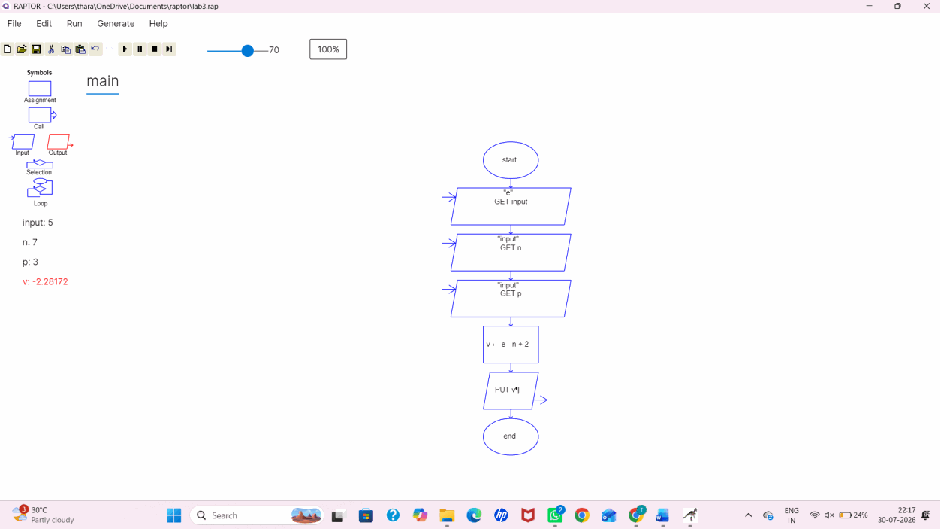
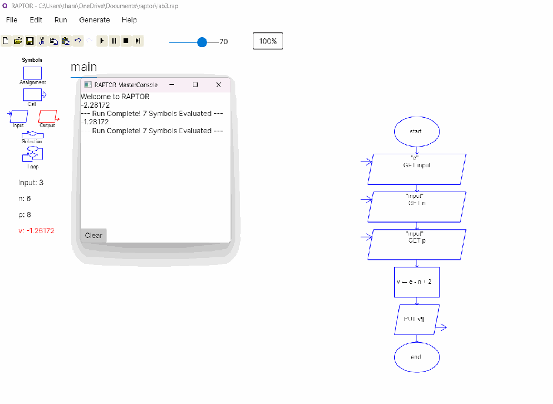
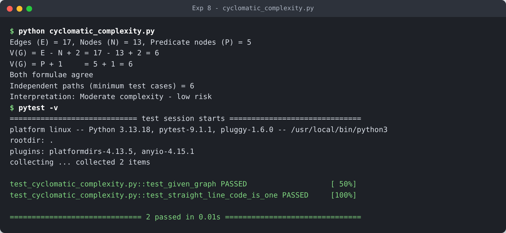

# Experiment 8: Cyclomatic Complexity Of A Flow Graph

 

> **Course:** CSA10 - Software Engineering &nbsp;|&nbsp; **Tools used:** Raptor &nbsp;|&nbsp; **Course outcome:** CO1

---

## Problem Statement


Cyclomatic Complexity in Software Testing is a testing metric used for measuring the complexity of a software program. It is a quantitative measure of independent paths in the source code of a software program. Cyclomatic complexity can be calculated by using control flow graphs or with respect to functions, modules, methods or classes within a software program. Cyclomatic complexity for a flow graph G is V(G)=E-N+2. Cyclomatic complexity is a software metric (measurement), used to indicate the complexity of a program, Cyclomatic complexity = E - N + P where, E = number of edges in the flow graph, N = number of nodes in the flow graph, P = number of nodes that have exit points. Find Cyclomatic Complexity for a graph having number of edges as 17, number of nodes as 13 and number of predicate nodes in the flow graph as 5.


## Aim


To find the cyclomatic complexity of a program whose flow graph has 17 edges, 13 nodes and 5 predicate nodes, and to verify the result using the alternate formula.


## Software / Tools Required

- RAPTOR / any drawing tool for the control flow graph
- Calculator

## Theory


Cyclomatic complexity, proposed by Thomas McCabe (1976), is a software metric that measures the number of linearly independent paths through a program’s source code. It is computed from the Control Flow Graph (CFG), in which nodes represent statements or blocks and edges represent the flow of control.

It can be computed in three equivalent ways:

- V(G) = E − N + 2P, where E = edges, N = nodes, P = connected components (P = 1 for a single program).
- V(G) = π + 1, where π = number of predicate (decision) nodes.
- V(G) = number of closed regions in the planar flow graph + 1.

| V(G) | Complexity | Risk |
|---|---|---|
| 1 – 10 | Simple program | Low |
| 11 – 20 | More complex | Moderate |
| 21 – 50 | Complex | High |
| > 50 | Untestable | Very high |

The value of V(G) gives the minimum number of test cases needed for basis path testing.


## Diagram

<p align="center"><br><sub><em>Cyclomatic complexity calculation</em></sub></p>

<sub>Source: [`diagrams/control-flow-and-formula.mmd`](diagrams/control-flow-and-formula.mmd) (Mermaid)</sub>

## Procedure


### Step 1: Read the Problem Statement

- Read the given control flow graph details carefully.
- Identify the values provided for the number of edges, nodes, and predicate nodes.
- Note the given values:
  - Number of Edges (E) = 17
  - Number of Nodes (N) = 13
  - Number of Predicate Nodes (P) = 5

### Step 2: Draw the Control Flow Graph

- Draw the control flow graph representing the program.
- Label all the nodes and edges correctly.
- Identify the predicate (decision) nodes in the graph.

### Step 3: Count the Graph Components

- Count the total number of nodes in the control flow graph.
- Count the total number of edges connecting the nodes.
- Count the number of predicate nodes present in the graph.
- Verify that the counted values match the given data.

### Step 4: Apply the Cyclomatic Complexity Formula

- Use the Cyclomatic Complexity formula:

```
V(G) = E − N + 2
```

- Substitute the given values:

```
V(G) = 17 − 13 + 2
```

### Step 5: Calculate the Cyclomatic Complexity

- Perform the calculation:

```
V(G) = 6
```

- Record the calculated Cyclomatic Complexity value.

### Step 6: Verify Using Predicate Nodes

- Use the alternate formula:

```
V(G) = P + 1
```

- Substitute the given value:

```
V(G) = 5 + 1
```

- Calculate the result:

```
V(G) = 6
```

- Compare the result with the previous calculation.

### Step 7: Analyze the Result

- Verify that both methods produce the same Cyclomatic Complexity.
- Conclude that the program contains six independent execution paths.

### Step 8: Interpret the Complexity

- Determine the testing effort required based on the Cyclomatic Complexity value.
- Note that a Cyclomatic Complexity of 6 indicates a program with moderate complexity and at least six independent test cases are required for complete basis path testing.

### Step 9: Document the Result

- Record all calculations neatly.
- Write the final Cyclomatic Complexity value in the observation section.

### Step 10: Save the Work

- Verify the calculations once again.
- Save the document or record the experiment for submission.

<p align="center"><br><sub><em>Figure 8.1 – Save the Work</em></sub></p>

<p align="center"><br><sub><em>Figure 8.2 – Save the Work</em></sub></p>


## Code

All source files for this experiment are in the [`code/`](code/) folder:

- [`cyclomatic_complexity.py`](code/cyclomatic_complexity.py)
- [`test_cyclomatic_complexity.py`](code/test_cyclomatic_complexity.py)

## Output

Output captured by running the code in [`code/`](code/) (terminal text is also saved in [`output/`](output/)).

<p align="center"><br><sub><em>Both formulae give V(G) = 6; unit tests pass</em></sub></p>

Lab screenshots from the original run are in [`screenshots/`](screenshots/) (2 images, shown in the Procedure above).

### Expected Output

- Using V(G) = E − N + 2 = 17 − 13 + 2 = **6**
- Using V(G) = P + 1 = 5 + 1 = **6**
- Both methods give V(G) = 6, so at least six independent test paths are required.

## Result


Thus the cyclomatic complexity of the given flow graph was calculated as V(G) = 6 using both formulae, indicating six independent paths and moderate complexity.


## Viva Voce Questions

1. **Who introduced cyclomatic complexity?**
   **Ans:** Thomas J. McCabe in 1976.

2. **What is a predicate node?**
   **Ans:** A node containing a condition (decision), from which two or more edges leave.

3. **What is basis path testing?**
   **Ans:** A white-box technique that designs test cases to execute every independent path at least once.

4. **What does V(G) = 6 tell the tester?**
   **Ans:** At least six test cases are needed to cover all independent paths.

5. **Is cyclomatic complexity a black-box or white-box metric?**
   **Ans:** White-box – it needs the internal structure of the code.


---
[Back to all experiments](../README.md)
