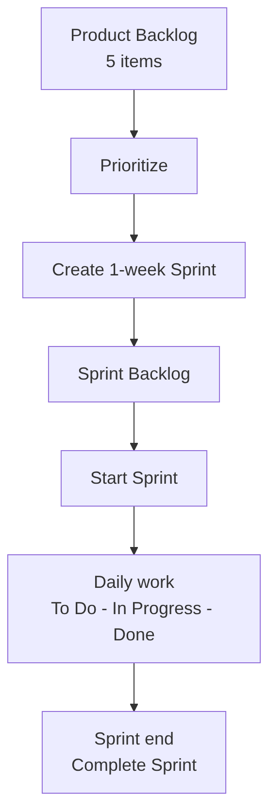
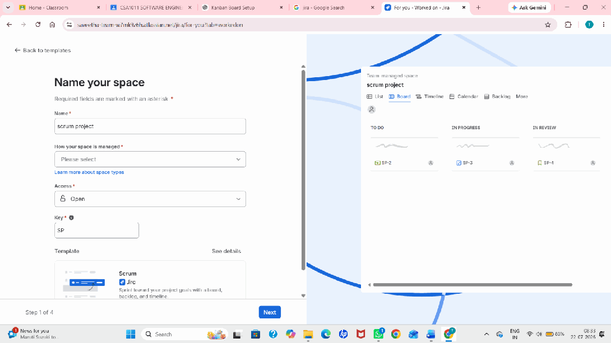
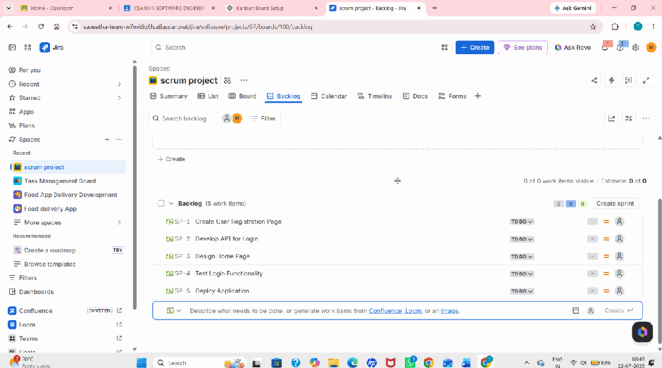
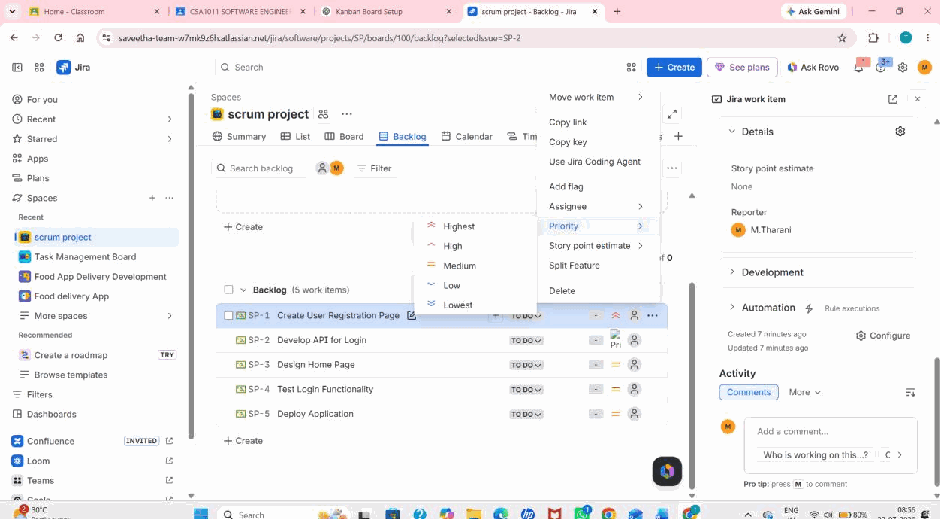
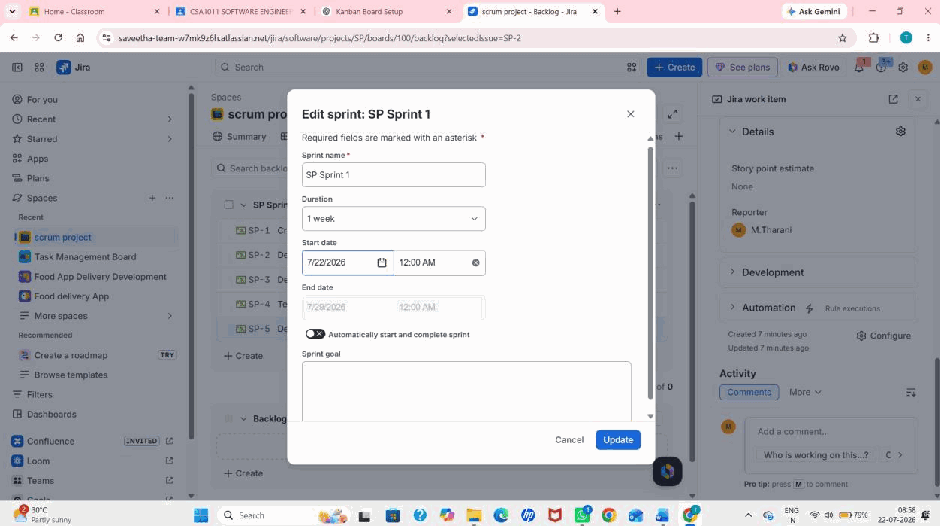
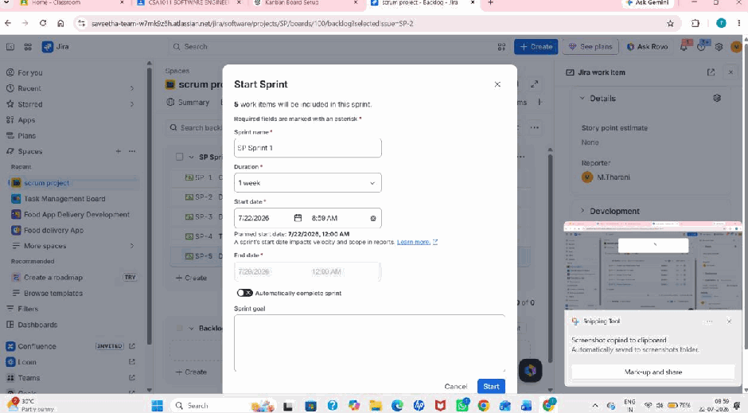
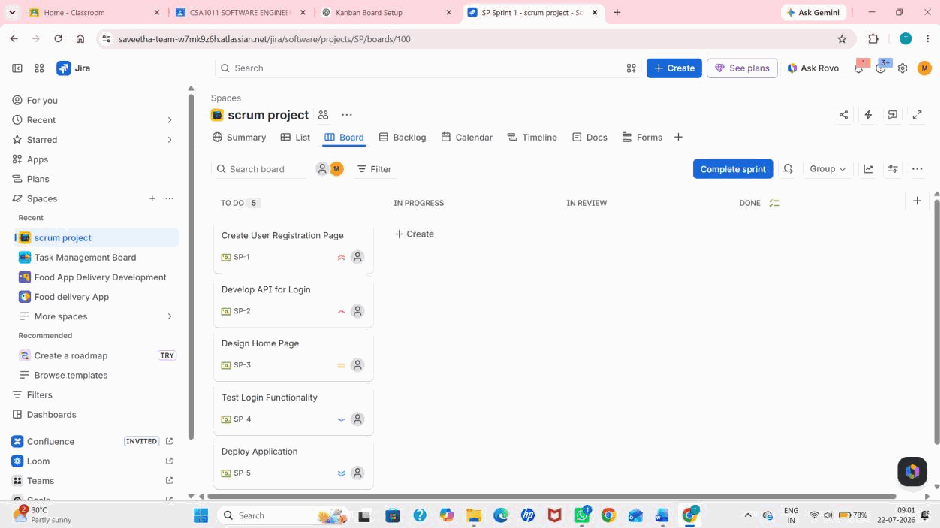
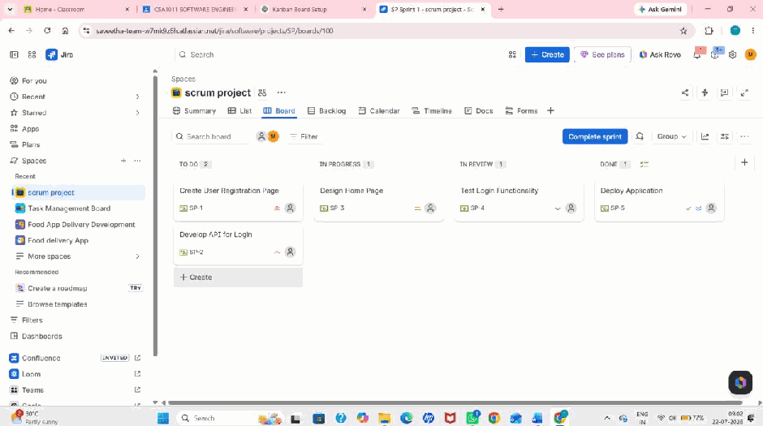

# Experiment 9: Creating A Scrum Project With Backlog And Sprint In Jira

 

> **Course:** CSA10 - Software Engineering &nbsp;|&nbsp; **Tools used:** Jira &nbsp;|&nbsp; **Course outcome:** CO2

---

## Problem Statement

Create a Scrum Project in Jira. Add a backlog with at least 5 items (e.g., "Create user registration page", "Develop API for login"). Prioritize the backlog and create a 1-week sprint. Move backlog items into the sprint and start the sprint. Finally show the Screenshot of the sprint board at the start and end of the sprint.

## Aim

To create a Scrum project in Jira, add user stories to the product backlog, plan a sprint, start the sprint and track the work on the sprint board.

## Software / Tools Required

- Jira Software (Cloud)
- Web browser
- Atlassian account

## Theory

Scrum is an Agile framework in which a cross-functional team delivers working software in short, fixed iterations called sprints (usually 1–4 weeks).

- **Roles** – Product Owner (owns the backlog), Scrum Master (facilitates the process) and Development Team.
- **Artefacts** – Product Backlog, Sprint Backlog and Increment.
- **Events** – Sprint Planning, Daily Scrum (stand-up), Sprint Review and Sprint Retrospective.

In Jira a Scrum project offers a Backlog view (to create epics, stories, tasks and bugs and to estimate them with story points), a sprint planning area, an active sprint board and reports such as the Burndown chart and Velocity chart.

## Diagram

 <em>Scrum workflow</em>

Source: [`diagrams/scrum-flow.mmd`](diagrams/scrum-flow.mmd) (Mermaid)

## Procedure

### Step 1: Login

- Open a web browser and navigate to the Jira website.
- Login - https://id.atlassian.com/login
- Sign in to your Jira account using your registered email address and password.
- After successful authentication, access the Jira dashboard to begin the project creation process.

### Step 2: Create a Scrum Project

- Click Create Project from the Jira dashboard.
- Select the Scrum project template.
- Enter the project name as Scrum Workflow Project.
- Choose Team-managed as the project type.
- Keep the access level as Open.
- Click Create to create the Scrum project.

 <em>Figure 9.1 – Create a Scrum Project</em>

### Step 3: Create Backlog Items

- Open the Backlog tab in the Scrum project.
- Click Create to add new backlog items.
- Create the following five backlog items:
  - Create User Registration Page
  - Develop API for Login
  - Design Home Page
  - Test Login Functionality
  - Deploy Application
- Verify that all the created items are displayed in the project backlog.

 <em>Figure 9.2 – Create Backlog Items</em>

### Step 4: Prioritize the Backlog

- Arrange the backlog items according to their priority by dragging and dropping them.
- Set the highest priority for Create User Registration Page and Develop API for Login.
- Place the remaining tasks in the desired order based on project requirements.
- Verify that the backlog is prioritized correctly.

 <em>Figure 9.3 – Prioritize the Backlog</em>

### Step 5: Create a 1-Week Sprint

- Click Create Sprint in the Backlog view.
- Drag all five backlog items into the newly created sprint.
- Set the sprint duration to 1 week by selecting the start and end dates.
- Verify that all selected backlog items are included in the sprint.

 <em>Figure 9.4 – Create a 1-Week Sprint</em>

### Step 6: Start the Sprint

- Click the Start Sprint button.
- Confirm the sprint name and duration.
- Start the sprint to move the selected backlog items into the active sprint.
- Verify that the sprint has started successfully.

 <em>Figure 9.5 – Start the Sprint</em>

### Step 7: Sprint Board at the Start

- Open the Active Sprints board.
- Verify that all sprint tasks are displayed in the To Do column.
- Capture a screenshot of the sprint board before moving any tasks.

 <em>Figure 9.6 – Sprint Board at the Start</em>

### Step 8: Sprint Board at the End

- Simulate the sprint workflow by moving the tasks across the board:
- Verify that the sprint board displays tasks in To Do, In Progress, and Done columns.
- Capture a final screenshot of the sprint board after the workflow simulation.

 <em>Figure 9.7 – Sprint Board at the End</em>

## Output

Lab screenshots from the original run are in [`screenshots/`](screenshots/) (7 images, shown in the Procedure above).

### Expected Output

- A Jira Scrum project is created.
- User stories and tasks are created in the backlog and estimated.
- Sprint 1 is created, issues are moved into it and the sprint is started; the board shows the issues under To Do / In Progress / Done.

## Result

Thus a Scrum project was created in Jira, backlog items were added, a sprint was planned and started, and progress was tracked on the sprint board.

## Viva Voce Questions

1. **What is a sprint?**
   **Ans:** A fixed time-box (1–4 weeks) during which a usable increment is produced.

2. **What is a product backlog?**
   **Ans:** An ordered list of all features, enhancements and fixes needed for the product.

3. **What is a story point?**
   **Ans:** A relative unit used to estimate the effort or complexity of a user story.

4. **What is a burndown chart?**
   **Ans:** A graph of remaining work versus time in a sprint.

5. **Who prioritises the product backlog?**
   **Ans:** The Product Owner.

---
[Back to all experiments](../README.md)
