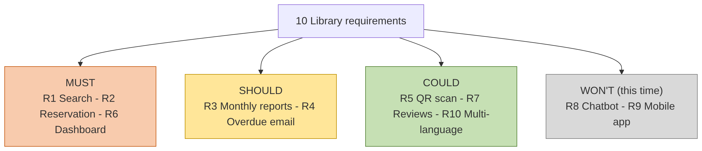
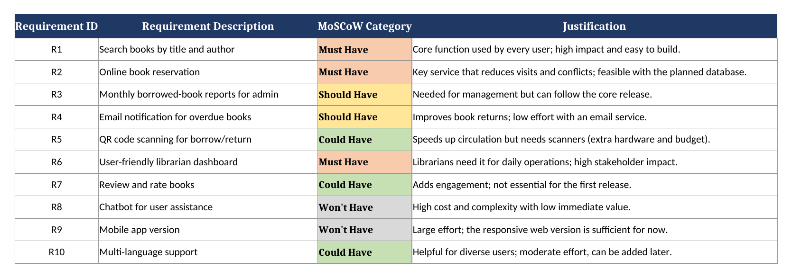

# Experiment 10: MoSCoW Prioritization Of Library Management System Requirements

 

> **Course:** CSA10 - Software Engineering &nbsp;|&nbsp; **Tools used:** Google Sheet or Excel &nbsp;|&nbsp; **Course outcome:** CO2

---

## Problem Statement

Use the following requirements for a Library Management System: Add a feature to search books by title and author. Implement an online book reservation system. Generate monthly reports on borrowed books for administrators. Enable email notifications for overdue books. Add support for QR code scanning for borrowing and returning books. Create a user-friendly dashboard for librarians. Allow users to review and rate books. Integrate a chatbot for user assistance. Develop a mobile app version of the system. Provide multi-language support. Categorize each requirement using MOSCOW Method (Must-Have, Should-Have, Could-Have, or Won’t-Have) based on the following criteria: Impact on the users and stakeholders. Feasibility considering time, budget, and resource constraints. Finally Submit the completed Google Sheet or Excel file with all requirements categorized and justified.

## Aim

To categorize the requirements of a Library Management System into Must-Have, Should-Have, Could-Have and Won’t-Have using the MoSCoW method, with justification based on impact and feasibility, in Google Sheets / Excel.

## Software / Tools Required

- Google Sheets or Microsoft Excel

## Theory

Requirement prioritization decides the order in which requirements are implemented when time, budget and resources are limited. MoSCoW is a simple and widely used prioritization technique from DSDM (Dynamic Systems Development Method).

| Category | Meaning |
|---|---|
| Must Have | Critical for the release; without it the system fails. |
| Should Have | Important but not vital; can be delayed if needed. |
| Could Have | Desirable; included only if time and resources allow. |
| Won’t Have (this time) | Agreed to be out of scope for the current release. |

Each requirement is assessed on (i) its impact on users and stakeholders and (ii) feasibility considering time, budget and resources.

**Sample categorization:**

| ID | Requirement | MoSCoW | Justification |
|---|---|---|---|
| R1 | Search books by title and author | Must Have | Core function used by every user. |
| R2 | Online book reservation | Must Have | Key service that reduces visits and conflicts. |
| R3 | Monthly borrowed-book reports for admin | Should Have | Needed for management; can follow core release. |
| R4 | Email notification for overdue books | Should Have | Improves returns; low effort. |
| R5 | QR code scanning for borrow/return | Could Have | Speeds circulation but needs hardware. |
| R6 | User-friendly librarian dashboard | Must Have | Librarians need it for daily operations. |
| R7 | Review and rate books | Could Have | Adds engagement; not essential. |
| R8 | Chatbot for user assistance | Won’t Have | High cost, low immediate value. |
| R9 | Mobile app version | Won’t Have | Large effort; web version is sufficient now. |
| R10 | Multi-language support | Could Have | Helpful for diverse users; moderate effort. |

## Diagram

 <em>MoSCoW categories</em>

Source: [`diagrams/moscow-model.mmd`](diagrams/moscow-model.mmd) (Mermaid)

## Procedure

### Step 1: Read the Problem Statement

- Read the given requirements of the Library Management System carefully.
- Understand the purpose and functionality of each requirement.
- Identify the features that need to be categorized using the MoSCoW method.

### Step 2: Open Google Sheets or Microsoft Excel

- Launch Google Sheets or Microsoft Excel.
- Create a new spreadsheet.
- Save the file with the name "Library Management System – MoSCoW Prioritization."

### Step 3: Create the Spreadsheet Structure

- Create the required columns in the spreadsheet.
- Include the following column headings:
  - Requirement ID
  - Requirement Description
  - MoSCoW Category
  - Justification

### Step 4: List the Requirements

- Enter all the given requirements into the Requirement Description column.
- Assign a unique Requirement ID for each requirement.
- Verify that all requirements have been entered correctly.

### Step 5: Categorize the Requirements

- Analyze each requirement based on its importance to the system.
- Assign one of the following MoSCoW categories:
  - Must-Have
  - Should-Have
  - Could-Have
  - Won't-Have
- Ensure that each requirement is placed in only one category.

### Step 6: Justify Each Category

- Provide a brief justification for every categorized requirement.
- Consider the following factors while writing the justification:
  - Impact on users and stakeholders.
  - Feasibility based on available time, budget, and resources.
- Ensure that the justification clearly explains the assigned priority.

### Step 7: Review the Categorization

- Verify that every requirement has a MoSCoW category.
- Check that all justifications are meaningful and appropriate.
- Ensure there are no missing or duplicate entries.

### Step 8: Format the Spreadsheet

- Apply suitable formatting to improve readability.
- Highlight the column headings.
- Adjust column widths and align the content properly.
- Ensure the spreadsheet is neat and well-organized.

### Step 9: Save the Spreadsheet

- Save the completed spreadsheet.
- Verify that all data has been stored correctly.

 <em>Figure 10.1 – Save the Spreadsheet</em>

## Code

All source files for this experiment are in the [`code/`](code/) folder:

- [`Library_Management_System_MoSCoW.csv`](code/Library_Management_System_MoSCoW.csv)
- [`Library_Management_System_MoSCoW.xlsx`](code/Library_Management_System_MoSCoW.xlsx)

## Output

Output captured by running the code in [`code/`](code/) (terminal text is also saved in [`output/`](output/)).

 <em>Completed spreadsheet <code>code/Library_Management_System_MoSCoW.xlsx</code></em>

Lab screenshots from the original run are in [`screenshots/`](screenshots/) (1 images, shown in the Procedure above).

### Expected Output

- A spreadsheet “Library Management System – MoSCoW Prioritization” with columns Requirement ID, Requirement Description, MoSCoW Category and Justification.
- All ten requirements categorized and justified, with formatted headings and colour-coded categories.

## Result

Thus the requirements of the Library Management System were prioritized using the MoSCoW method with suitable justification and submitted as a spreadsheet.

## Viva Voce Questions

1. **Expand MoSCoW.**
   **Ans:** Must have, Should have, Could have, Won’t have (this time).

2. **Why are the lower-case o’s in MoSCoW?**
   **Ans:** They are added only to make the acronym pronounceable.

3. **What criteria did you use to prioritize?**
   **Ans:** Impact on users/stakeholders and feasibility in terms of time, budget and resources.

4. **Name two other prioritization techniques.**
   **Ans:** Kano model and the 100-point (cumulative voting) method; also AHP.

5. **What does Won’t Have mean?**
   **Ans:** It is out of scope for the current release but may be considered later.

---
[Back to all experiments](../README.md)
