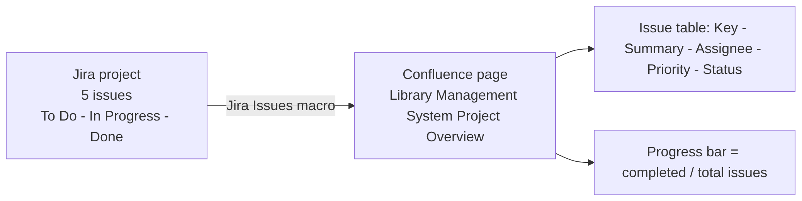
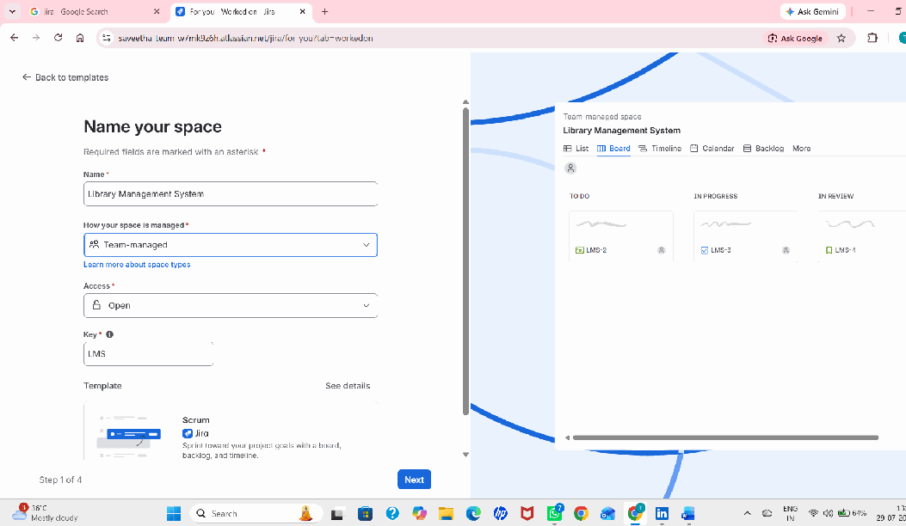
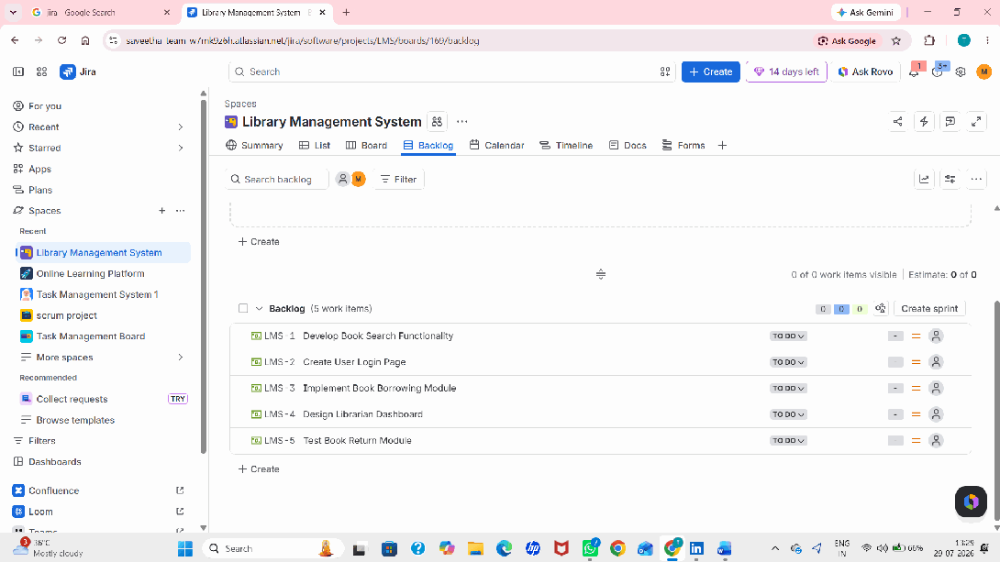
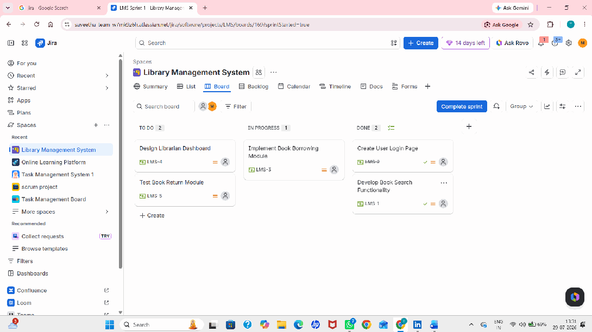
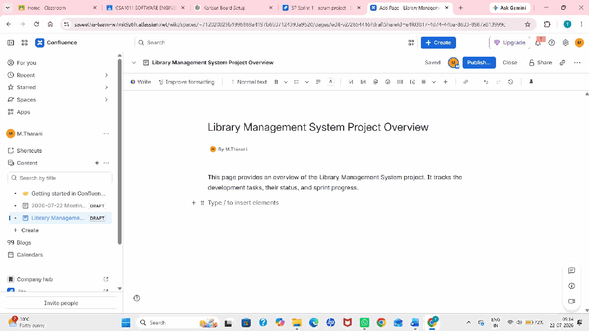
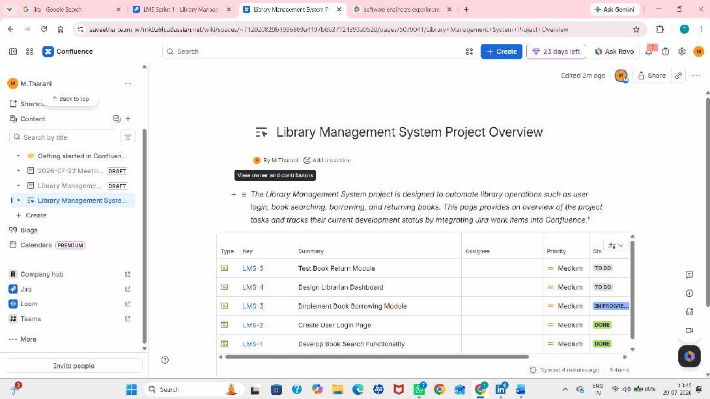

# Experiment 11: Linking Jira Issues With Confluence For Progress Tracking

 

> **Course:** CSA10 - Software Engineering &nbsp;|&nbsp; **Tools used:** Jira & Confluence &nbsp;|&nbsp; **Course outcome:** CO2

---

## Problem Statement

Link Jira tasks with Confluence to streamline task tracking and progress monitoring for the Library Management System development. Create a new page in Confluence titled "Library Management System Project Overview." Embed at least 5 Jira issues related to the development of the Library Management System (e.g., tasks from the sprint like "Develop book search functionality," "Create user login page," etc.). Use the Jira macro to display issues with status (e.g., "To Do," "In Progress," "Done"). Add a progress bar in the Confluence page to visually track the completion of each embedded Jira task (e.g., percentage of tasks completed in the sprint). Submit a screenshot of the Confluence page showing the embedded Jira tasks and the progress bar.

## Aim

To link Jira tasks of a Library Management System with a Confluence page, embed at least five Jira issues using the Jira macro with their status, and add a progress bar to track completion.

## Software / Tools Required

- Jira Software (Cloud)
- Confluence (Cloud)
- Web browser

## Theory

Jira is used for issue and project tracking, while Confluence is a team workspace for documentation and knowledge sharing. Both are Atlassian products and integrate closely, so that requirements, plans and meeting notes in Confluence stay connected to the actual work items in Jira.

- **Jira macro (/jira)** – inserts a single issue, a list of issues from a JQL query, or an issue count into a Confluence page. The status shown is live and updates automatically when the issue changes in Jira.
- **JQL (Jira Query Language)** – e.g. project = LMS AND type = Task ORDER BY status selects the issues to display.
- **Progress bar / status macro** – gives a visual indication of how many tasks are completed.
- **Linked pages** – a Jira project can be connected to a Confluence space so that pages appear under the project’s Pages tab.

## Diagram

 <em>Jira and Confluence integration</em>

Source: [`diagrams/jira-confluence-link.mmd`](diagrams/jira-confluence-link.mmd) (Mermaid)

## Procedure

### Step 1: Login

- Open a web browser and navigate to the Jira website.
- Login - https://id.atlassian.com/login
- Sign in to your Jira account using your registered email address and password.
- After successful authentication, access the Jira dashboard to begin the project creation process.

### Step 2: Create Jira Issues

- Open the Jira project related to the Library Management System.
- Create the following development tasks:
  - Develop Book Search Functionality
  - Create User Login Page
  - Implement Book Borrowing Module
  - Design Admin Dashboard
  - Test Library Management System
- Verify that all five issues are successfully created in Jira.

 <em>Figure 11.1 – Create Jira Issues</em>

### Step 3: Verify the Issues and Connect Confluence

- Open the Library Management System project and view the created issues in the List / Board view.
- Set the workflow status of the issues (To Do, In Progress, Done) to reflect the current progress.
- From the project sidebar open Pages and connect the project to a Confluence space (or open Confluence from the app switcher).
- Verify that the Confluence space is available for creating project documentation.

 <em>Figure 11.2 – Verify the Issues and Connect Confluence</em>

 <em>Figure 11.3 – Verify the Issues and Connect Confluence</em>

### Step 4: Create a New Confluence Page

- Click the Create button to create a new page.
- Enter the page title as Library Management System Project Overview.
- Add a brief description explaining the objectives and development progress of the Library Management System.
- Save the page.
- Verify that all embedded Jira issues are displayed correctly.

 <em>Figure 11.4 – Create a New Confluence Page</em>

### Step 5: Display Task Status

- Configure the Jira macro to display the workflow status of each task.
- Ensure that the task statuses are visible as To Do, In Progress, or Done.
- Verify that the status of each embedded issue is updated automatically based on Jira.

### Step 6: Embed Jira Issues in Confluence

- Return to the Library Management System Project Overview page in Confluence.
- Type /jira and select the Jira macro.
- Search for the required Jira issues and insert them into the page.
- Configure the macro to display the issue details, including Issue Key, Summary, Assignee, Priority, and Status.

### Step 7: Submit the Output

- Review the Confluence page to ensure that all Jira issues are embedded successfully.
- Verify that the progress bar and task statuses are visible.
- Capture a screenshot of the completed Confluence page showing the embedded Jira tasks and the progress bar. https://saveetha-team-w7mk9z6h.atlassian.net/wiki/x/AYBN
- Submit the screenshot as the final output.

 <em>Figure 11.5 – Submit the Output</em>

## Output

Lab screenshots from the original run are in [`screenshots/`](screenshots/) (5 images, shown in the Procedure above).

### Expected Output

- Five Jira issues for the Library Management System (Develop Book Search Functionality, Create User Login Page, Implement Book Borrowing Module, Design Admin Dashboard, Test Library Management System).
- A Confluence page “Library Management System Project Overview” with the embedded Jira issue table showing Key, Summary, Assignee, Priority and Status, and a progress bar.
- Confluence page link: https://saveetha-team-w7mk9z6h.atlassian.net/wiki/x/AYBN

## Result

Thus Jira tasks were linked with a Confluence page, the issues were embedded with their live status and a progress bar, and task tracking for the Library Management System was streamlined.

## Viva Voce Questions

1. **What is Confluence?**
   **Ans:** An Atlassian team-collaboration and documentation tool.

2. **How do you insert Jira issues into a Confluence page?**
   **Ans:** Type /jira on the page and choose the Jira macro, then search or enter a JQL query.

3. **What is JQL?**
   **Ans:** Jira Query Language, used to search and filter issues.

4. **Will the issue status in Confluence update automatically?**
   **Ans:** Yes, the macro shows live data from Jira.

5. **Why integrate Jira with Confluence?**
   **Ans:** To keep documentation and work tracking in one connected place and improve visibility.

---
[Back to all experiments](../README.md)
