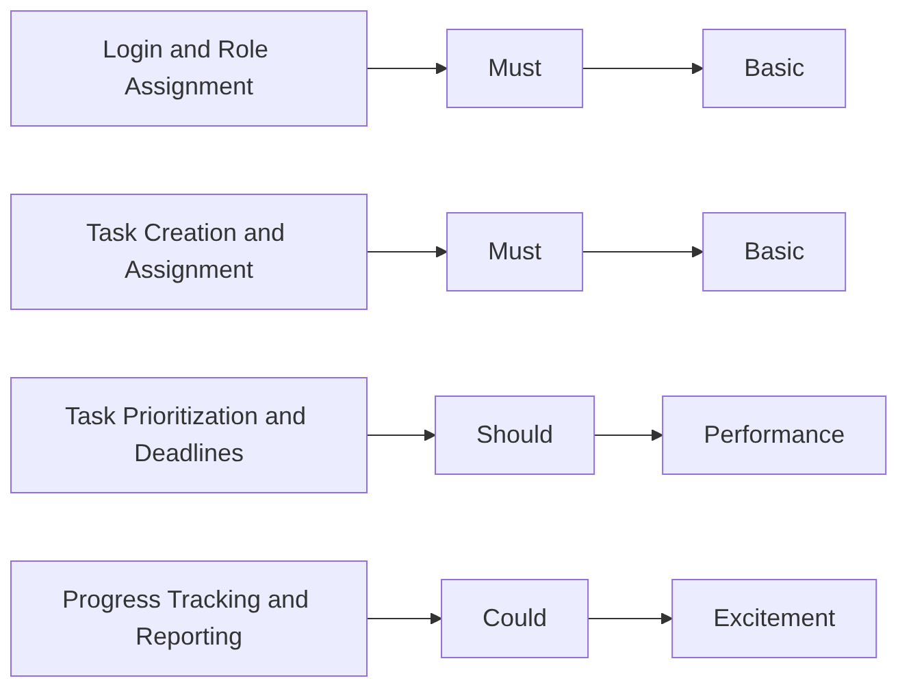
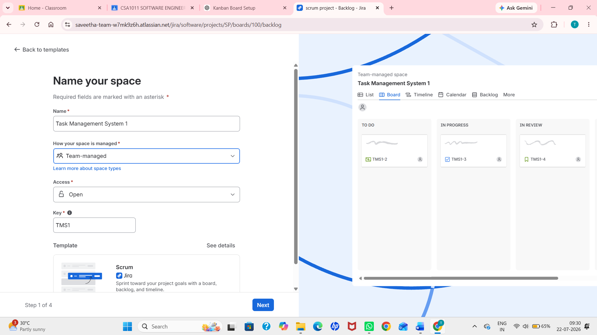
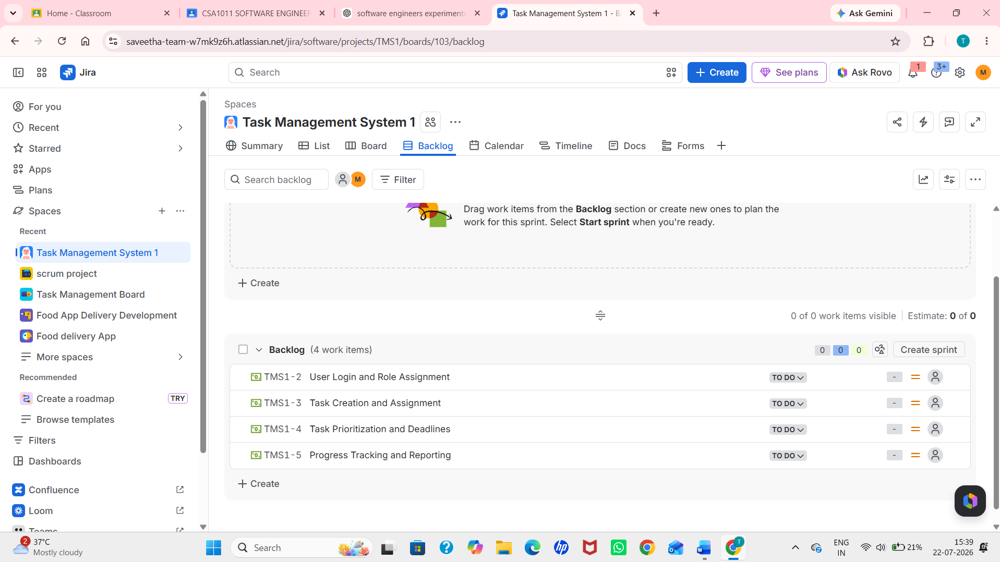
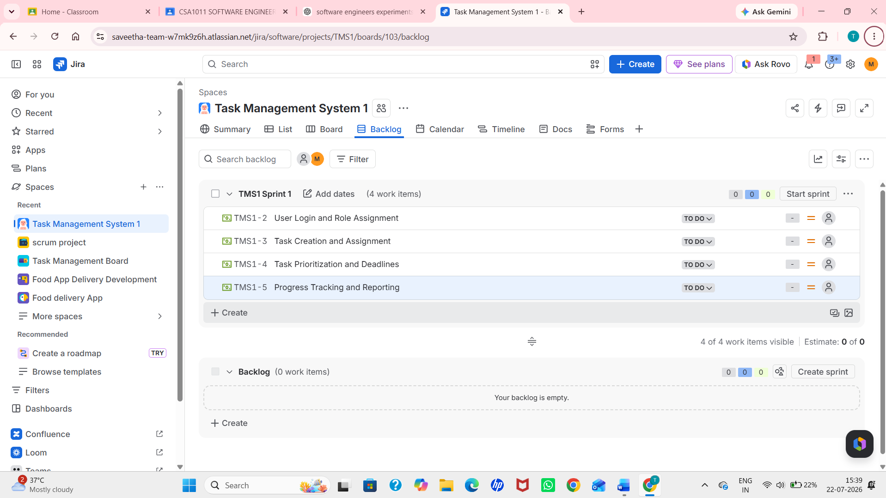
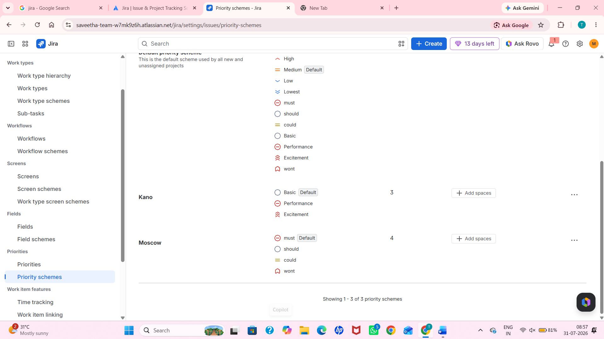
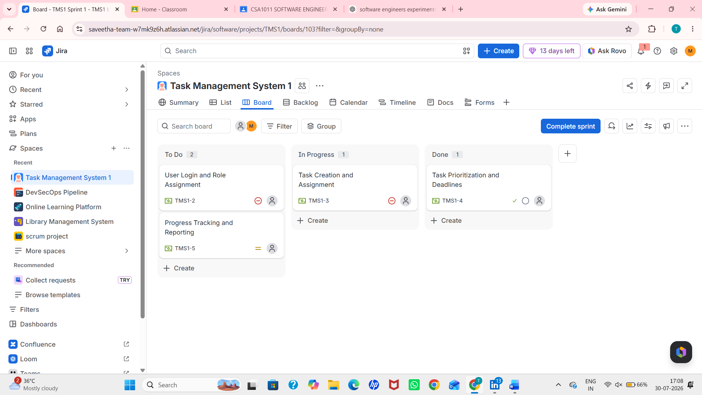
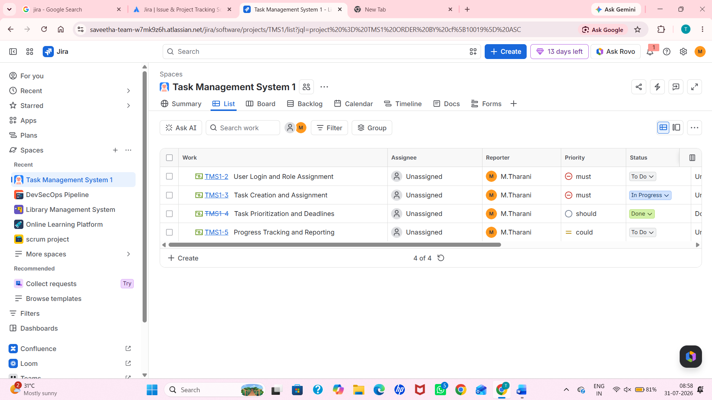

# Experiment 12: Prioritizing Task Management System Requirements Using MoSCoW And Kano In Jira

 

> **Course:** CSA10 - Software Engineering &nbsp;|&nbsp; **Tools used:** Jira &nbsp;|&nbsp; **Course outcome:** CO2

---

## Problem Statement

You are designing a Task Management System for a small team. The system should include the following features: User Login and Role Assignment Task Creation and Assignment Task Prioritization and Deadlines Progress Tracking and Reporting Prioritize these requirements using the MoSCoW and Kano models in Jira.

## Aim

To create the requirements of a Task Management System as Jira issues and prioritize them using the MoSCoW and Kano models.

## Software / Tools Required

- Jira Software (Cloud) – Scrum project
- Web browser

## Theory

Prioritization techniques help the team decide which requirements give the most value. Two complementary techniques are used here:

- **MoSCoW** – classifies requirements as Must, Should, Could and Won’t have, based on business necessity.
- **Kano model** (Noriaki Kano, 1984) – classifies features by their effect on customer satisfaction.

| Kano Category | Description |
|---|---|
| Basic (Must-be) | Expected by users; absence causes dissatisfaction, presence is taken for granted. |
| Performance (One-dimensional) | Satisfaction increases in proportion to how well it is implemented. |
| Excitement (Attractive) | Unexpected features that delight users; absence causes no dissatisfaction. |
| Indifferent | Users do not care either way. |
| Reverse | Presence causes dissatisfaction for some users. |

In Jira the categories are recorded with labels (e.g. MoSCoW-Must, Kano-Basic) or with custom fields, and can be used to filter the backlog.

## Diagram

 <em>MoSCoW + Kano mapping</em>

Source: [`diagrams/moscow-kano.mmd`](diagrams/moscow-kano.mmd) (Mermaid)

## Procedure

### Step 1: Login

- Open a web browser and navigate to the Jira website.
- Login - https://id.atlassian.com/login
- Sign in to your Jira account using your registered email address and password.

### Step 2: Create a New Project

- Click Create Project.
- Select Scrum
- Enter the project name as Task Management System.
- Choose Team-managed.
- Click Create.

 <em>Figure 12.1 – Create a New Project</em>

### Step 3: Open the Backlog and Create Project Requirements as Tasks

- Select the newly created Task Management System project.
- Click the Backlog tab from the project menu.
- Create a new sprint if one is not already available.
- User Login and Role Assignment
- Task Creation and Assignment
- Task Prioritization and Deadlines
- Progress Tracking and Reporting

 <em>Figure 12.2 – Open the Backlog and Create Project Requirements as Tasks</em>

### Step 4: Add Tasks to the Sprint

- Drag and drop all four tasks from the backlog into Sprint 1.
- Verify that all tasks are successfully added to the sprint.

 <em>Figure 12.3 – Add Tasks to the Sprint</em>

### Step 5: Start the Sprint

- Click the Start Sprint button.
- Set the sprint duration to 1 Week.
- Click Start to begin the sprint.

### Step 6: Prioritize Requirements Using the MoSCoW Model

- Assign the following priorities to the tasks:

| Requirement | MoSCoW Priority |
|---|---|
| User Login and Role Assignment | Must Have |
| Task Creation and Assignment | Must Have |
| Task Prioritization and Deadlines | Should Have |
| Progress Tracking and Reporting | Could Have |

 <em>Figure 12.4 – Prioritize Requirements Using the MoSCoW Model</em>

### Step 7: Categorize Requirements Using the Kano Model

- Open each task and add a second label based on the Kano model (e.g. Kano-Basic, Kano-Performance, Kano-Excitement).

| Requirement | Kano Category |
|---|---|
| User Login and Role Assignment | Basic |
| Task Creation and Assignment | Basic |
| Task Prioritization and Deadlines | Performance |
| Progress Tracking and Reporting | Excitement |

- Save each task and confirm that both MoSCoW and Kano labels are displayed.

### Step 8: Verify the Prioritization

- Open each task individually.
- Verify that the assigned MoSCoW and Kano classifications are correctly recorded (using labels, custom fields, or the method provided by your Jira setup).
- Ensure all tasks are displayed correctly on the Sprint Board.

### Step 9: Capture the Output

- Open the Active Sprint board.
- Verify that all four tasks are visible with their assigned priorities and classifications.
- Capture screenshots of:
- Scrum Project
- Backlog
- Sprint Board
- Task Details showing MoSCoW and Kano prioritization

 <em>Figure 12.5 – Capture the Output</em>

 <em>Figure 12.6 – Capture the Output</em>

## Code

All source files for this experiment are in the [`code/`](code/) folder:

- [`requirements_prioritization.csv`](code/requirements_prioritization.csv)

## Output

Lab screenshots from the original run are in [`screenshots/`](screenshots/) (6 images, shown in the Procedure above).

### Expected Output

- Scrum project “Task Management System” with four requirements created as tasks and added to Sprint 1.
- MoSCoW: Login & Role Assignment – Must; Task Creation & Assignment – Must; Task Prioritization & Deadlines – Should; Progress Tracking & Reporting – Could.
- Kano: Login & Role Assignment – Basic; Task Creation & Assignment – Basic; Task Prioritization & Deadlines – Performance; Progress Tracking & Reporting – Excitement.

## Result

Thus the requirements of the Task Management System were created in Jira and prioritized using the MoSCoW and Kano models.

## Viva Voce Questions

1. **What is the Kano model?**
   **Ans:** A model that classifies features according to how they affect customer satisfaction.

2. **Give an example of a Basic feature.**
   **Ans:** User login – users expect it to exist.

3. **Give an example of an Excitement feature.**
   **Ans:** Automatic progress reports or smart reminders.

4. **How can MoSCoW priority be stored in Jira?**
   **Ans:** Using labels, the Priority field or a custom select-list field.

5. **Why use both MoSCoW and Kano?**
   **Ans:** MoSCoW captures business necessity while Kano captures customer satisfaction, giving a balanced view.

---
[Back to all experiments](../README.md)
