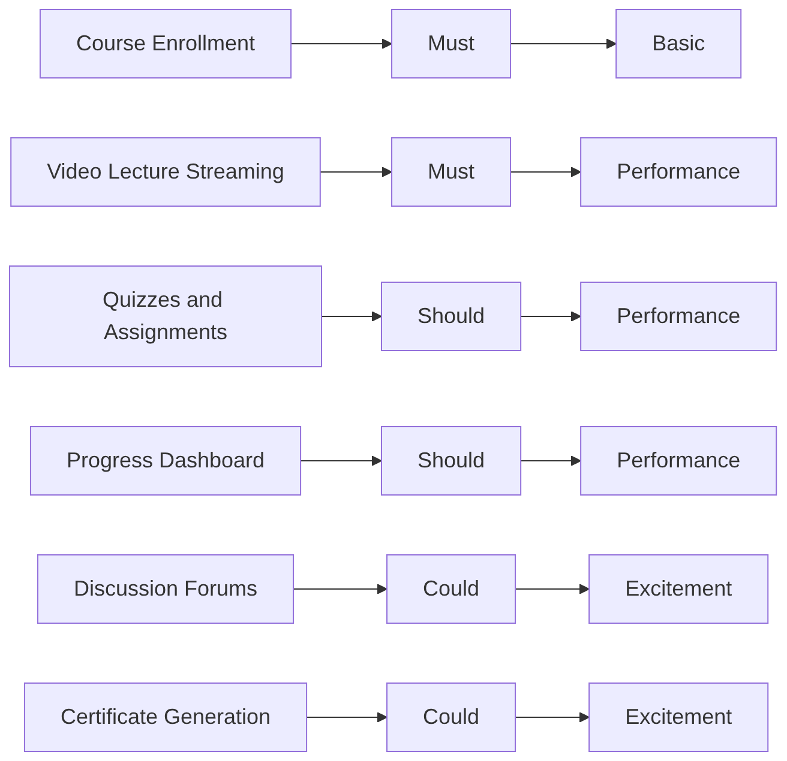
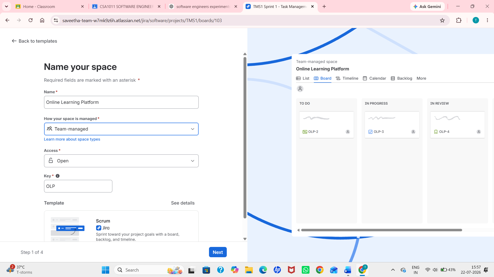
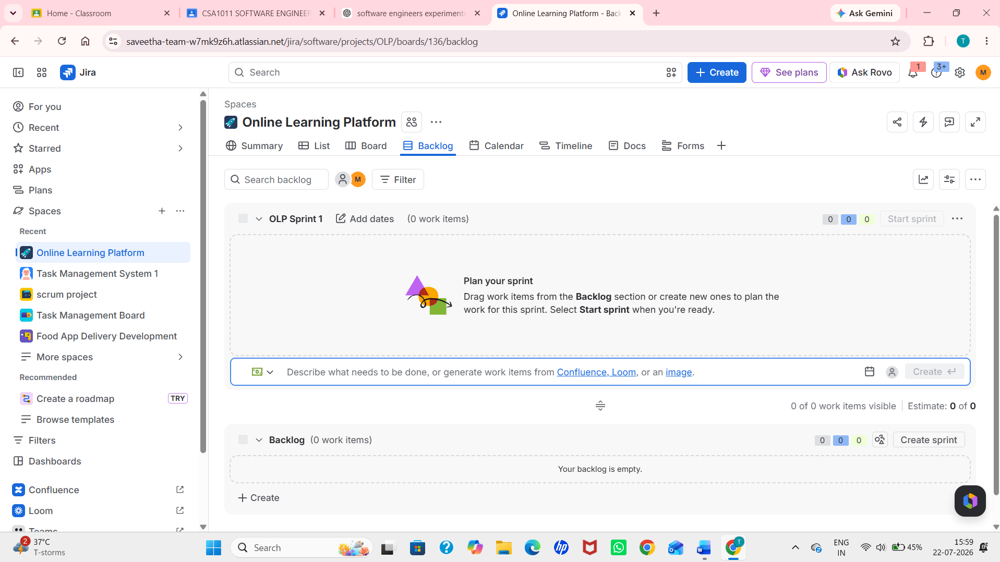
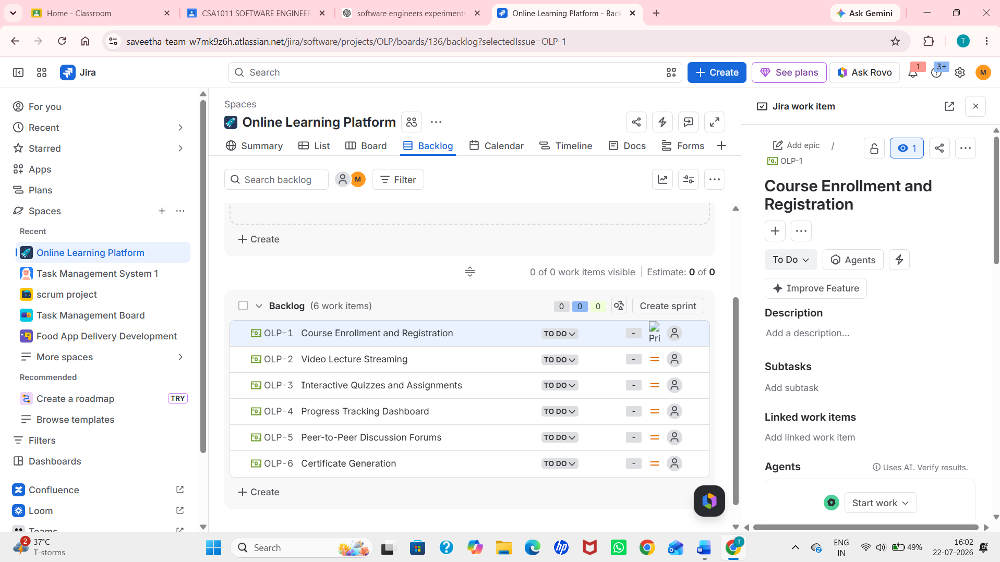
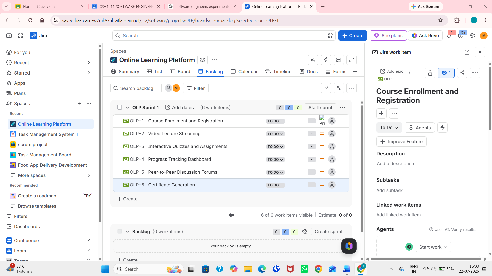
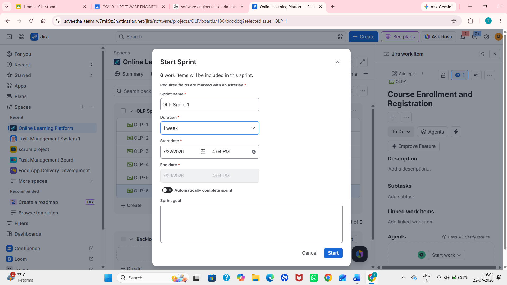
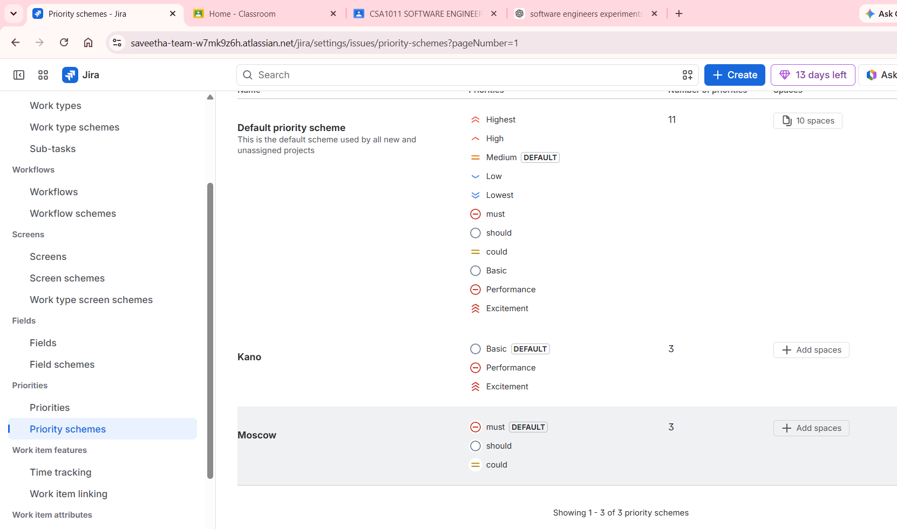
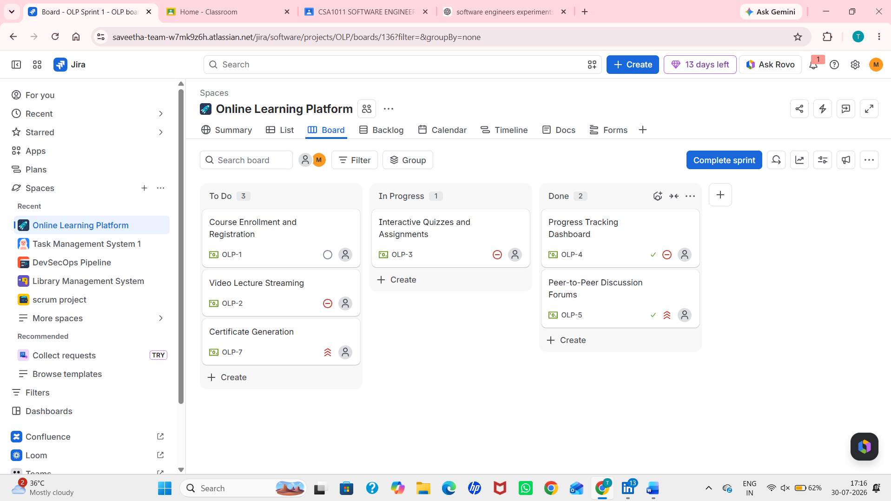
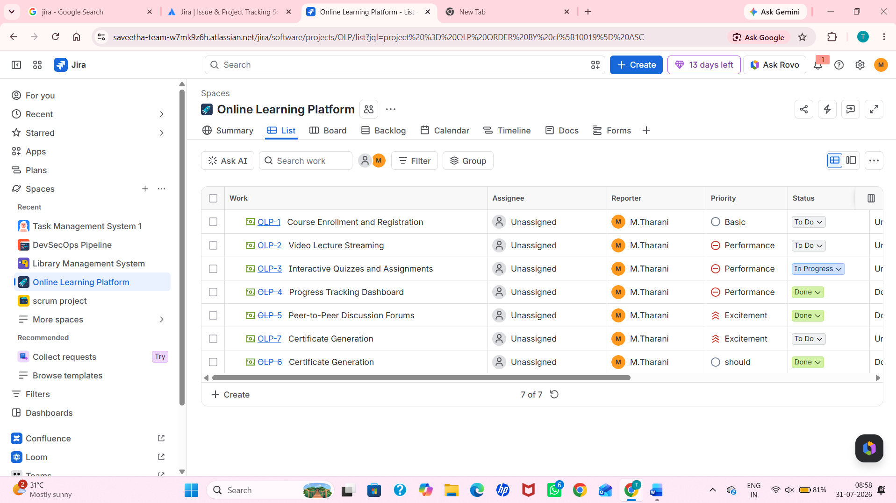

# Experiment 13: Prioritizing Online Learning Platform Requirements Using MoSCoW And Kano In Jira

 

> **Course:** CSA10 - Software Engineering &nbsp;|&nbsp; **Tools used:** Jira &nbsp;|&nbsp; **Course outcome:** CO2

---

## Problem Statement

You are tasked with developing an Online Learning Platform. The platform should include the following functionalities: Course Enrollment and Registration Video Lecture Streaming Interactive Quizzes and Assignments Progress Tracking Dashboard Peer-to-Peer Discussion Forums Certificate Generation Use Jira to categorize and prioritize these requirements using MoSCoW and Kano techniques.

## Aim

To categorize and prioritize the functional requirements of an Online Learning Platform in Jira using the MoSCoW and Kano techniques.

## Software / Tools Required

- Jira Software (Cloud) – Scrum project
- Web browser

## Theory

An Online Learning Platform provides course enrolment, video lectures, quizzes, progress tracking, discussion forums and certificates. Not all of these are equally important for the first release, so they are prioritized.

**MoSCoW** answers “what must be delivered in this release?”, whereas the **Kano model** answers “how will each feature affect learner satisfaction?”. Applying both gives the product owner a balanced decision.

| Requirement | MoSCoW | Kano |
|---|---|---|
| Course Enrollment and Registration | Must Have | Basic |
| Video Lecture Streaming | Must Have | Performance |
| Interactive Quizzes and Assignments | Should Have | Performance |
| Progress Tracking Dashboard | Should Have | Performance |
| Peer-to-Peer Discussion Forums | Could Have | Excitement |
| Certificate Generation | Could Have | Excitement |

## Diagram

 <em>MoSCoW + Kano mapping</em>

Source: [`diagrams/moscow-kano.mmd`](diagrams/moscow-kano.mmd) (Mermaid)

## Procedure

### Step 1: Login

- Open a web browser and navigate to the Jira website.
- Login - https://id.atlassian.com/login
- Sign in to your Jira account using your registered email address and password.

### Step 2: Create a New Project

- Click Create Project.
- Select Scrum
- Enter the project name as Online Learning Platform.
- Choose Team-managed.
- Click Create.

 <em>Figure 13.1 – Create a New Project</em>

### Step 3: Open the Backlog

- Select the Online Learning Platform project.
- Click the Backlog tab.
- Create a new sprint if one is not already available.

 <em>Figure 13.2 – Open the Backlog</em>

### Step 4: Create the Project Requirements as Tasks

- Create the following six tasks:
- Course Enrollment and Registration
- Video Lecture Streaming
- Interactive Quizzes and Assignments
- Progress Tracking Dashboard
- Peer-to-Peer Discussion Forums
- Certificate Generation

 <em>Figure 13.3 – Create the Project Requirements as Tasks</em>

### Step 5: Add Tasks to the Sprint

- Drag all six tasks into Sprint 1.
- Verify that all tasks are added to the sprint.

 <em>Figure 13.4 – Add Tasks to the Sprint</em>

### Step 6: Start the Sprint

- Click Start Sprint.
- Set the sprint duration to 1 Week.
- Click Start.

 <em>Figure 13.5 – Start the Sprint</em>

### Step 7: Prioritize Requirements Using the MoSCoW Model

- Open each task and add a label for its MoSCoW priority (e.g. MoSCoW-Must, MoSCoW-Should, MoSCoW-Could).

| Requirement | MoSCoW Priority |
|---|---|
| Course Enrollment and Registration | Must Have |
| Video Lecture Streaming | Must Have |
| Interactive Quizzes and Assignments | Should Have |
| Progress Tracking Dashboard | Should Have |
| Peer-to-Peer Discussion Forums | Could Have |
| Certificate Generation | Could Have |

- Save each task.

### Step 8: Categorize Requirements Using the Kano Model

- Add another label to each task based on the Kano model.

| Requirement | Kano |
|---|---|
| Course Enrollment and Registration | Basic |
| Video Lecture Streaming | Performance |
| Interactive Quizzes and Assignments | Performance |
| Progress Tracking Dashboard | Performance |
| Peer-to-Peer Discussion Forums | Excitement |
| Certificate Generation | Excitement |

 <em>Figure 13.6 – Categorize Requirements Using the Kano Model</em>

### Step 9: Verify the Prioritization

- Open each task and verify that both the Kano labels are correctly assigned.
- Ensure all six tasks are displayed in the Sprint Board.

 <em>Figure 13.7 – Verify the Prioritization</em>

 <em>Figure 13.8 – Verify the Prioritization</em>

## Code

All source files for this experiment are in the [`code/`](code/) folder:

- [`requirements_prioritization.csv`](code/requirements_prioritization.csv)

## Output

Lab screenshots from the original run are in [`screenshots/`](screenshots/) (8 images, shown in the Procedure above).

### Expected Output

- Scrum project “Online Learning Platform” with six requirement tasks in Sprint 1.
- Each task labelled with its MoSCoW and Kano category as in the table above.
- Sprint board displaying all six tasks with their labels.

## Result

Thus the requirements of the Online Learning Platform were created in Jira and categorized and prioritized using the MoSCoW and Kano techniques.

## Viva Voce Questions

1. **Why is course enrolment a Basic feature?**
   **Ans:** Learners expect it; without it the platform cannot be used.

2. **Why is certificate generation an Excitement feature?**
   **Ans:** It delights learners but its absence does not stop learning.

3. **What is a performance feature?**
   **Ans:** A feature whose better implementation gives proportionally higher satisfaction, e.g. smooth video streaming.

4. **How do you filter issues by label in Jira?**
   **Ans:** Use the backlog filter or JQL: labels = Kano-Basic.

5. **Can Kano categories change over time?**
   **Ans:** Yes – excitement features tend to become performance and then basic features as users get used to them.

---
[Back to all experiments](../README.md)
