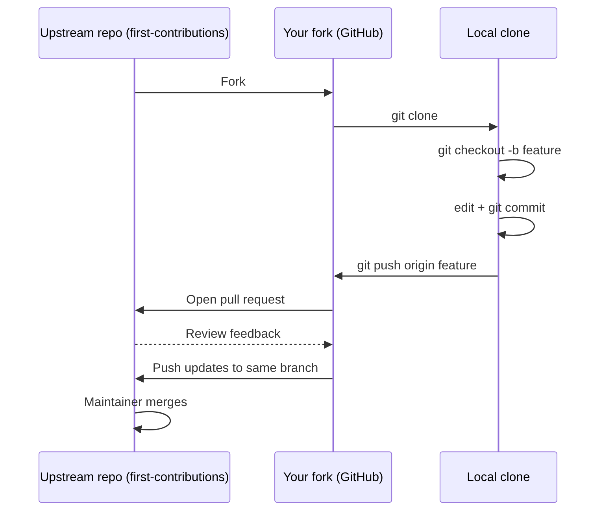
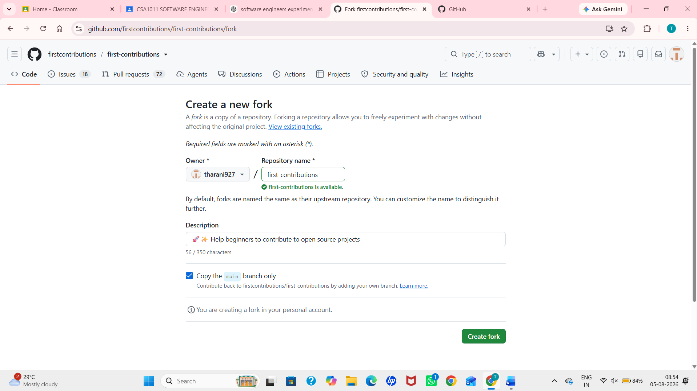
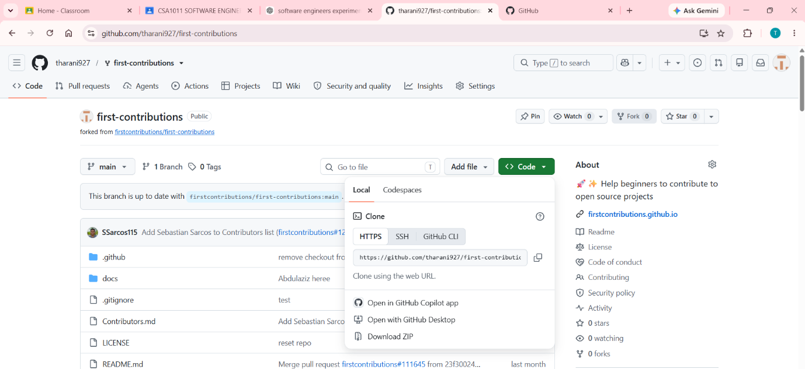
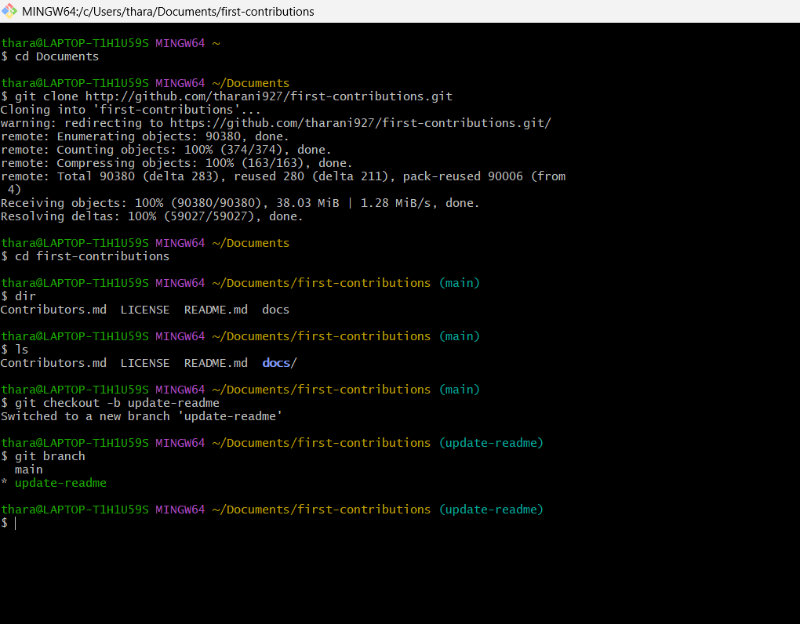
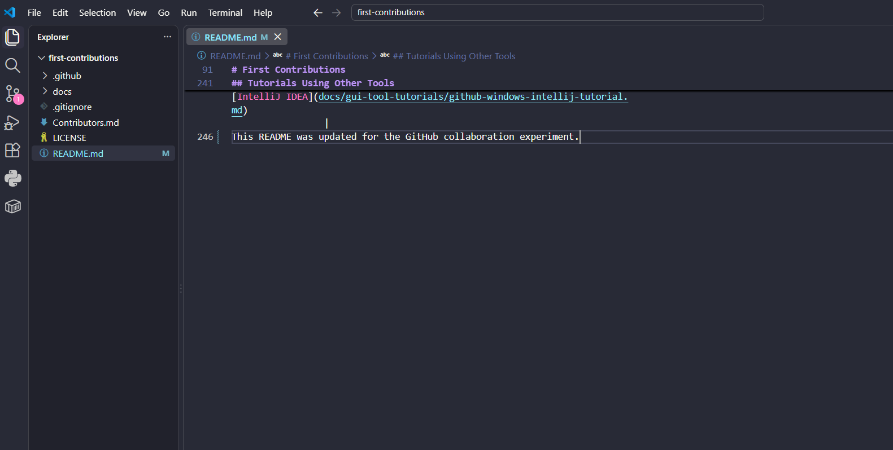
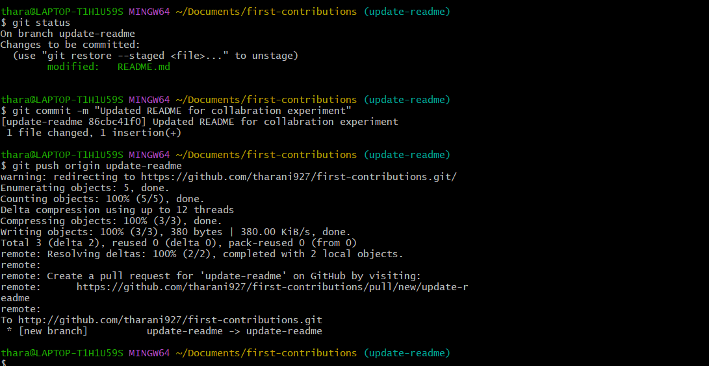
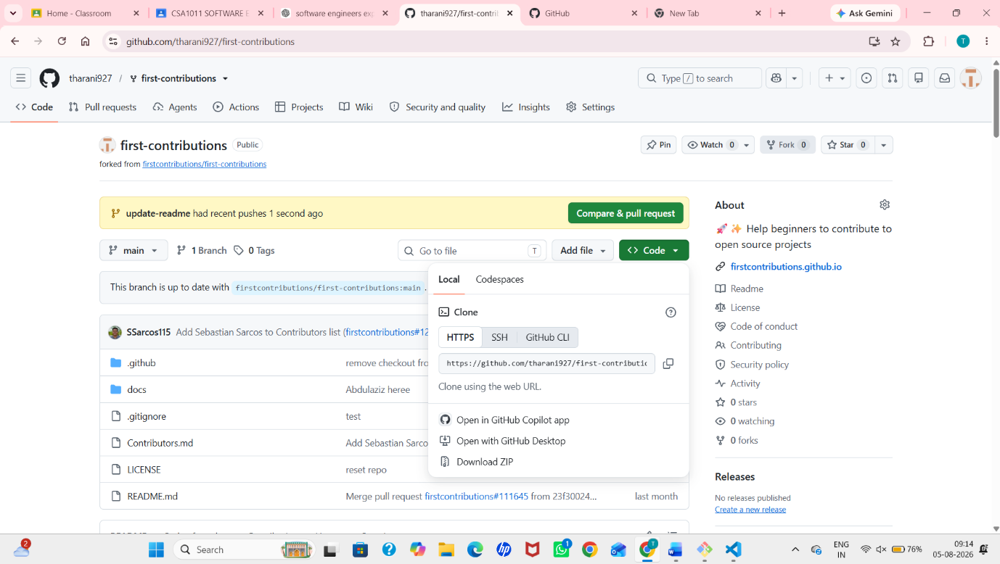
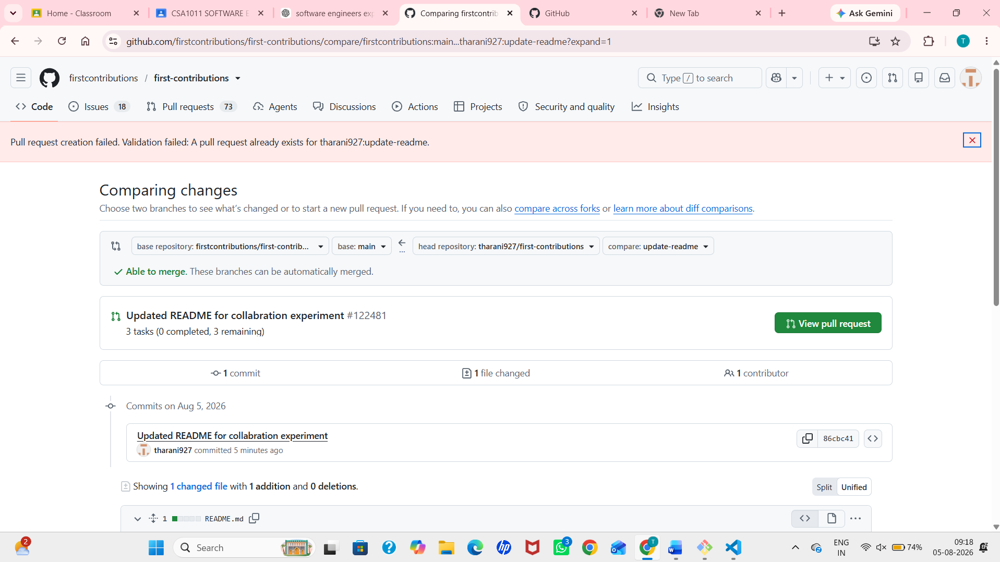
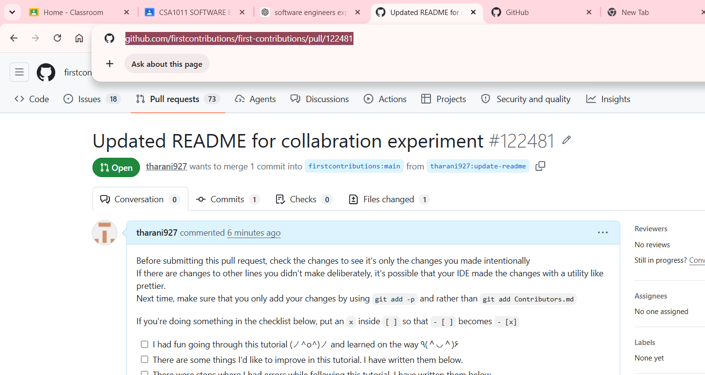

# Experiment 14: Fork-And-Pull-Request Collaboration Workflow Using Git And GitHub

 

> **Course:** CSA10 - Software Engineering &nbsp;|&nbsp; **Tools used:** Git/GitHub &nbsp;|&nbsp; **Course outcome:** CO3

---

## Problem Statement


Demonstrate how to work collaboratively in Git/GitHub on a project using the fork-and-pull request workflow.

**Tasks:**

- Fork an existing public GitHub repository (e.g., a sample JavaScript or Python project).
- Clone the forked repository to your local machine using Git.
- Create a new branch for the feature or change you want to work on.
- Make modifications or add new features (e.g., add a function, fix a bug, or update the README).
- Commit your changes and push the branch to GitHub.
- Go to the GitHub repository and create a pull request to merge your feature branch into the main branch.
- Review the pull request and provide feedback on the changes.
- Respond to feedback by making additional commits to the

## Aim


To collaborate on a GitHub project using the fork-and-pull-request workflow: fork a public repository, clone it, create a branch, make changes, push them and raise a pull request for review and merge.


## Software / Tools Required

- Git (Git Bash)
- GitHub account
- Visual Studio Code

## Theory


Git is a distributed version control system that records snapshots (commits) of a project. GitHub hosts Git repositories online and adds collaboration features such as forks, pull requests and code review.

- **Fork** – a personal copy of someone else’s repository under your GitHub account.
- **Clone** – a local copy of a remote repository on your machine.
- **Branch** – an independent line of development; changes are made on a feature branch instead of main.
- **Pull Request (PR)** – a request to the maintainers to review and merge the changes from your branch into their branch.

Workflow: Fork → Clone → Branch → Edit → Commit → Push → Open PR → Review → Update → Merge. In open-source projects only the maintainers of the original repository can merge the PR.


## Diagram

<p align="center"><br><sub><em>Fork and pull request workflow</em></sub></p>

<sub>Source: [`diagrams/fork-pr-workflow.mmd`](diagrams/fork-pr-workflow.mmd) (Mermaid)</sub>

## Procedure


### Step 1: Fork the Repository

- Open the GitHub website and sign in to your account.
- Navigate to an existing public repository.
- Click the Fork button to create a copy of the repository under your GitHub account.

<p align="center"><br><sub><em>Figure 14.1 – Fork the Repository</em></sub></p>

### Step 2: Clone the Forked Repository

- Copy the URL of the forked repository.
- Open Git Bash or the terminal.
- Use the git clone command to clone the repository to your local machine.
- Navigate to the project directory using the cd command.

```bash
git clone https://github.com/<your-username>/first-contributions.git
cd first-contributions
```

<p align="center"><br><sub><em>Figure 14.2 – Clone the Forked Repository</em></sub></p>

### Step 3: Create a New Branch

- Create a new branch using the git checkout -b command.
- Verify that the new branch has been created successfully.
- Switch to the newly created branch before making any changes.

```bash
git checkout -b update-readme
git branch
```

<p align="center"><br><sub><em>Figure 14.3 – Create a New Branch</em></sub></p>

### Step 4: Modify the Project

- Open the project in a code editor such as Visual Studio Code.
- Make the required changes, such as adding a new feature, fixing a bug, or updating the README file.
- Save all the modified files.

<p align="center"><br><sub><em>Figure 14.4 – Modify the Project</em></sub></p>

### Step 5: Commit and Push the Changes

- Check the modified files using the git status command.
- Stage the changes using the git add command.
- Commit the changes with an appropriate commit message using the git commit command.
- Push the feature branch to the forked GitHub repository using the git push command.

```bash
git status
git add README.md
git commit -m "Updated README for collaboration experiment"
git push -u origin update-readme
```

<p align="center"><br><sub><em>Figure 14.5 – Commit and Push the Changes</em></sub></p>

### Step 6: Create a Pull Request

- Open the forked repository on GitHub.
- Click Compare & Pull Request or New Pull Request.
- Select the feature branch as the source and the main branch as the destination.
- Add a suitable title and description.
- Submit the pull request.

<p align="center"><br><sub><em>Figure 14.6 – Create a Pull Request</em></sub></p>

### Step 7: Review the Pull Request

- Review the changes shown in the pull request.
- Verify the modified files and commit history.
- Add review comments or feedback if required.

<p align="center"><br><sub><em>Figure 14.7 – Review the Pull Request</em></sub></p>

### Step 8: Update the Pull Request

- Make additional modifications if feedback is received.
- Commit the updated changes.
- Push the latest commits to the same feature branch.
- Verify that the pull request is updated automatically.

```bash
git add .
git commit -m "Addressed review comments"
git push
```

### Step 9: Merge the Pull Request

- After the pull request is approved, merge it into the main branch.
- Confirm that the changes have been successfully merged.
- Delete the feature branch if it is no longer required.

Note: GitHub shows “You cannot merge this Pull Request because it targets the original repository (firstcontributions/first-contributions)”. Only the maintainers of the original repository can merge it.

### Step 10: Document the Work

- Copy the pull request URL.
- Prepare a brief summary of the changes made.
- Submit the pull request link along with the summary for evaluation.
- https://github.com/firstcontributions/first-contributions/pull/122481

<p align="center"><br><sub><em>Figure 14.8 – Document the Work</em></sub></p>


## Output

Lab screenshots from the original run are in [`screenshots/`](screenshots/) (8 images, shown in the Procedure above).

### Expected Output

- The repository firstcontributions/first-contributions is forked and cloned.
- A new branch is created, README is updated, committed and pushed.
- Pull Request link: https://github.com/firstcontributions/first-contributions/pull/122481 (merge is done by the maintainers of the original repository).

## Result


Thus the fork-and-pull-request workflow was demonstrated: the repository was forked, changes were made on a branch, pushed, and a pull request was submitted for review.


## Viva Voce Questions

1. **Differentiate fork and clone.**
   **Ans:** A fork is a server-side copy on GitHub; a clone is a local copy on your computer.

2. **What is a pull request?**
   **Ans:** A proposal to merge changes from one branch into another, with review and discussion.

3. **Why work on a separate branch?**
   **Ans:** To keep main stable and isolate the new feature until it is reviewed.

4. **What happens when you push more commits to a branch with an open PR?**
   **Ans:** The PR updates automatically with the new commits.

5. **Who can merge a PR to the original repository?**
   **Ans:** Only users with write access – the maintainers.


---
[Back to all experiments](../README.md)
