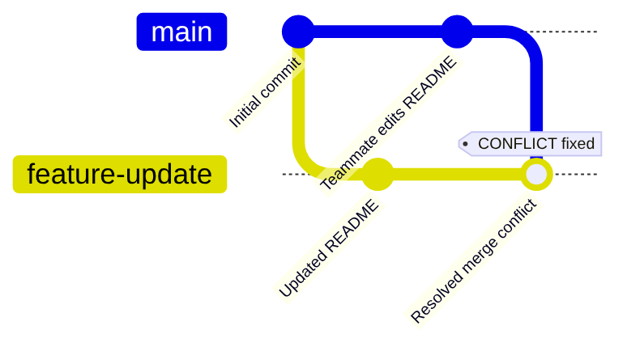
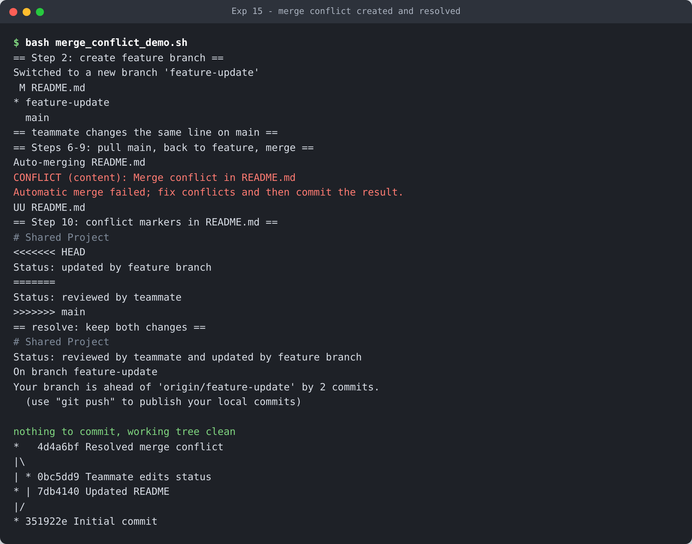

# Experiment 15: Working With Git Branches And Resolving Merge Conflicts

 

> **Course:** CSA10 - Software Engineering &nbsp;|&nbsp; **Tools used:** Git/GitHub &nbsp;|&nbsp; **Course outcome:** CO3

---

## Problem Statement


Demonstrate how to work with Git branches and resolve merge conflicts when collaborating with others.

**Tasks:**

- Clone a shared repository to your local machine.
- Create a new branch and switch to it.
- Make changes to a file (e.g., update a README or modify code in a specific function).
- Commit your changes.
- Push the changes to the remote repository.
- Before merging, pull the latest changes from the main branch.
- Switch back to your feature branch.
- Merge the main branch into your feature branch.
- If there are conflicts, resolve them manually by editing the conflicting files. After resolving conflicts, mark the conflicts as resolved.
- Commit the resolved merge.
- Push your feature branch with the merged changes to GitHub and create a pull request.
- Submit a summary of the steps you performed, the conflicts you encountered, and how you resolved them.

## Aim


To work with Git branches while collaborating, merge the main branch into a feature branch, resolve merge conflicts manually, and push the result to GitHub with a pull request.


## Software / Tools Required

- Git (Git Bash)
- GitHub
- Visual Studio Code

## Theory


A merge conflict occurs when two branches change the same lines of a file (or one branch edits a file that the other deletes) and Git cannot decide automatically which change to keep.

Git marks the conflicting region in the file as follows:

```diff
<<<<<<< HEAD
changes in the current (feature) branch
=======
changes coming from the other (main) branch
>>>>>>> main
```

To resolve the conflict, edit the file to keep the correct content, delete the markers, then stage and commit the file.

| Command | Purpose |
|---|---|
| git branch | List branches |
| git checkout -b <name> | Create and switch to a branch |
| git pull origin main | Fetch and merge latest main |
| git merge main | Merge main into the current branch |
| git status | Show conflicted / modified files |
| git log --oneline --graph | View branch history |


## Diagram

<p align="center"><br><sub><em>Branch merge and conflict resolution</em></sub></p>

<sub>Source: [`diagrams/merge-conflict-flow.mmd`](diagrams/merge-conflict-flow.mmd) (Mermaid)</sub>

## Procedure


### Step 1: Clone the Shared Repository

- Open Git Bash or the terminal on the local machine.
- Copy the HTTPS URL of the shared GitHub repository.
- Clone the repository using the following command:

```bash
git clone <repository_url>
```

- Navigate into the cloned repository:

```bash
cd <repository_name>
```

- Verify the repository files using:

```bash
ls
```

### Step 2: Create and Switch to a New Branch

- Create a new feature branch using:

```bash
git checkout -b feature-update
```

- Verify the current branch:

```bash
git branch
```

### Step 3: Make Changes to a File

- Open the repository in Visual Studio Code:

```bash
code .
```

- Open a file such as README.md.
- Add or modify a small section of content.
- Save the file using Ctrl + S.

### Step 4: Check and Commit the Changes

- Check the modified files:

```bash
git status
```

- Stage the modified file:

```bash
git add README.md
```

- Commit the changes:

```bash
git commit -m "Updated README"
```

### Step 5: Push the Feature Branch

- Push the feature branch to GitHub:

```bash
git push -u origin feature-update
```

- Verify that the feature branch has been successfully pushed to the remote repository.

### Step 6: Switch to the Main Branch

- Switch from the feature branch to the main branch:

```bash
git checkout main
```

- Verify the current branch:

```bash
git branch
```

### Step 7: Pull the Latest Changes from the Main Branch

- Get the latest changes from GitHub:

```bash
git pull origin main
```

- Wait for the pull operation to complete successfully.

### Step 8: Switch Back to the Feature Branch

- Switch back to the feature branch:

```bash
git checkout feature-update
```

- Verify the current branch:

```bash
git branch
```

### Step 9: Merge the Main Branch into the Feature Branch

- Merge the latest main branch changes into the feature branch:

```bash
git merge main
```

- If there are no conflicts, the merge will complete automatically.
- If a conflict occurs, Git will display the conflicting files.

### Step 10: Resolve the Merge Conflict

- Open the conflicting file in Visual Studio Code.
- Locate the conflict markers:

```diff
<<<<<<< HEAD
Your feature branch changes
=======
Changes from main branch
>>>>>>> main
```

- Decide which changes should be kept or combine both changes.
- Remove the conflict markers:

```diff
<<<<<<< HEAD
=======
>>>>>>> main
```

- Save the file.
- Check the conflict status:

```bash
git status
```

### Step 11: Mark the Conflict as Resolved and Commit

- Stage the resolved file:

```bash
git add <conflicted_file>
```

- Commit the resolved merge:

```bash
git commit -m "Resolved merge conflict"
```

- Verify that the working tree is clean:

```bash
git status
```

### Step 12: Push the Merged Feature Branch

- Push the updated feature branch to GitHub:

```bash
git push origin feature-update
```

- Open the GitHub repository.
- Create a Pull Request from feature-update to main.
- Enter a suitable title and description.
- Click Create pull request.

### Step 13: Verify the Pull Request

- Open the created Pull Request on GitHub.
- Verify that the feature branch contains the merged changes.
- Check the Files changed section to verify the final changes.

## Code

All source files for this experiment are in the [`code/`](code/) folder:

- [`merge_conflict_demo.sh`](code/merge_conflict_demo.sh)

## Output

Output captured by running the code in [`code/`](code/) (terminal text is also saved in [`output/`](output/)).

<p align="center"><br><sub><em>Conflict created, shown, resolved and committed (replayed locally with a bare repository standing in for GitHub)</em></sub></p>

### Expected Output

- Feature branch feature-update created and pushed.
- Merging main into feature-update shows CONFLICT (content): Merge conflict in README.md.
- Conflict resolved, committed as “Resolved merge conflict”, pushed, and a pull request created from feature-update to main.

## Result


Thus Git branches were used for collaboration, the merge conflict between the feature and main branches was resolved manually, and the merged feature branch was pushed with a pull request.


## Viva Voce Questions

1. **When does a merge conflict occur?**
   **Ans:** When the same part of a file is changed differently in the two branches being merged.

2. **What do <<<<<<<, ======= and >>>>>>> indicate?**
   **Ans:** The start of the current-branch change, the separator, and the end of the incoming change.

3. **How do you abort a merge?**
   **Ans:** git merge --abort.

4. **Differentiate git fetch and git pull.**
   **Ans:** fetch downloads changes only; pull = fetch + merge.

5. **What is a fast-forward merge?**
   **Ans:** A merge where the branch pointer just moves forward because there are no divergent commits.


---
[Back to all experiments](../README.md)
