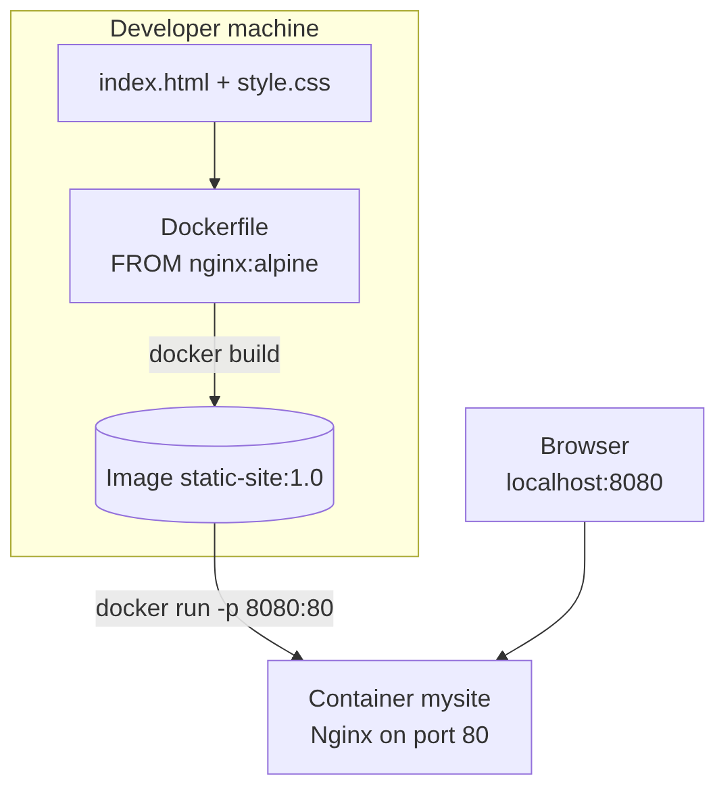
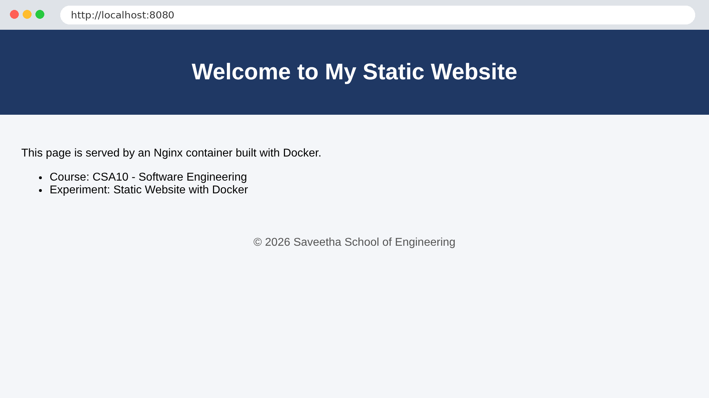

# Experiment 16: Static Website Containerized And Served With Docker And Nginx

 

> **Course:** CSA10 - Software Engineering &nbsp;|&nbsp; **Tools used:** Docker &nbsp;|&nbsp; **Course outcome:** CO3

---

## Problem Statement


Create a Static Website and Containerize, Build & Serve it using Docker.

**Tasks:**

- Create a Simple Static Website (index.html file) with basic HTML content.
- Write/create a Dockerfile to serve the website using Nginx.
- Build the Docker Image
- Run the container:
- Access the Website using a Browser

## Aim


To create a simple static website, write a Dockerfile that serves it with Nginx, build the Docker image, run the container and access the website from a browser.


## Software / Tools Required

- Docker Desktop / Docker Engine
- Visual Studio Code
- Web browser

## Theory


Docker is a containerization platform that packages an application with all its dependencies into a lightweight, portable unit called a container. Containers share the host OS kernel, so they start in seconds and use far less memory than virtual machines.

- **Dockerfile** – a text file of instructions (FROM, COPY, RUN, EXPOSE, CMD) used to build an image.
- **Image** – a read-only template built from a Dockerfile.
- **Container** – a running instance of an image.
- **Nginx** – a high-performance web server; the official nginx:alpine image serves files from /usr/share/nginx/html on port 80.
- **Port mapping** – -p 8080:80 maps host port 8080 to container port 80.

## Diagram

<p align="center"><br><sub><em>Docker + Nginx architecture</em></sub></p>

<sub>Source: [`diagrams/architecture.mmd`](diagrams/architecture.mmd) (Mermaid)</sub>

## Procedure


### Step 1: Install and Verify Docker

- Install Docker Desktop (Windows/macOS) or Docker Engine (Linux) and start it.
- Open a terminal / PowerShell and verify the installation:

```bash
docker --version
docker run hello-world
```

- The message “Hello from Docker!” confirms that Docker is working.

### Step 2: Create the Project Folder

- Create a folder for the website and open it in VS Code:

```bash
mkdir static-site
cd static-site
code .
```

### Step 3: Create the Static Website (index.html)

- Create a file named index.html with the following content:

**`index.html`**

```html
<!DOCTYPE html>
<html lang="en">
<head>
  <meta charset="UTF-8">
  <title>My Static Website</title>
  <link rel="stylesheet" href="style.css">
</head>
<body>
  <header><h1>Welcome to My Static Website</h1></header>
  <main>
    <p>This page is served by an Nginx container built with Docker.</p>
    <ul>
      <li>Course: CSA10 - Software Engineering</li>
      <li>Experiment: Static Website with Docker</li>
    </ul>
  </main>
  <footer>&copy; 2026 Saveetha School of Engineering</footer>
</body>
</html>
```

- Create style.css for basic styling:

**`style.css`**

```css
body   { font-family: Arial, sans-serif; margin: 0; background: #f4f6f9; }
header { background: #1f3864; color: #fff; padding: 20px; text-align: center; }
main   { padding: 30px; }
footer { text-align: center; padding: 10px; color: #555; }
```

### Step 4: Write the Dockerfile

- In the same folder create a file named Dockerfile (no extension):

**`Dockerfile`**

```dockerfile
# Use the lightweight official Nginx image
FROM nginx:alpine

# Remove the default Nginx page
RUN rm -rf /usr/share/nginx/html/*

# Copy website files into the Nginx web root
COPY index.html style.css /usr/share/nginx/html/

# Nginx listens on port 80
EXPOSE 80

# Start Nginx in the foreground
CMD ["nginx", "-g", "daemon off;"]
```

- Project structure: static-site/ → index.html, style.css, Dockerfile.

### Step 5: Build the Docker Image

- Build the image and tag it as static-site:1.0 (the dot means the current folder is the build context):

```bash
docker build -t static-site:1.0 .
docker images
```

- Verify that static-site with tag 1.0 is listed.

### Step 6: Run the Container

- Run the container in detached mode and map host port 8080 to container port 80:

```bash
docker run -d --name mysite -p 8080:80 static-site:1.0
docker ps
```

- docker ps should show the container mysite with PORTS 0.0.0.0:8080->80/tcp.

### Step 7: Access the Website in a Browser

- Open a browser and go to http://localhost:8080
- The page “Welcome to My Static Website” is displayed.

### Step 8: Update, Stop and Clean Up

- To change the website, edit index.html, rebuild the image (tag 1.1) and run a new container.
- Stop and remove the container when finished:

```bash
docker logs mysite
docker stop mysite
docker rm mysite
```


## Code

All source files for this experiment are in the [`code/`](code/) folder:

- [`static-site/Dockerfile`](code/static-site/Dockerfile)
- [`static-site/index.html`](code/static-site/index.html)
- [`static-site/style.css`](code/static-site/style.css)

## Output

Output captured by running the code in [`code/`](code/) (terminal text is also saved in [`output/`](output/)).

<p align="center"><br><sub><em>The website page (served locally on port 8080 from the same files Nginx serves in the container)</em></sub></p>

### Screenshots to attach from your own machine

These steps need your own Docker / Docker Hub / Kubernetes / Jenkins / cloud account. Capture each screenshot and save it in [`screenshots/`](screenshots/) with the suggested name.

- [ ] `step-01.png` - docker --version and hello-world output
- [ ] `step-02.png` - docker build output and docker images list
- [ ] `step-03.png` - docker ps showing the running container
- [ ] `step-04.png` - website opened at http://localhost:8080

### Expected Output

- Image static-site:1.0 is built successfully.
- docker ps shows the container running with 0.0.0.0:8080->80/tcp.
- http://localhost:8080 displays the “Welcome to My Static Website” page.

## Result


Thus a static website was created, containerized with a Dockerfile using Nginx, built into an image, run as a container and accessed successfully in a browser.


## Viva Voce Questions

1. **What is the difference between an image and a container?**
   **Ans:** An image is a read-only template; a container is a running instance of that image.

2. **What does the EXPOSE instruction do?**
   **Ans:** Documents the port on which the container listens; publishing is done with -p.

3. **What is the purpose of -d in docker run?**
   **Ans:** Runs the container in detached (background) mode.

4. **Where does Nginx serve static files from in the official image?**
   **Ans:** /usr/share/nginx/html.

5. **Why is alpine used as the base?**
   **Ans:** It is a very small Linux distribution, giving a small and secure image.


---
[Back to all experiments](../README.md)
