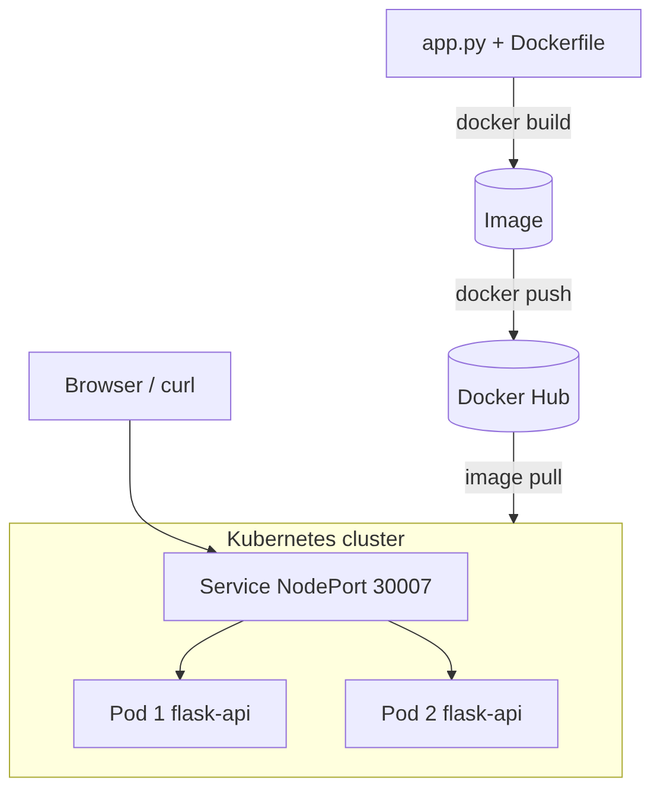
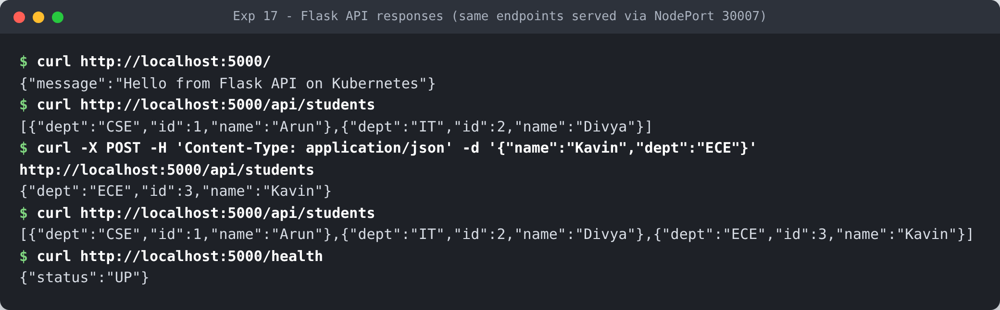
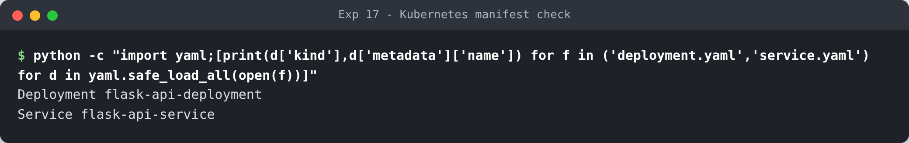

# Experiment 17: Flask API Containerized With Docker, Pushed To Docker Hub And Deployed On Kubernetes

 

> **Course:** CSA10 - Software Engineering &nbsp;|&nbsp; **Tools used:** Docker & Kubernetes &nbsp;|&nbsp; **Course outcome:** CO3

---

## Problem Statement


Create a Simple Python Flask API, Containerize the Application, Build & Push the Image using Docker and Deploy the Application using Kubernetes.

**Tasks:**

- Create a Simple Flask API by writing a Python file (app.py) with basic endpoints.
- Containerize the Flask App using Dockerfile.
- Build the Image using Docker.
- Push the Image to Docker Hub.
- Create Kubernetes manifests (Deployment YAML & Service YAML) to deploy the application.
- Apply the Manifests and Access the API via NodePort.

## Aim


To create a simple Python Flask API, containerize it with Docker, push the image to Docker Hub and deploy it on Kubernetes using Deployment and Service (NodePort) manifests.


## Software / Tools Required

- Python 3 and Flask
- Docker Desktop
- Docker Hub account
- Kubernetes (Docker Desktop Kubernetes or Minikube) and kubectl

## Theory


Flask is a lightweight Python web framework used to build REST APIs. After containerizing the API with Docker, the image is stored in a registry (Docker Hub) from which any Kubernetes cluster can pull it.

Kubernetes (K8s) is an open-source container-orchestration platform that automates deployment, scaling and self-healing of containers.

- **Pod** – the smallest deployable unit; it runs one or more containers.
- **Deployment** – declares the desired number of pod replicas and manages rolling updates.
- **Service** – gives a stable network endpoint to a set of pods. Types: ClusterIP (internal), NodePort (exposes a port 30000–32767 on every node) and LoadBalancer.
- **kubectl** – the command-line tool used to apply manifests and inspect cluster resources.

## Diagram

<p align="center"><br><sub><em>Flask API to Kubernetes</em></sub></p>

<sub>Source: [`diagrams/architecture.mmd`](diagrams/architecture.mmd) (Mermaid)</sub>

## Procedure


### Step 1: Create the Flask API (app.py)

- Create a project folder flask-api and inside it create app.py:

**`app.py`**

```python
from flask import Flask, jsonify, request

app = Flask(__name__)

students = [
    {"id": 1, "name": "Arun",  "dept": "CSE"},
    {"id": 2, "name": "Divya", "dept": "IT"},
]

@app.route("/")
def home():
    return jsonify(message="Hello from Flask API on Kubernetes")

@app.route("/api/students", methods=["GET"])
def get_students():
    return jsonify(students)

@app.route("/api/students", methods=["POST"])
def add_student():
    data = request.get_json()
    data["id"] = len(students) + 1
    students.append(data)
    return jsonify(data), 201

@app.route("/health")
def health():
    return jsonify(status="UP")

if __name__ == "__main__":
    app.run(host="0.0.0.0", port=5000)
```

- Create requirements.txt:

**`requirements.txt`**

```text
flask==3.0.3
```

- Test locally (optional):

```bash
pip install -r requirements.txt
python app.py
# open http://localhost:5000/api/students
```

### Step 2: Containerize the Flask App

- Create the Dockerfile:

**`Dockerfile`**

```dockerfile
FROM python:3.11-slim
WORKDIR /app
COPY requirements.txt .
RUN pip install --no-cache-dir -r requirements.txt
COPY app.py .
EXPOSE 5000
CMD ["python", "app.py"]
```

### Step 3: Build and Test the Image

- Build the image using your Docker Hub username in the name:

```bash
docker build -t <dockerhub-username>/flask-api:1.0 .
docker run -d -p 5000:5000 --name api <dockerhub-username>/flask-api:1.0
curl http://localhost:5000/api/students
docker stop api && docker rm api
```

### Step 4: Push the Image to Docker Hub

- Log in to Docker Hub (use an access token as the password) and push the image:

```bash
docker login
docker push <dockerhub-username>/flask-api:1.0
```

- Open hub.docker.com and verify that the repository flask-api with tag 1.0 is present.

### Step 5: Start the Kubernetes Cluster

- Enable Kubernetes in Docker Desktop (Settings → Kubernetes → Enable) or start Minikube:

```bash
minikube start
kubectl get nodes
```

- The node should be in Ready state.

### Step 6: Create the Deployment Manifest

- Create deployment.yaml:

**`deployment.yaml`**

```yaml
apiVersion: apps/v1
kind: Deployment
metadata:
  name: flask-api-deployment
spec:
  replicas: 2
  selector:
    matchLabels:
      app: flask-api
  template:
    metadata:
      labels:
        app: flask-api
    spec:
      containers:
        - name: flask-api
          image: <dockerhub-username>/flask-api:1.0
          ports:
            - containerPort: 5000
```

### Step 7: Create the Service Manifest (NodePort)

- Create service.yaml:

**`service.yaml`**

```yaml
apiVersion: v1
kind: Service
metadata:
  name: flask-api-service
spec:
  type: NodePort
  selector:
    app: flask-api
  ports:
    - port: 5000
      targetPort: 5000
      nodePort: 30007
```

### Step 8: Apply the Manifests

```bash
kubectl apply -f deployment.yaml
kubectl apply -f service.yaml
kubectl get deployments
kubectl get pods -o wide
kubectl get svc
```

- Verify that 2/2 pods are Running and the service shows 5000:30007/TCP.

### Step 9: Access the API via NodePort

- Docker Desktop: open http://localhost:30007/ and http://localhost:30007/api/students
- Minikube: get the URL with the command below and open it in the browser:

```bash
minikube service flask-api-service --url
curl http://<node-ip>:30007/api/students
```


## Code

All source files for this experiment are in the [`code/`](code/) folder:

- [`flask-api/Dockerfile`](code/flask-api/Dockerfile)
- [`flask-api/app.py`](code/flask-api/app.py)
- [`flask-api/deployment.yaml`](code/flask-api/deployment.yaml)
- [`flask-api/requirements.txt`](code/flask-api/requirements.txt)
- [`flask-api/service.yaml`](code/flask-api/service.yaml)

## Output

Output captured by running the code in [`code/`](code/) (terminal text is also saved in [`output/`](output/)).

<p align="center"><br><sub><em>API endpoints responding (same code that runs in the container / pods)</em></sub></p>

<p align="center"><br><sub><em>Kubernetes manifests parse correctly</em></sub></p>

### Screenshots to attach from your own machine

These steps need your own Docker / Docker Hub / Kubernetes / Jenkins / cloud account. Capture each screenshot and save it in [`screenshots/`](screenshots/) with the suggested name.

- [ ] `step-01.png` - docker build and curl output
- [ ] `step-02.png` - image flask-api:1.0 on Docker Hub
- [ ] `step-03.png` - kubectl get pods and kubectl get svc
- [ ] `step-04.png` - JSON response from the API through NodePort

### Expected Output

- Image <dockerhub-username>/flask-api:1.0 pushed to Docker Hub.
- kubectl get pods shows 2 pods in Running state; kubectl get svc shows flask-api-service of type NodePort 5000:30007/TCP.
- http://localhost:30007/ returns {"message": "Hello from Flask API on Kubernetes"} and /api/students returns the JSON list.

## Result


Thus a Flask API was containerized with Docker, pushed to Docker Hub and deployed on Kubernetes, and the API was accessed successfully through the NodePort service.


## Viva Voce Questions

1. **What is a Pod?**
   **Ans:** The smallest deployable unit in Kubernetes, wrapping one or more containers.

2. **What is the NodePort range?**
   **Ans:** 30000 to 32767.

3. **What is the role of the selector in a Service?**
   **Ans:** It selects the pods (by label) to which traffic is sent.

4. **Why must Flask listen on 0.0.0.0 inside a container?**
   **Ans:** So that it accepts connections from outside the container, not only from localhost.

5. **What does kubectl apply -f do?**
   **Ans:** Creates or updates resources declared in the given manifest file.


---
[Back to all experiments](../README.md)
