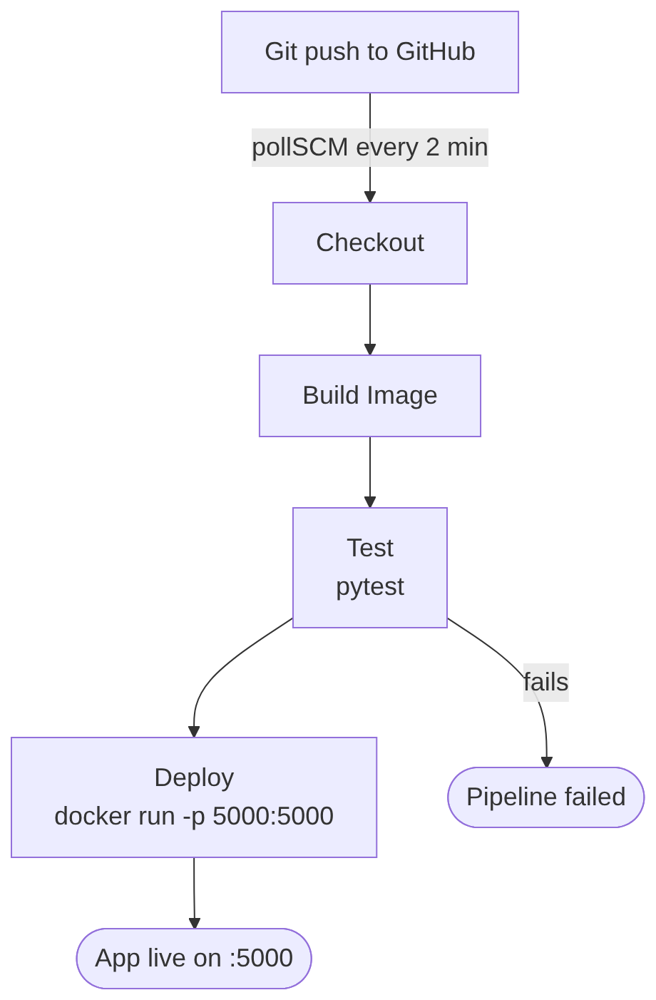
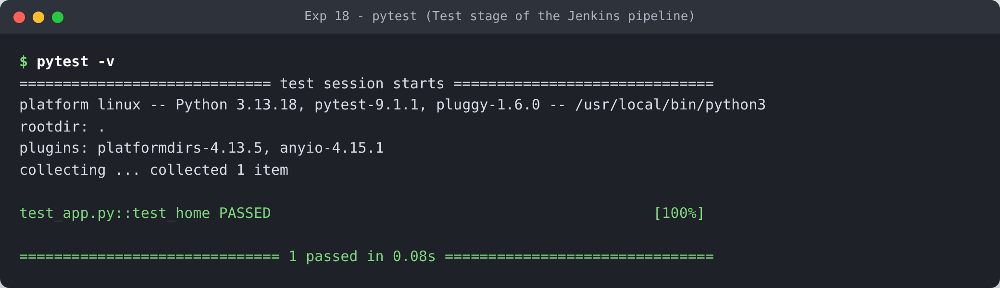

# Experiment 18: CI/CD Pipeline With Jenkins For A Containerized Application

 

> **Course:** CSA10 - Software Engineering &nbsp;|&nbsp; **Tools used:** Docker &nbsp;|&nbsp; **Course outcome:** CO4

---

## Problem Statement


Set up a CI/CD pipeline to automate the building, testing, and deployment of a containerized application.

**Tasks:**

- Set up Jenkins on a local machine or server.

## Aim


To set up Jenkins and create a CI/CD pipeline that automatically builds, tests and deploys a containerized application whenever code is pushed to the repository.


## Software / Tools Required

- Jenkins (LTS) – run as a Docker container or installed locally
- Docker
- Git and GitHub
- Python 3 / Flask sample application

## Theory


Continuous Integration (CI) is the practice of merging code into a shared repository frequently, with every change automatically built and tested. Continuous Delivery/Deployment (CD) extends this by automatically releasing the tested build to a staging or production environment.

Jenkins is an open-source automation server. A **Jenkins Pipeline** is defined as code in a **Jenkinsfile** stored in the repository. A declarative pipeline consists of:

- **agent** – where the pipeline runs.
- **stages / stage** – logical phases such as Checkout, Build, Test, Deploy.
- **steps** – the commands executed in each stage (sh, git, echo).
- **triggers** – what starts the pipeline, e.g. pollSCM or a GitHub webhook.
- **post** – actions after the run (success, failure, always).

## Diagram

<p align="center"><br><sub><em>Jenkins CI/CD pipeline</em></sub></p>

<sub>Source: [`diagrams/jenkins-pipeline.mmd`](diagrams/jenkins-pipeline.mmd) (Mermaid)</sub>

## Procedure


### Step 1: Run Jenkins using Docker

- Start Jenkins LTS as a container. The Docker socket is mounted so that Jenkins can run Docker commands:

```bash
docker volume create jenkins_home
docker run -d --name jenkins -p 8080:8080 -p 50000:50000 \
  -v jenkins_home:/var/jenkins_home \
  -v /var/run/docker.sock:/var/run/docker.sock \
  jenkins/jenkins:lts
```

- Install the Docker CLI inside the Jenkins container (one time):

```bash
docker exec -u root jenkins bash -c "apt-get update && apt-get install -y docker.io"
docker exec -u root jenkins chmod 666 /var/run/docker.sock
```

- (Alternatively, install Jenkins on Windows using the .msi installer from jenkins.io.)

### Step 2: Unlock and Configure Jenkins

- Get the initial admin password:

```bash
docker exec jenkins cat /var/jenkins_home/secrets/initialAdminPassword
```

- Open http://localhost:8080, paste the password, choose Install suggested plugins and create the admin user.
- Go to Manage Jenkins → Plugins and make sure Git, Pipeline and Docker Pipeline plugins are installed.

### Step 3: Prepare the Application Repository

- Create a GitHub repository jenkins-flask-demo with app.py, test_app.py, requirements.txt, Dockerfile and Jenkinsfile.

**`app.py`**

```python
from flask import Flask
app = Flask(__name__)

@app.route("/")
def home():
    return "CI/CD with Jenkins - Build successful!"

if __name__ == "__main__":
    app.run(host="0.0.0.0", port=5000)
```

**`test_app.py`**

```python
from app import app

def test_home():
    client = app.test_client()
    resp = client.get("/")
    assert resp.status_code == 200
    assert b"Jenkins" in resp.data
```

**`requirements.txt`**

```text
flask==3.0.3
pytest==8.2.0
```

**`Dockerfile`**

```dockerfile
FROM python:3.11-slim
WORKDIR /app
COPY requirements.txt .
RUN pip install --no-cache-dir -r requirements.txt
COPY . .
EXPOSE 5000
CMD ["python", "app.py"]
```

### Step 4: Write the Jenkinsfile

- Add the declarative pipeline to the root of the repository:

**`Jenkinsfile`**

```groovy
pipeline {
    agent any
    environment {
        IMAGE = "flask-cicd"
        TAG   = "${env.BUILD_NUMBER}"
    }
    triggers { pollSCM('H/2 * * * *') }      // check GitHub every 2 minutes
    stages {
        stage('Checkout') {
            steps { git branch: 'main', url: 'https://github.com/<username>/jenkins-flask-demo.git' }
        }
        stage('Build Image') {
            steps { sh 'docker build -t $IMAGE:$TAG .' }
        }
        stage('Test') {
            steps { sh 'docker run --rm $IMAGE:$TAG pytest -q' }
        }
        stage('Deploy') {
            steps {
                sh 'docker rm -f flask-app || true'
                sh 'docker run -d --name flask-app -p 5000:5000 $IMAGE:$TAG'
            }
        }
    }
    post {
        success { echo 'Pipeline completed: application deployed on port 5000' }
        failure { echo 'Pipeline failed - check the console output' }
    }
}
```

- Commit and push all files to GitHub.

### Step 5: Create the Pipeline Job

- On the Jenkins dashboard click New Item → enter flask-cicd → select Pipeline → OK.
- Under Pipeline choose Definition: Pipeline script from SCM, SCM: Git, enter the repository URL, branch */main and Script Path Jenkinsfile.
- Click Save.

### Step 6: Run the Pipeline

- Click Build Now. Open the build and view Console Output and the Stage View.
- All stages Checkout, Build Image, Test and Deploy should be green.

### Step 7: Verify the Deployment

- Open http://localhost:5000 – the message “CI/CD with Jenkins - Build successful!” is displayed.

```bash
docker ps
curl http://localhost:5000
```

### Step 8: Test Automatic Triggering

- Change the message in app.py and the test, commit and push to GitHub.
- Within two minutes Jenkins polls the repository and starts a new build automatically (or configure a GitHub webhook to http://<jenkins-host>:8080/github-webhook/).
- Verify that the new version is deployed.

## Code

All source files for this experiment are in the [`code/`](code/) folder:

- [`jenkins-flask-demo/Dockerfile`](code/jenkins-flask-demo/Dockerfile)
- [`jenkins-flask-demo/Jenkinsfile`](code/jenkins-flask-demo/Jenkinsfile)
- [`jenkins-flask-demo/app.py`](code/jenkins-flask-demo/app.py)
- [`jenkins-flask-demo/requirements.txt`](code/jenkins-flask-demo/requirements.txt)
- [`jenkins-flask-demo/test_app.py`](code/jenkins-flask-demo/test_app.py)

## Output

Output captured by running the code in [`code/`](code/) (terminal text is also saved in [`output/`](output/)).

<p align="center"><br><sub><em><code>pytest</code> - the Test stage of the Jenkins pipeline</em></sub></p>

### Screenshots to attach from your own machine

These steps need your own Docker / Docker Hub / Kubernetes / Jenkins / cloud account. Capture each screenshot and save it in [`screenshots/`](screenshots/) with the suggested name.

- [ ] `step-01.png` - Jenkins dashboard after setup
- [ ] `step-02.png` - pipeline job configuration
- [ ] `step-03.png` - Stage View with all stages successful
- [ ] `step-04.png` - application in browser after deployment
- [ ] `step-05.png` - build history showing the automatically triggered build

### Expected Output

- Jenkins dashboard shows the pipeline job flask-cicd.
- Stage View shows Checkout → Build Image → Test → Deploy all green (SUCCESS).
- After the Deploy stage, http://localhost:5000 displays the application; a new push triggers a new build automatically.

## Result


Thus Jenkins was set up and a CI/CD pipeline was created that automatically builds, tests and deploys the containerized application.


## Viva Voce Questions

1. **What is CI?**
   **Ans:** Continuous Integration – automatically building and testing code on every commit.

2. **What is a Jenkinsfile?**
   **Ans:** A text file containing the pipeline definition, stored with the source code (Pipeline as Code).

3. **Differentiate Continuous Delivery and Continuous Deployment.**
   **Ans:** In Delivery the release to production needs manual approval; in Deployment it is automatic.

4. **How can Jenkins be triggered on a push?**
   **Ans:** Using a GitHub webhook or the pollSCM trigger.

5. **What is the default port of Jenkins?**
   **Ans:** 8080.


---
[Back to all experiments](../README.md)
