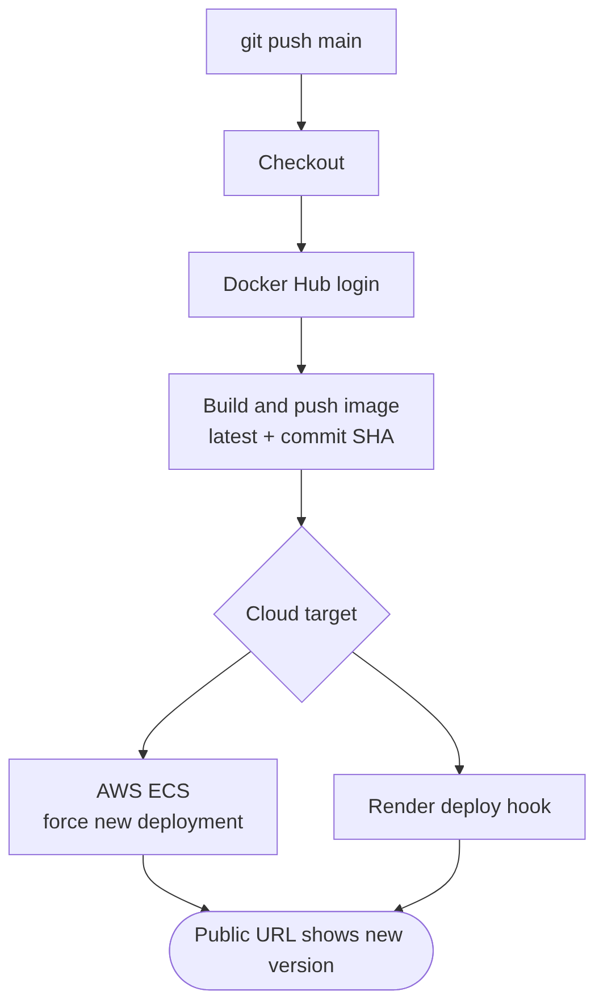
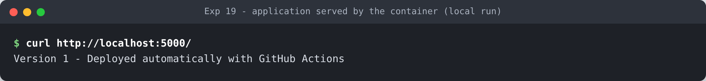

# Experiment 19: Continuous Deployment Of A Dockerized Application Using GitHub Actions

 

> **Course:** CSA10 - Software Engineering &nbsp;|&nbsp; **Tools used:** Docker &nbsp;|&nbsp; **Course outcome:** CO4

---

## Problem Statement


Implement Continuous Deployment using GitHub Actions to deploy a Dockerized application.

**Tasks:**

- Set up a GitHub repository and push a simple Dockerized application.
- Create a GitHub Actions workflow to automatically build and push the Docker image to Docker Hub or GitHub Container Registry.
- Automate deployment to a cloud platform (e.g., AWS ECS, Azure Kubernetes Service, or Google Kubernetes Engine).
- Test the CI/CD pipeline by pushing new code changes and verifying that the deployment occurs automatically.

## Aim


To implement continuous deployment with GitHub Actions: build and push the Docker image of an application to Docker Hub automatically and deploy it to a cloud platform whenever new code is pushed.


## Software / Tools Required

- GitHub repository and GitHub Actions
- Docker and Docker Hub account
- Cloud platform – AWS ECS / Azure AKS / Google GKE (or Render for a free alternative)

## Theory


GitHub Actions is a CI/CD platform built into GitHub. Workflows are written in YAML under .github/workflows/ and run on GitHub-hosted runners.

- **Workflow** – an automated process defined in a YAML file.
- **Event** – the trigger, such as push, pull_request or workflow_dispatch.
- **Job** – a set of steps that run on the same runner (e.g. ubuntu-latest).
- **Step / Action** – a single command (run) or a reusable action (uses), e.g. actions/checkout, docker/login-action, docker/build-push-action.
- **Secrets** – encrypted values (DOCKERHUB_USERNAME, DOCKERHUB_TOKEN, cloud credentials) stored in the repository settings.

Continuous Deployment means every change that passes the pipeline is released to users automatically, without manual steps.


## Diagram

<p align="center"><br><sub><em>GitHub Actions continuous deployment</em></sub></p>

<sub>Source: [`diagrams/cd-pipeline.mmd`](diagrams/cd-pipeline.mmd) (Mermaid)</sub>

## Procedure


### Step 1: Create the Application

- Create a GitHub repository gha-docker-cd and add a simple Flask application:

**`app.py`**

```python
from flask import Flask
import os
app = Flask(__name__)

@app.route("/")
def home():
    return "Version 1 - Deployed automatically with GitHub Actions"

if __name__ == "__main__":
    app.run(host="0.0.0.0", port=int(os.environ.get("PORT", 5000)))
```

**`requirements.txt`**

```text
flask==3.0.3
gunicorn==22.0.0
```

**`Dockerfile`**

```dockerfile
FROM python:3.11-slim
WORKDIR /app
COPY requirements.txt .
RUN pip install --no-cache-dir -r requirements.txt
COPY . .
EXPOSE 5000
CMD ["gunicorn", "-b", "0.0.0.0:5000", "app:app"]
```

```bash
git init
git add .
git commit -m "Initial Dockerized app"
git branch -M main
git remote add origin https://github.com/<username>/gha-docker-cd.git
git push -u origin main
```

### Step 2: Create a Docker Hub Access Token

- Log in to hub.docker.com → Account Settings → Personal access tokens → Generate new token (Read & Write).
- Copy the token; it is shown only once.

### Step 3: Add Repository Secrets

- In GitHub open the repository → Settings → Secrets and variables → Actions → New repository secret.
- Add DOCKERHUB_USERNAME and DOCKERHUB_TOKEN.
- Add the cloud credentials needed for deployment (for AWS: AWS_ACCESS_KEY_ID, AWS_SECRET_ACCESS_KEY; for Render: RENDER_DEPLOY_HOOK).

### Step 4: Prepare the Cloud Platform

- **Option A – AWS ECS (Fargate):** create a cluster gha-cluster, a task definition gha-task using the image <dockerhub-username>/gha-docker-cd:latest (port 5000) and a service gha-service with a public IP / load balancer.
- **Option B – Render (free):** New → Web Service → Deploy an existing image → <dockerhub-username>/gha-docker-cd:latest; copy the Deploy Hook URL from Settings.
- Note the public URL of the service.

### Step 5: Write the GitHub Actions Workflow

- Create the file .github/workflows/cd.yml:

**`.github/workflows/cd.yml`**

```yaml
name: CD - Build, Push and Deploy

on:
  push:
    branches: [ "main" ]
  workflow_dispatch:

env:
  IMAGE: ${{ secrets.DOCKERHUB_USERNAME }}/gha-docker-cd

jobs:
  build-push-deploy:
    runs-on: ubuntu-latest
    steps:
      - name: Checkout code
        uses: actions/checkout@v4

      - name: Log in to Docker Hub
        uses: docker/login-action@v3
        with:
          username: ${{ secrets.DOCKERHUB_USERNAME }}
          password: ${{ secrets.DOCKERHUB_TOKEN }}

      - name: Build and push image
        uses: docker/build-push-action@v6
        with:
          context: .
          push: true
          tags: |
            ${{ env.IMAGE }}:latest
            ${{ env.IMAGE }}:${{ github.sha }}

      # ---- Option A: AWS ECS ----
      - name: Configure AWS credentials
        uses: aws-actions/configure-aws-credentials@v4
        with:
          aws-access-key-id: ${{ secrets.AWS_ACCESS_KEY_ID }}
          aws-secret-access-key: ${{ secrets.AWS_SECRET_ACCESS_KEY }}
          aws-region: ap-south-1

      - name: Deploy to ECS
        run: |
          aws ecs update-service --cluster gha-cluster \
            --service gha-service --force-new-deployment

      # ---- Option B: Render (use instead of Option A) ----
      # - name: Trigger Render deploy
      #   run: curl -X POST "${{ secrets.RENDER_DEPLOY_HOOK }}"

```

- Commit and push the workflow file to the main branch.

### Step 6: Run and Monitor the Workflow

- Open the Actions tab in the repository. The workflow starts automatically because of the push.
- Click the run to view the log of each step; all steps should show a green tick.

### Step 7: Verify the Image and Deployment

- Open Docker Hub and verify the tags latest and the commit SHA.
- Open the public URL of the ECS service / Render service – “Version 1 - Deployed automatically with GitHub Actions” is displayed.

### Step 8: Test the Pipeline with a Code Change

- Change the message in app.py to “Version 2 …”, then commit and push:

```bash
git add app.py
git commit -m "Release version 2"
git push
```

- A new workflow run starts automatically; after it finishes, refresh the public URL and confirm that Version 2 is live.

## Code

All source files for this experiment are in the [`code/`](code/) folder:

- [`gha-docker-cd/.github/workflows/cd.yml`](code/gha-docker-cd/.github/workflows/cd.yml)
- [`gha-docker-cd/Dockerfile`](code/gha-docker-cd/Dockerfile)
- [`gha-docker-cd/app.py`](code/gha-docker-cd/app.py)
- [`gha-docker-cd/requirements.txt`](code/gha-docker-cd/requirements.txt)

## Output

Output captured by running the code in [`code/`](code/) (terminal text is also saved in [`output/`](output/)).

<p align="center"><br><sub><em>Application response served on port 5000</em></sub></p>

### Screenshots to attach from your own machine

These steps need your own Docker / Docker Hub / Kubernetes / Jenkins / cloud account. Capture each screenshot and save it in [`screenshots/`](screenshots/) with the suggested name.

- [ ] `step-01.png` - repository secrets page
- [ ] `step-02.png` - successful workflow run in the Actions tab
- [ ] `step-03.png` - Docker Hub tags and the deployed application
- [ ] `step-04.png` - second workflow run and updated application

### Expected Output

- The Actions tab shows the workflow “CD – Build, Push and Deploy” completed with a green tick.
- Docker Hub shows the new image tags latest and the commit SHA.
- The cloud service is updated and the public URL displays the new version after every push.

## Result


Thus continuous deployment was implemented with GitHub Actions; on every push the Docker image was built, pushed to Docker Hub and deployed to the cloud platform automatically.


## Viva Voce Questions

1. **Where are GitHub Actions workflow files stored?**
   **Ans:** In the .github/workflows/ directory of the repository.

2. **What is a runner?**
   **Ans:** A machine (GitHub-hosted or self-hosted) that executes the workflow jobs.

3. **Why are secrets used?**
   **Ans:** To keep passwords and tokens encrypted and out of the source code.

4. **What does actions/checkout do?**
   **Ans:** Checks out the repository code onto the runner.

5. **Why tag the image with the commit SHA?**
   **Ans:** To make every build uniquely identifiable and allow easy rollback.


---
[Back to all experiments](../README.md)
