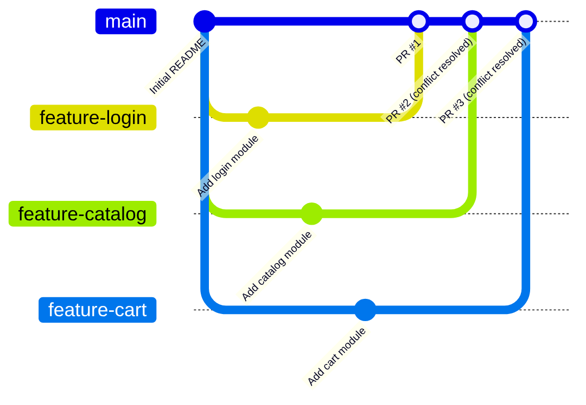
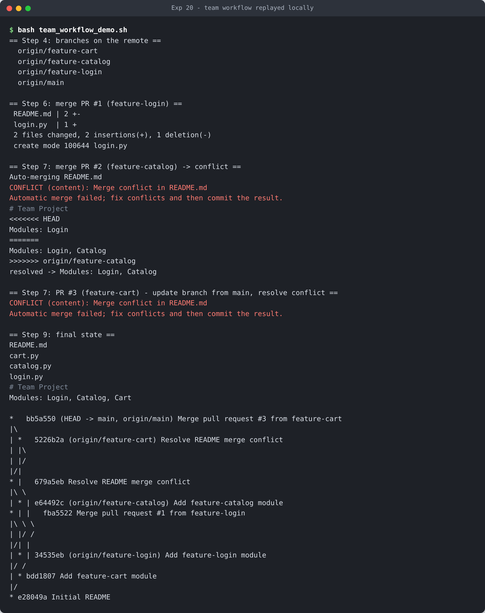

# Experiment 20: Team Project Repository With Branches, Pull Requests And Readme Documentation

 

> **Course:** CSA10 - Software Engineering &nbsp;|&nbsp; **Tools used:** Git/GitHub &nbsp;|&nbsp; **Course outcome:** CO3

---

## Problem Statement


Create a GitHub Repository and Implement Version Control

**Tasks:**

- Set up a repository for a team project.
- Create branches for individual modules.
- Merge branches with pull requests after code reviews.
- Resolve conflicts during branch merging.
- Document the workflow using the README file.
- Submit the repository link

## Aim


To set up a GitHub repository for a team project, create branches for individual modules, merge them using pull requests after code review, resolve merge conflicts and document the workflow in the README file.


## Software / Tools Required

- Git
- GitHub (organization or shared repository)
- Visual Studio Code

## Theory


Version control lets several developers work on the same code base safely. A common team strategy is the **feature-branch workflow** : main always contains reviewed, working code, and each module is developed on its own branch.

- **Collaborators / branch protection** – the repository owner adds team members and can protect main so that changes must come through reviewed pull requests.
- **Code review** – reviewers comment on the PR, request changes or approve.
- **Merge strategies** – Create a merge commit, Squash and merge, or Rebase and merge.
- **README.md** – a Markdown file that describes the project, setup steps, branch strategy and contribution guidelines.

| Branch | Module | Owner |
|---|---|---|
| main | Stable integrated code | Team lead |
| feature-login | Login / authentication module | Student 1 |
| feature-catalog | Product / catalogue module | Student 2 |
| feature-cart | Cart and checkout module | Student 3 |


## Diagram

<p align="center"><br><sub><em>Team branching model</em></sub></p>

<sub>Source: [`diagrams/team-branching.mmd`](diagrams/team-branching.mmd) (Mermaid)</sub>

## Procedure


### Step 1: Create the Team Repository

- The team lead signs in to GitHub → New repository → name team-project → Public → tick Add a README file → Create repository.
- Open Settings → Collaborators → Add people and invite every team member; each member accepts the invitation.
- (Optional) Settings → Branches → Add branch protection rule for main → Require a pull request before merging → Require 1 approval.

### Step 2: Clone the Repository (each member)

```bash
git clone https://github.com/<team-lead>/team-project.git
cd team-project
git branch -a
```

### Step 3: Create Branches for Individual Modules

- Each member creates a branch for the module assigned to them:

```bash
git checkout -b feature-login      # Student 1
git checkout -b feature-catalog    # Student 2
git checkout -b feature-cart       # Student 3
```

### Step 4: Develop the Module and Push the Branch

- Example for Student 1 – create login.py:

**`login.py`**

```python
def login(username, password):
    users = {"admin": "admin123", "student": "pass123"}
    if users.get(username) == password:
        return "Login successful"
    return "Invalid credentials"

```

```bash
git add login.py
git commit -m "Add login module"
git push -u origin feature-login
```

- Students 2 and 3 do the same for catalog.py and cart.py on their branches.

### Step 5: Open Pull Requests and Review Code

- On GitHub click Compare & pull request for each branch → base: main, compare: feature-xxx.
- Add a title and description and assign another team member as Reviewer.
- The reviewer opens Files changed, adds comments and selects Approve (or Request changes).
- If changes are requested, the author commits again on the same branch; the PR updates automatically.

### Step 6: Merge the Pull Requests

- After approval click Merge pull request → Confirm merge, and then Delete branch.
- Merge feature-login first, then feature-catalog.

### Step 7: Create and Resolve a Merge Conflict

- Two members edit the same line of README.md on their branches (for example the “Modules” line).
- After the first PR is merged, the second PR shows “This branch has conflicts that must be resolved”.
- Resolve it locally:

```bash
git checkout feature-cart
git pull origin main
# README.md now contains:
<<<<<<< HEAD
Modules: Login, Cart
=======
Modules: Login, Catalog
>>>>>>> main
```

- Edit the file to keep both changes (Modules: Login, Catalog, Cart), remove the markers, then:

```bash
git add README.md
git commit -m "Resolve README merge conflict"
git push
```

- The PR now shows “No conflicts”; review and merge it.

### Step 8: Document the Workflow in README

- Update README.md on a docs branch and merge it through a PR:

**`README.md`**

```markdown
# Team Project - Online Shopping Modules

## Team
| Member    | Module  | Branch          |
|-----------|---------|-----------------|
| Student 1 | Login   | feature-login   |
| Student 2 | Catalog | feature-catalog |
| Student 3 | Cart    | feature-cart    |

## Workflow
1. Pull the latest main: `git pull origin main`
2. Create a branch: `git checkout -b feature-<module>`
3. Commit small, meaningful changes and push the branch
4. Open a Pull Request to `main` and request a review
5. Resolve conflicts locally, then merge after approval

## How to run
python login.py
```

### Step 9: Submit the Repository Link

- Verify the commit graph in Insights → Network and copy the repository URL https://github.com/<team-lead>/team-project for submission.

## Code

All source files for this experiment are in the [`code/`](code/) folder:

- [`team-project/README.md`](code/team-project/README.md)
- [`team-project/cart.py`](code/team-project/cart.py)
- [`team-project/catalog.py`](code/team-project/catalog.py)
- [`team-project/login.py`](code/team-project/login.py)
- [`team_workflow_demo.sh`](code/team_workflow_demo.sh)

## Output

Output captured by running the code in [`code/`](code/) (terminal text is also saved in [`output/`](output/)).

<p align="center"><br><sub><em>Team workflow: three module branches, merged PRs, two README conflicts resolved (replayed locally)</em></sub></p>

### Screenshots to attach from your own machine

These steps need your own Docker / Docker Hub / Kubernetes / Jenkins / cloud account. Capture each screenshot and save it in [`screenshots/`](screenshots/) with the suggested name.

- [ ] `step-01.png` - repository with collaborators / branch protection rule
- [ ] `step-02.png` - branches listed on GitHub
- [ ] `step-03.png` - pull request with review approval
- [ ] `step-04.png` - conflict message and resolved PR
- [ ] `step-05.png` - network graph / final repository page

### Expected Output

- Repository team-project with branches main, feature-login, feature-catalog and feature-cart.
- Pull requests reviewed (approved) and merged; one conflict in README.md resolved.
- README.md documents the project, branch strategy and workflow; repository link submitted.

## Result


Thus a team GitHub repository was set up, modules were developed on separate branches, merged through reviewed pull requests, conflicts were resolved and the workflow was documented in the README.


## Viva Voce Questions

1. **What is branch protection?**
   **Ans:** A rule that prevents direct pushes to a branch and requires reviewed pull requests or passing checks.

2. **What is squash and merge?**
   **Ans:** Combining all commits of a PR into a single commit on the target branch.

3. **How do you add collaborators on GitHub?**
   **Ans:** Settings → Collaborators → Add people.

4. **Why document the workflow in README?**
   **Ans:** So every team member and new contributor follows the same process.

5. **What is code review?**
   **Ans:** Systematic examination of code changes by peers before merging.


---
[Back to all experiments](../README.md)
