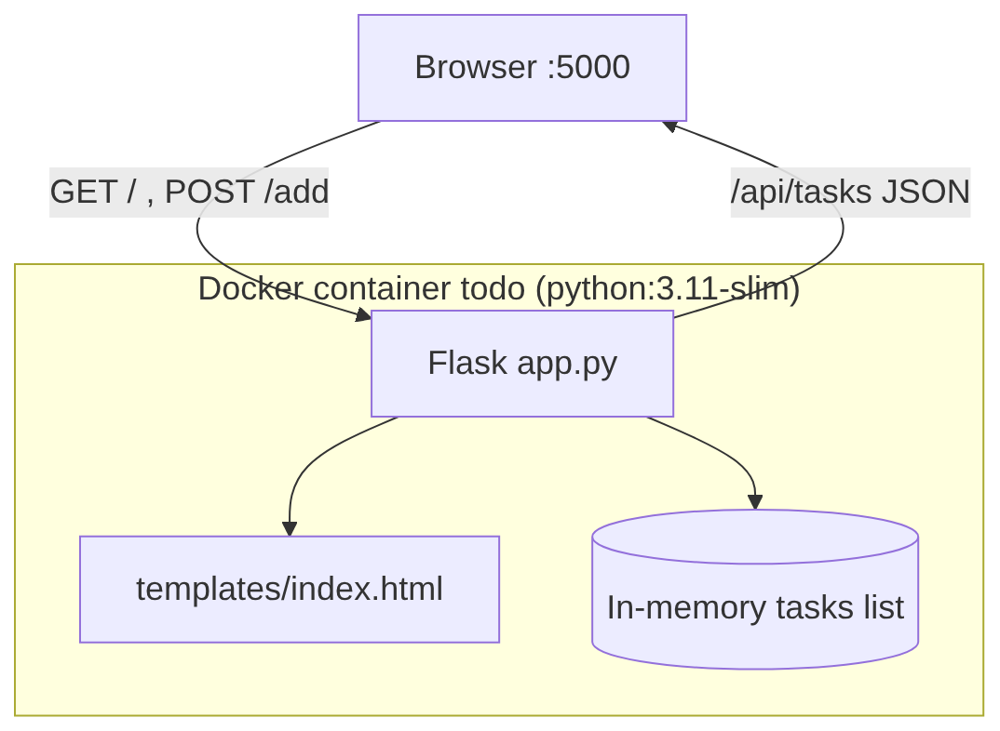
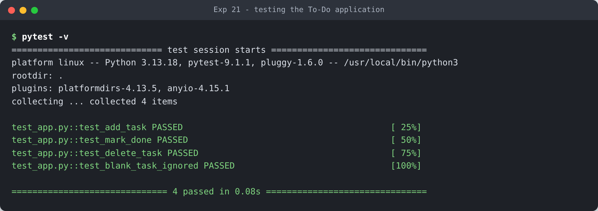
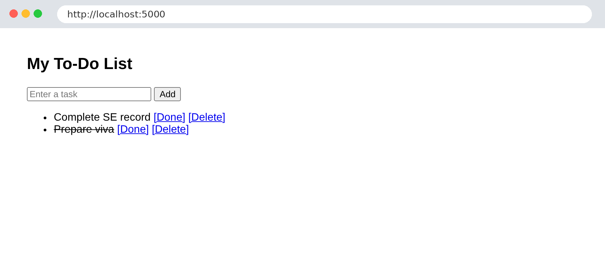
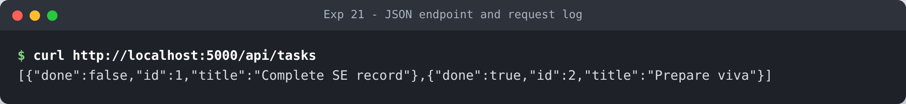

# Experiment 21: Containerizing A Python Flask To-Do Application Using Docker

 

> **Course:** CSA10 - Software Engineering &nbsp;|&nbsp; **Tools used:** Docker, Flask &nbsp;|&nbsp; **Course outcome:** CO3

---

## Problem Statement


Containerize a Python Flask Application Using Docker

**Tasks:**

- Write a simple Python Flask application for a "To-Do" list.
- Create a Dockerfile to containerize the application.
- Build and run the Docker container locally.
- Test the application’s functionality inside the container.
- Push the Docker image to Docker Hub.
- Submit the Dockerfile and screenshots of testing results

## Aim


To write a simple Python Flask To-Do list application, containerize it with a Dockerfile, build and run it locally, test its functionality inside the container and push the image to Docker Hub.


## Software / Tools Required

- Python 3, Flask
- Docker Desktop
- Docker Hub account
- Web browser / curl

## Theory


A To-Do application lets users add, view and delete tasks. Flask makes it easy to build such an app with routes and HTML templates.

Containerizing the application guarantees that it runs identically on every machine (“it works on my machine” problem is removed), because the Python version and all libraries are packed into the image.

| Dockerfile instruction | Use |
|---|---|
| FROM python:3.11-slim | Base image with Python |
| WORKDIR /app | Working directory inside the container |
| COPY requirements.txt . | Copy dependency list |
| RUN pip install -r requirements.txt | Install dependencies |
| COPY . . | Copy the source code |
| EXPOSE 5000 | Document the port |
| CMD ["python", "app.py"] | Command to start the app |

docker exec lets us run commands inside a running container, which is used to test the application from inside.


## Diagram

<p align="center"><br><sub><em>To-Do app container</em></sub></p>

<sub>Source: [`diagrams/architecture.mmd`](diagrams/architecture.mmd) (Mermaid)</sub>

## Procedure


### Step 1: Create the Flask To-Do Application

- Create a folder todo-app with the structure: app.py, templates/index.html, requirements.txt, Dockerfile.

**`app.py`**

```python
from flask import Flask, render_template, request, redirect, url_for, jsonify

app = Flask(__name__)
tasks = []          # in-memory list of tasks

@app.route("/")
def index():
    return render_template("index.html", tasks=tasks)

@app.route("/add", methods=["POST"])
def add():
    title = request.form.get("task", "").strip()
    if title:
        tasks.append({"id": len(tasks) + 1, "title": title, "done": False})
    return redirect(url_for("index"))

@app.route("/done/<int:task_id>")
def done(task_id):
    for t in tasks:
        if t["id"] == task_id:
            t["done"] = True
    return redirect(url_for("index"))

@app.route("/delete/<int:task_id>")
def delete(task_id):
    global tasks
    tasks = [t for t in tasks if t["id"] != task_id]
    return redirect(url_for("index"))

@app.route("/api/tasks")
def api_tasks():
    return jsonify(tasks)

if __name__ == "__main__":
    app.run(host="0.0.0.0", port=5000)
```

**`templates/index.html`**

```html
<!DOCTYPE html>
<html>
<head><title>To-Do List</title></head>
<body style="font-family:Arial; margin:40px">
  <h2>My To-Do List</h2>
  <form action="/add" method="post">
    <input name="task" placeholder="Enter a task" required>
    <button type="submit">Add</button>
  </form>
  <ul>
  
    <li>
      <s>{{ t.title }}</s>{{ t.title }}
      <a href="/done/{{ t.id }}">[Done]</a>
      <a href="/delete/{{ t.id }}">[Delete]</a>
    </li>
  
  </ul>
</body>
</html>
```

**`requirements.txt`**

```text
flask==3.0.3
```

### Step 2: Create the Dockerfile

**`Dockerfile`**

```dockerfile
FROM python:3.11-slim
WORKDIR /app
COPY requirements.txt .
RUN pip install --no-cache-dir -r requirements.txt
COPY . .
EXPOSE 5000
CMD ["python", "app.py"]
```

- Create .dockerignore containing __pycache__ and *.pyc so that unnecessary files are not copied.

### Step 3: Build the Docker Image

```bash
docker build -t todo-app:1.0 .
docker images todo-app
```

### Step 4: Run the Container Locally

```bash
docker run -d --name todo -p 5000:5000 todo-app:1.0
docker ps
```

- Open http://localhost:5000 in the browser.

### Step 5: Test the Application Functionality

- Add three tasks (e.g. “Complete SE record”, “Prepare viva”, “Submit assignment”), mark one as Done and delete one.
- Test the JSON endpoint from the host and from inside the container:

```bash
curl http://localhost:5000/api/tasks
docker exec -it todo python -c "import urllib.request;print(urllib.request.urlopen('http://localhost:5000/api/tasks').read())"
docker logs todo
```

- The response shows the list of tasks in JSON, and the logs show the GET/POST requests.

### Step 6: Push the Image to Docker Hub

```bash
docker login
docker tag todo-app:1.0 <dockerhub-username>/todo-app:1.0
docker push <dockerhub-username>/todo-app:1.0
```

- Verify the repository on hub.docker.com.

### Step 7: Clean Up

```bash
docker stop todo
docker rm todo
```

- Submit the Dockerfile and the screenshots of the testing results.

## Code

All source files for this experiment are in the [`code/`](code/) folder:

- [`todo-app/.dockerignore`](code/todo-app/.dockerignore)
- [`todo-app/Dockerfile`](code/todo-app/Dockerfile)
- [`todo-app/app.py`](code/todo-app/app.py)
- [`todo-app/requirements.txt`](code/todo-app/requirements.txt)
- [`todo-app/templates/index.html`](code/todo-app/templates/index.html)
- [`todo-app/test_app.py`](code/todo-app/test_app.py)

## Output

Output captured by running the code in [`code/`](code/) (terminal text is also saved in [`output/`](output/)).

<p align="center"><br><sub><em>Functional tests of the To-Do app</em></sub></p>

<p align="center"><br><sub><em>To-Do app in the browser (3 tasks added, one marked done, one deleted)</em></sub></p>

<p align="center"><br><sub><em>JSON endpoint <code>/api/tasks</code></em></sub></p>

### Screenshots to attach from your own machine

These steps need your own Docker / Docker Hub / Kubernetes / Jenkins / cloud account. Capture each screenshot and save it in [`screenshots/`](screenshots/) with the suggested name.

- [ ] `step-01.png` - docker build output
- [ ] `step-02.png` - To-Do app home page
- [ ] `step-03.png` - tasks added, curl output and docker logs
- [ ] `step-04.png` - todo-app image on Docker Hub

### Expected Output

- Image todo-app:1.0 built; container todo running on port 5000.
- http://localhost:5000 shows the To-Do list; tasks can be added and deleted.
- Image pushed as <dockerhub-username>/todo-app:1.0 and visible on Docker Hub.

## Result


Thus a Flask To-Do application was containerized using Docker, tested inside the container and the image was pushed to Docker Hub.


## Viva Voce Questions

1. **Why is requirements.txt copied before the source code?**
   **Ans:** To use Docker layer caching – dependencies are reinstalled only when requirements change.

2. **What does docker exec -it do?**
   **Ans:** Runs an interactive command inside a running container.

3. **How do you view the logs of a container?**
   **Ans:** docker logs <container>.

4. **What is a .dockerignore file?**
   **Ans:** A file listing paths to exclude from the build context.

5. **Why use python:3.11-slim?**
   **Ans:** It is a smaller base image, giving faster builds and a smaller attack surface.


---
[Back to all experiments](../README.md)
