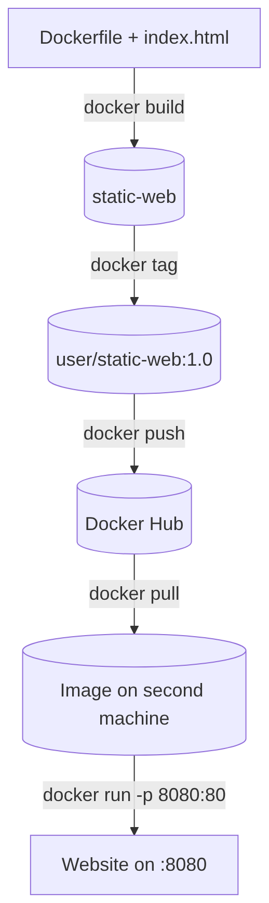
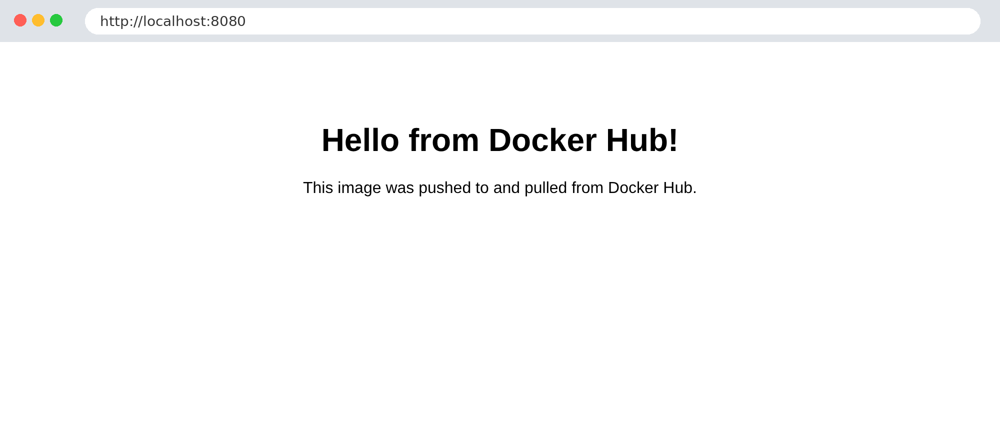

# Experiment 22: Push And Pull Docker Images Using Docker Hub

 

> **Course:** CSA10 - Software Engineering &nbsp;|&nbsp; **Tools used:** Docker Hub, Docker CLI &nbsp;|&nbsp; **Course outcome:** CO3

---

## Problem Statement


Push and Pull Docker Images Using Docker Hub

**Tasks:**

- Create a Docker image for a static HTML website.
- Tag and push the image to Docker Hub.
- Pull the image from Docker Hub and run it on another machine.
- Submit Docker commands and screenshots for each step.

## Aim


To create a Docker image for a static HTML website, tag and push it to Docker Hub, then pull the image on another machine and run it.


## Software / Tools Required

- Docker Engine / Docker Desktop
- Docker CLI
- Docker Hub account
- Second machine or Play with Docker (labs.play-with-docker.com)

## Theory


A container registry stores and distributes Docker images. Docker Hub is the default public registry. An image is identified as **[registry/]username/repository:tag** , for example student01/static-web:1.0. If no tag is given, latest is assumed.

| Command | Purpose |
|---|---|
| docker login | Authenticate with Docker Hub |
| docker build -t name:tag . | Build an image |
| docker tag src target | Give an image a new name/tag |
| docker push user/repo:tag | Upload image to registry |
| docker pull user/repo:tag | Download image from registry |
| docker images | List local images |
| docker rmi image | Remove a local image |

Pushing to a registry is how images are shared between developers, test servers and production clusters.


## Diagram

<p align="center"><br><sub><em>Docker Hub push and pull</em></sub></p>

<sub>Source: [`diagrams/push-pull-flow.mmd`](diagrams/push-pull-flow.mmd) (Mermaid)</sub>

## Procedure


### Step 1: Create the Static Website

- Create a folder web-image with an index.html file:

**`index.html`**

```html
<!DOCTYPE html>
<html>
<head><title>Docker Hub Demo</title></head>
<body style="font-family:Arial;text-align:center;margin-top:80px">
  <h1>Hello from Docker Hub!</h1>
  <p>This image was pushed to and pulled from Docker Hub.</p>
</body>
</html>
```

**`Dockerfile`**

```dockerfile
FROM nginx:alpine
COPY index.html /usr/share/nginx/html/index.html
EXPOSE 80
```

### Step 2: Build the Docker Image

```bash
docker build -t static-web .
docker images
```

### Step 3: Create a Repository on Docker Hub

- Sign in to hub.docker.com → Repositories → Create repository → name static-web → Public → Create.

### Step 4: Log in from the Docker CLI

```bash
docker login -u <dockerhub-username>
# enter the access token as password
# Login Succeeded
```

### Step 5: Tag the Image

- Tag the local image with the Docker Hub username, repository name and version:

```bash
docker tag static-web <dockerhub-username>/static-web:1.0
docker tag static-web <dockerhub-username>/static-web:latest
docker images
```

- Both tags point to the same IMAGE ID.

### Step 6: Push the Image to Docker Hub

```bash
docker push <dockerhub-username>/static-web:1.0
docker push <dockerhub-username>/static-web:latest
```

- Refresh the repository page on Docker Hub – tags 1.0 and latest are listed.

### Step 7: Pull the Image on Another Machine

- On a second computer with Docker (or open https://labs.play-with-docker.com → Add new instance), run:

```bash
docker pull <dockerhub-username>/static-web:1.0
docker images
```

- (On the same machine you can simulate this by first removing the local copy: docker rmi <dockerhub-username>/static-web:1.0 static-web)

### Step 8: Run the Pulled Image

```bash
docker run -d --name web -p 8080:80 <dockerhub-username>/static-web:1.0
docker ps
curl http://localhost:8080
```

- Open http://<machine-ip>:8080 (or the 8080 port link in Play with Docker) – the page “Hello from Docker Hub!” is displayed.

## Code

All source files for this experiment are in the [`code/`](code/) folder:

- [`web-image/Dockerfile`](code/web-image/Dockerfile)
- [`web-image/index.html`](code/web-image/index.html)

## Output

Output captured by running the code in [`code/`](code/) (terminal text is also saved in [`output/`](output/)).

<p align="center"><br><sub><em>The website packaged in the image (served locally on port 8080)</em></sub></p>

### Screenshots to attach from your own machine

These steps need your own Docker / Docker Hub / Kubernetes / Jenkins / cloud account. Capture each screenshot and save it in [`screenshots/`](screenshots/) with the suggested name.

- [ ] `step-01.png` - docker build and docker images
- [ ] `step-02.png` - new Docker Hub repository
- [ ] `step-03.png` - docker push output and tags on Docker Hub
- [ ] `step-04.png` - docker pull on the second machine
- [ ] `step-05.png` - website running from the pulled image

### Expected Output

- Image <dockerhub-username>/static-web:1.0 visible in the Docker Hub repository with its tag and size.
- On the second machine docker pull downloads the image and docker run -d -p 8080:80 starts it.
- The website opens on port 8080 of the second machine.

## Result


Thus a Docker image of a static website was built, tagged and pushed to Docker Hub, and then pulled and run successfully on another machine.


## Viva Voce Questions

1. **What is Docker Hub?**
   **Ans:** A cloud registry for storing and sharing Docker images.

2. **What is the default tag of an image?**
   **Ans:** latest.

3. **Why is docker tag needed before push?**
   **Ans:** The image name must include the Docker Hub username/repository to be pushed there.

4. **What is an access token in Docker Hub?**
   **Ans:** A revocable credential used instead of the password for docker login.

5. **How do you make a Docker Hub repository private?**
   **Ans:** Repository Settings → Visibility → Private.


---
[Back to all experiments](../README.md)
