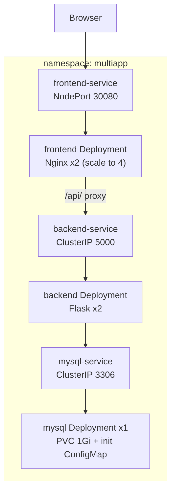
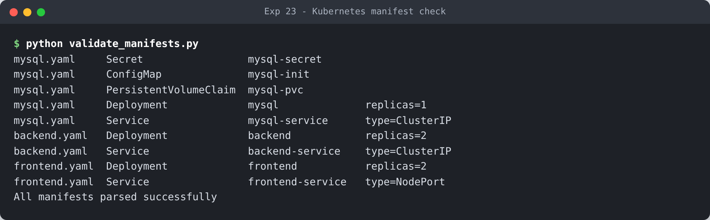

# Experiment 23: Multi-Container Application (Frontend, Backend, Database) On Kubernetes With Scaling

 

> **Course:** CSA10 - Software Engineering &nbsp;|&nbsp; **Tools used:** Docker, Kubernetes &nbsp;|&nbsp; **Course outcome:** CO3

---

## Problem Statement


Deploy a Multi-Container Application on Kubernetes.

**Tasks:**

- Create a multi-container application with a frontend, backend and database.
- Define a Kubernetes YAML file for deployment and services.
- Deploy the application using kubectl commands.
- Monitor the pods and services status.
- Scale the frontend container to handle increased load.
- Submit YAML files and screenshots of the Kubernetes dashboard.

## Aim


To deploy a multi-container application consisting of a frontend, a backend API and a database on Kubernetes using YAML files, monitor pods and services, and scale the frontend to handle increased load.


## Software / Tools Required

- Docker
- Kubernetes – Minikube or Docker Desktop Kubernetes
- kubectl
- Kubernetes Dashboard (minikube dashboard)

## Theory


Real applications are made of several cooperating services. In Kubernetes each tier runs in its own Deployment and communicates through Services using DNS names (for example, the backend reaches the database at mysql-service:3306).

- **Frontend** – Nginx serving the web UI; exposed outside the cluster with a NodePort service.
- **Backend** – Flask/Node.js REST API; exposed inside the cluster with a ClusterIP service.
- **Database** – MySQL with credentials passed through a Secret and data stored in a PersistentVolumeClaim.
- **Scaling** – kubectl scale changes the replica count manually; a HorizontalPodAutoscaler (HPA) changes it automatically based on CPU usage.
- **Monitoring** – kubectl get pods/svc/deploy, kubectl describe, kubectl logs and the Kubernetes Dashboard.

## Diagram

<p align="center"><br><sub><em>Three-tier application on Kubernetes</em></sub></p>

<sub>Source: [`diagrams/architecture.mmd`](diagrams/architecture.mmd) (Mermaid)</sub>

## Procedure


### Step 1: Start the Cluster and Create a Namespace

```bash
minikube start --cpus=2 --memory=4096
minikube addons enable metrics-server
kubectl create namespace multiapp
kubectl config set-context --current --namespace=multiapp
```

- Application architecture: Browser → frontend (Nginx, NodePort 30080) → backend (Flask, ClusterIP 5000) → mysql (ClusterIP 3306).

### Step 2: Create the Backend and Frontend Images

- Backend – a Flask API that reads from MySQL:

**`backend/app.py`**

```python
from flask import Flask, jsonify
import os, mysql.connector

app = Flask(__name__)

def db():
    return mysql.connector.connect(
        host=os.environ["DB_HOST"], user="root",
        password=os.environ["DB_PASSWORD"], database="college")

@app.route("/api/students")
def students():
    con = db(); cur = con.cursor(dictionary=True)
    cur.execute("SELECT id, name, dept FROM students")
    rows = cur.fetchall(); con.close()
    return jsonify(rows)

if __name__ == "__main__":
    app.run(host="0.0.0.0", port=5000)
```

**`backend/Dockerfile`**

```
FROM python:3.11-slim
WORKDIR /app
RUN pip install flask mysql-connector-python
COPY app.py .
CMD ["python", "app.py"]
```

- Frontend – Nginx serving index.html and forwarding /api to the backend service:

**`frontend/default.conf`**

```nginx
server {
  listen 80;
  location / { root /usr/share/nginx/html; index index.html; }
  location /api/ { proxy_pass http://backend-service:5000; }
}
```

**`frontend/index.html`**

```html
<h2>Student List</h2><ul id="list"></ul>
<script>
fetch('/api/students').then(r => r.json()).then(d =>
  d.forEach(s => list.innerHTML += `<li>${s.id} - ${s.name} (${s.dept})</li>`));
</script>
```

**`frontend/Dockerfile`**

```
FROM nginx:alpine
COPY default.conf /etc/nginx/conf.d/default.conf
COPY index.html /usr/share/nginx/html/index.html
```

- Build and push both images:

```bash
docker build -t <dockerhub-username>/k8s-backend:1.0 backend
docker build -t <dockerhub-username>/k8s-frontend:1.0 frontend
docker push <dockerhub-username>/k8s-backend:1.0
docker push <dockerhub-username>/k8s-frontend:1.0
```

### Step 3: Define the Database (Secret, ConfigMap, PVC, Deployment, Service)

**`mysql.yaml`**

```yaml
apiVersion: v1
kind: Secret
metadata: { name: mysql-secret }
type: Opaque
stringData: { MYSQL_ROOT_PASSWORD: "root123" }
---
apiVersion: v1
kind: ConfigMap
metadata: { name: mysql-init }
data:
  init.sql: |
    CREATE DATABASE IF NOT EXISTS college;
    USE college;
    CREATE TABLE students (id INT PRIMARY KEY, name VARCHAR(50), dept VARCHAR(10));
    INSERT INTO students VALUES (1,'Arun','CSE'),(2,'Divya','IT'),(3,'Kavin','ECE');
---
apiVersion: v1
kind: PersistentVolumeClaim
metadata: { name: mysql-pvc }
spec:
  accessModes: [ "ReadWriteOnce" ]
  resources: { requests: { storage: 1Gi } }
---
apiVersion: apps/v1
kind: Deployment
metadata: { name: mysql }
spec:
  replicas: 1
  selector: { matchLabels: { app: mysql } }
  template:
    metadata: { labels: { app: mysql } }
    spec:
      containers:
        - name: mysql
          image: mysql:8.0
          envFrom: [ { secretRef: { name: mysql-secret } } ]
          ports: [ { containerPort: 3306 } ]
          volumeMounts:
            - { name: data, mountPath: /var/lib/mysql }
            - { name: init, mountPath: /docker-entrypoint-initdb.d }
      volumes:
        - { name: data, persistentVolumeClaim: { claimName: mysql-pvc } }
        - { name: init, configMap: { name: mysql-init } }
---
apiVersion: v1
kind: Service
metadata: { name: mysql-service }
spec:
  selector: { app: mysql }
  ports: [ { port: 3306 } ]
```

### Step 4: Define the Backend Deployment and Service

**`backend.yaml`**

```yaml
apiVersion: apps/v1
kind: Deployment
metadata: { name: backend }
spec:
  replicas: 2
  selector: { matchLabels: { app: backend } }
  template:
    metadata: { labels: { app: backend } }
    spec:
      containers:
        - name: backend
          image: <dockerhub-username>/k8s-backend:1.0
          ports: [ { containerPort: 5000 } ]
          env:
            - { name: DB_HOST, value: mysql-service }
            - name: DB_PASSWORD
              valueFrom: { secretKeyRef: { name: mysql-secret, key: MYSQL_ROOT_PASSWORD } }
---
apiVersion: v1
kind: Service
metadata: { name: backend-service }
spec:
  selector: { app: backend }
  ports: [ { port: 5000, targetPort: 5000 } ]
```

### Step 5: Define the Frontend Deployment and Service

**`frontend.yaml`**

```yaml
apiVersion: apps/v1
kind: Deployment
metadata: { name: frontend }
spec:
  replicas: 2
  selector: { matchLabels: { app: frontend } }
  template:
    metadata: { labels: { app: frontend } }
    spec:
      containers:
        - name: frontend
          image: <dockerhub-username>/k8s-frontend:1.0
          ports: [ { containerPort: 80 } ]
          resources: { requests: { cpu: "50m" }, limits: { cpu: "200m" } }
---
apiVersion: v1
kind: Service
metadata: { name: frontend-service }
spec:
  type: NodePort
  selector: { app: frontend }
  ports: [ { port: 80, targetPort: 80, nodePort: 30080 } ]
```

### Step 6: Deploy the Application using kubectl

```bash
kubectl apply -f mysql.yaml
kubectl apply -f backend.yaml
kubectl apply -f frontend.yaml
kubectl get all
```

- Wait until all pods show STATUS Running (MySQL may take about a minute to initialise).

### Step 7: Access and Monitor the Application

```bash
minikube service frontend-service -n multiapp --url
kubectl get pods -o wide
kubectl get svc
kubectl describe deployment frontend
kubectl logs deploy/backend
minikube dashboard
```

- Open the frontend URL – the Student List fetched from MySQL through the backend is displayed.
- In the Kubernetes Dashboard view Workloads → Deployments, Pods and Services.

### Step 8: Scale the Frontend

- Manual scaling to handle increased load:

```bash
kubectl scale deployment frontend --replicas=4
kubectl get pods -l app=frontend
```

- Automatic scaling using a Horizontal Pod Autoscaler (optional):

```bash
kubectl autoscale deployment frontend --cpu-percent=50 --min=2 --max=6
kubectl get hpa
```

- Verify in the Dashboard that the frontend deployment now has four pods.

## Code

All source files for this experiment are in the [`code/`](code/) folder:

- [`multiapp/backend.yaml`](code/multiapp/backend.yaml)
- [`multiapp/backend/Dockerfile`](code/multiapp/backend/Dockerfile)
- [`multiapp/backend/app.py`](code/multiapp/backend/app.py)
- [`multiapp/frontend.yaml`](code/multiapp/frontend.yaml)
- [`multiapp/frontend/Dockerfile`](code/multiapp/frontend/Dockerfile)
- [`multiapp/frontend/default.conf`](code/multiapp/frontend/default.conf)
- [`multiapp/frontend/index.html`](code/multiapp/frontend/index.html)
- [`multiapp/mysql.yaml`](code/multiapp/mysql.yaml)
- [`multiapp/validate_manifests.py`](code/multiapp/validate_manifests.py)

## Output

Output captured by running the code in [`code/`](code/) (terminal text is also saved in [`output/`](output/)).

<p align="center"><br><sub><em>All three manifests parse: 3 Deployments, 3 Services, Secret, ConfigMap, PVC</em></sub></p>

### Screenshots to attach from your own machine

These steps need your own Docker / Docker Hub / Kubernetes / Jenkins / cloud account. Capture each screenshot and save it in [`screenshots/`](screenshots/) with the suggested name.

- [ ] `step-01.png` - kubectl get all
- [ ] `step-02.png` - frontend page and Kubernetes Dashboard
- [ ] `step-03.png` - four frontend pods after scaling / HPA status

### Expected Output

- kubectl get all shows the mysql, backend and frontend deployments and services in Running state.
- The frontend opens through the NodePort and displays data fetched from the backend, which reads from MySQL.
- After kubectl scale deployment frontend --replicas=4, four frontend pods are Running; the Dashboard shows the updated deployment.

## Result


Thus a multi-container application with frontend, backend and database was deployed on Kubernetes, its pods and services were monitored, and the frontend was scaled to handle increased load.


## Viva Voce Questions

1. **How do pods of different tiers find each other?**
   **Ans:** Through Kubernetes Services and cluster DNS names.

2. **What is a Secret?**
   **Ans:** An object that stores sensitive data such as passwords in base64-encoded form.

3. **What is a PersistentVolumeClaim?**
   **Ans:** A request for storage that keeps data even when the pod restarts.

4. **Differentiate manual scaling and HPA.**
   **Ans:** Manual scaling uses kubectl scale; HPA scales automatically based on metrics like CPU.

5. **Which service type is used for the database?**
   **Ans:** ClusterIP, since it should be reachable only inside the cluster.


---
[Back to all experiments](../README.md)
