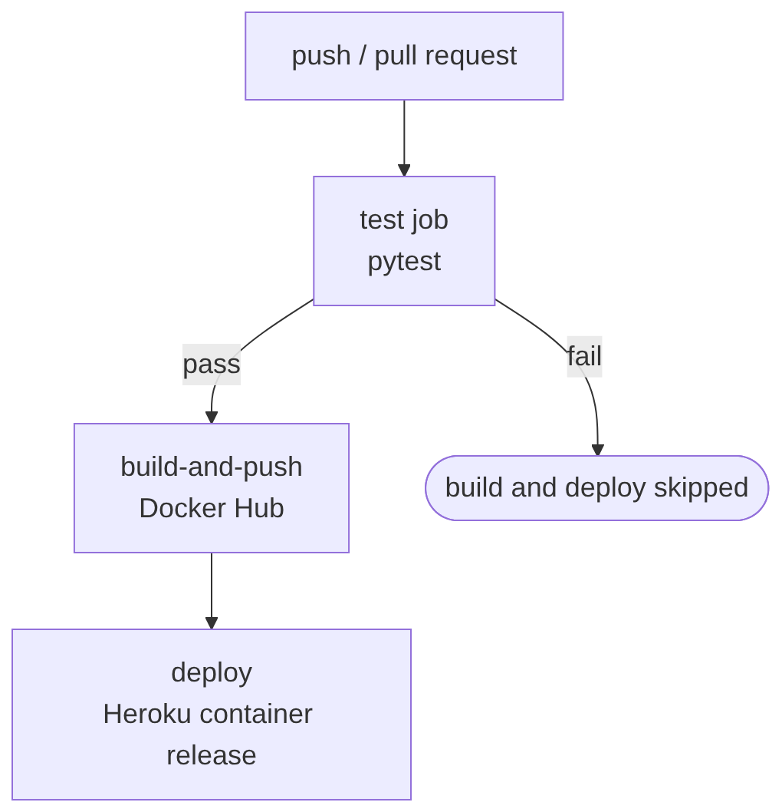
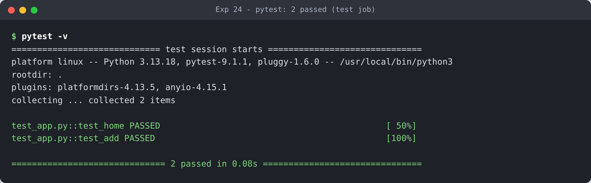
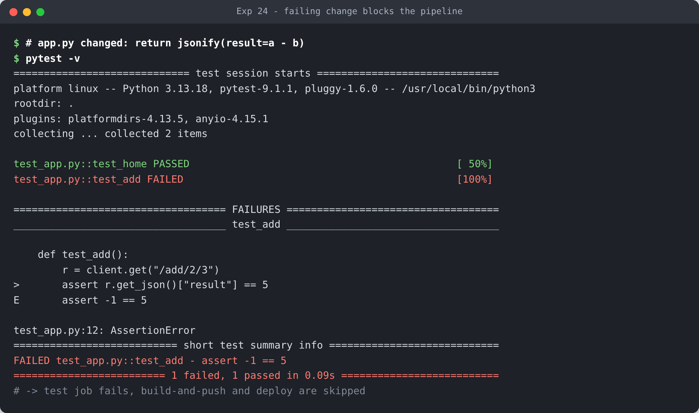

# Experiment 24: CI/CD Pipeline For A Flask Application Using GitHub Actions With Cloud Deployment

 

> **Course:** CSA10 - Software Engineering &nbsp;|&nbsp; **Tools used:** GitHub Actions, Docker &nbsp;|&nbsp; **Course outcome:** CO3

---

## Problem Statement


Create a CI/CD Pipeline Using GitHub Actions

**Tasks:**

- Set up a GitHub repository for a containerized Flask application.
- Define a GitHub Actions workflow file to automate testing and deployment.
- Add steps to build, test, and push Docker images to Docker Hub.
- Deploy the application to a cloud platform (Heroku/AWS).
- Submit the workflow file and deployment link.

## Aim


To create a CI/CD pipeline with GitHub Actions for a containerized Flask application that automatically tests the code, builds and pushes the Docker image to Docker Hub and deploys the application to a cloud platform (Heroku / AWS).


## Software / Tools Required

- GitHub and GitHub Actions
- Python 3, Flask, pytest
- Docker and Docker Hub
- Heroku account (or AWS / Render)

## Theory


A complete CI/CD pipeline has three parts:

- **Continuous Integration** – on every push or pull request, install dependencies and run automated unit tests (pytest).
- **Continuous Delivery** – if tests pass, build the Docker image and push it to a registry (Docker Hub).
- **Continuous Deployment** – release the new image to the cloud platform automatically (Heroku Container Registry, AWS ECS/App Runner, Render).

Jobs can depend on each other with the **needs** keyword, so the deploy job runs only after the test and build jobs succeed. Sensitive values such as DOCKERHUB_TOKEN and HEROKU_API_KEY are stored as repository secrets.

Heroku runs containers that listen on the port given in the PORT environment variable, so the app reads os.environ.get("PORT").


## Diagram

<p align="center"><br><sub><em>CI/CD pipeline with test gate</em></sub></p>

<sub>Source: [`diagrams/cicd-pipeline.mmd`](diagrams/cicd-pipeline.mmd) (Mermaid)</sub>

## Procedure


### Step 1: Set Up the Repository and Flask Application

- Create a GitHub repository flask-cicd-actions with the following files.

**`app.py`**

```python
from flask import Flask, jsonify
import os

app = Flask(__name__)

@app.route("/")
def home():
    return jsonify(message="Flask CI/CD with GitHub Actions", status="running")

@app.route("/add/<int:a>/<int:b>")
def add(a, b):
    return jsonify(result=a + b)

if __name__ == "__main__":
    app.run(host="0.0.0.0", port=int(os.environ.get("PORT", 5000)))
```

**`test_app.py`**

```python
from app import app

client = app.test_client()

def test_home():
    r = client.get("/")
    assert r.status_code == 200
    assert r.get_json()["status"] == "running"

def test_add():
    r = client.get("/add/2/3")
    assert r.get_json()["result"] == 5
```

**`requirements.txt`**

```text
flask==3.0.3
gunicorn==22.0.0
pytest==8.2.0
```

**`Dockerfile`**

```dockerfile
FROM python:3.11-slim
WORKDIR /app
COPY requirements.txt .
RUN pip install --no-cache-dir -r requirements.txt
COPY . .
ENV PORT=5000
EXPOSE 5000
CMD gunicorn -b 0.0.0.0:$PORT app:app
```

- Run the tests locally once: pip install -r requirements.txt && pytest -q

### Step 2: Create the Cloud Application and Secrets

- Heroku: create an app (Dashboard → New → Create new app, e.g. flask-cicd-<rollno>) and copy the API key from Account settings.
- (Heroku requires a verified/paid account; AWS App Runner or Render can be used as alternatives.)
- In GitHub → Settings → Secrets and variables → Actions add: DOCKERHUB_USERNAME, DOCKERHUB_TOKEN, HEROKU_API_KEY, HEROKU_APP_NAME.

### Step 3: Define the GitHub Actions Workflow

- Create .github/workflows/ci-cd.yml:

**`.github/workflows/ci-cd.yml`**

```yaml
name: Flask CI/CD

on:
  push:
    branches: [ "main" ]
  pull_request:
    branches: [ "main" ]

jobs:
  test:
    runs-on: ubuntu-latest
    steps:
      - uses: actions/checkout@v4
      - uses: actions/setup-python@v5
        with:
          python-version: "3.11"
      - name: Install dependencies
        run: pip install -r requirements.txt
      - name: Run unit tests
        run: pytest -v

  build-and-push:
    needs: test
    if: github.event_name == 'push'
    runs-on: ubuntu-latest
    steps:
      - uses: actions/checkout@v4
      - uses: docker/login-action@v3
        with:
          username: ${{ secrets.DOCKERHUB_USERNAME }}
          password: ${{ secrets.DOCKERHUB_TOKEN }}
      - uses: docker/build-push-action@v6
        with:
          context: .
          push: true
          tags: ${{ secrets.DOCKERHUB_USERNAME }}/flask-cicd:latest

  deploy:
    needs: build-and-push
    runs-on: ubuntu-latest
    steps:
      - uses: actions/checkout@v4
      - name: Deploy container to Heroku
        env:
          HEROKU_API_KEY: ${{ secrets.HEROKU_API_KEY }}
        run: |
          heroku container:login
          heroku container:push web -a ${{ secrets.HEROKU_APP_NAME }}
          heroku container:release web -a ${{ secrets.HEROKU_APP_NAME }}
```

### Step 4: Push the Code and Trigger the Pipeline

```bash
git add .
git commit -m "Add Flask app with CI/CD workflow"
git push origin main
```

- Open the Actions tab – jobs test, build-and-push and deploy run one after another.

### Step 5: Verify Testing, Image and Deployment

- Open the test job log – pytest shows 2 passed.
- Docker Hub shows <dockerhub-username>/flask-cicd:latest.
- Open https://<app-name>.herokuapp.com – the JSON message “Flask CI/CD with GitHub Actions” is displayed; /add/2/3 returns 5.

### Step 6: Test the Pipeline with a Failing and a Passing Change

- Change the add route to return a - b and push – the test job fails and build/deploy are skipped, protecting production.
- Fix the code and push again – the full pipeline succeeds and the new version is deployed.
- Submit the workflow file and the deployment link.

## Code

All source files for this experiment are in the [`code/`](code/) folder:

- [`flask-cicd-actions/.github/workflows/ci-cd.yml`](code/flask-cicd-actions/.github/workflows/ci-cd.yml)
- [`flask-cicd-actions/Dockerfile`](code/flask-cicd-actions/Dockerfile)
- [`flask-cicd-actions/app.py`](code/flask-cicd-actions/app.py)
- [`flask-cicd-actions/requirements.txt`](code/flask-cicd-actions/requirements.txt)
- [`flask-cicd-actions/test_app.py`](code/flask-cicd-actions/test_app.py)

## Output

Output captured by running the code in [`code/`](code/) (terminal text is also saved in [`output/`](output/)).

<p align="center"><br><sub><em><code>pytest</code> - 2 passed (the <code>test</code> job)</em></sub></p>

<p align="center"><br><sub><em>A failing change stops the pipeline before build and deploy</em></sub></p>

### Screenshots to attach from your own machine

These steps need your own Docker / Docker Hub / Kubernetes / Jenkins / cloud account. Capture each screenshot and save it in [`screenshots/`](screenshots/) with the suggested name.

- [ ] `step-01.png` - repository secrets
- [ ] `step-02.png` - workflow graph with all three jobs successful
- [ ] `step-03.png` - pytest log, Docker Hub image and deployed application
- [ ] `step-04.png` - failed run and successful re-run

### Expected Output

- Actions run shows jobs test → build-and-push → deploy completed successfully.
- pytest reports 2 passed.
- Docker Hub shows the new image; the deployment link (e.g. https://<app-name>.herokuapp.com) displays the Flask application.

## Result


Thus a CI/CD pipeline was created with GitHub Actions that tests, builds and pushes the Docker image of the Flask application and deploys it to the cloud automatically.


## Viva Voce Questions

1. **What does the needs keyword do?**
   **Ans:** Makes a job wait for the successful completion of another job.

2. **Why are tests run before building the image?**
   **Ans:** To prevent broken code from being packaged and deployed.

3. **How does Heroku know which port to use?**
   **Ans:** It sets the PORT environment variable that the app must listen on.

4. **What is pytest?**
   **Ans:** A Python testing framework for writing and running unit tests.

5. **What triggers this workflow?**
   **Ans:** A push or pull request to the main branch (and optionally manual dispatch).


---
[Back to all experiments](../README.md)
