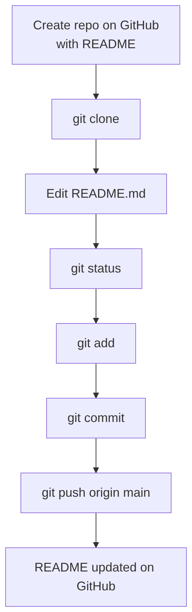
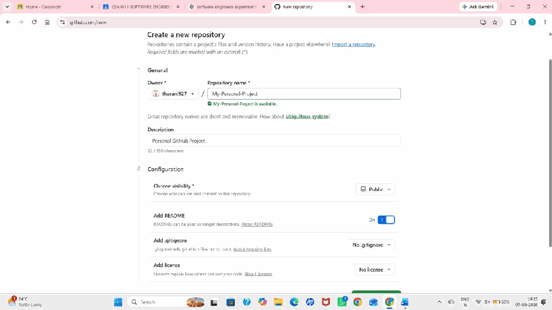
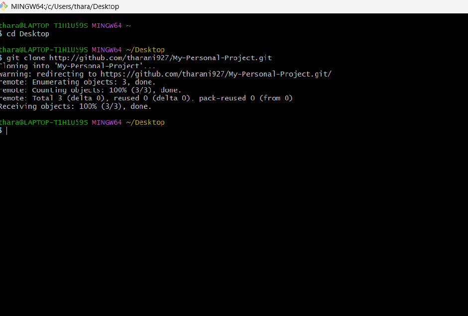
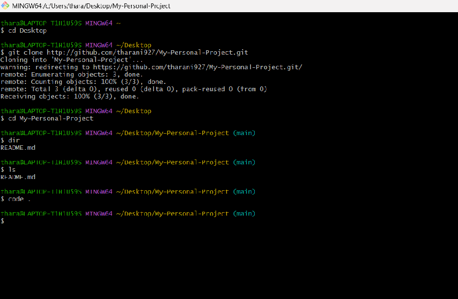
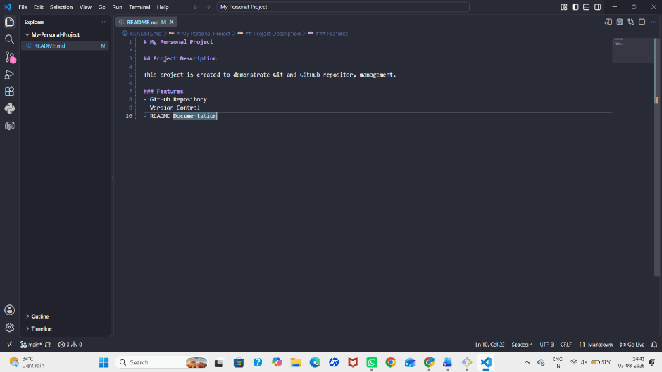
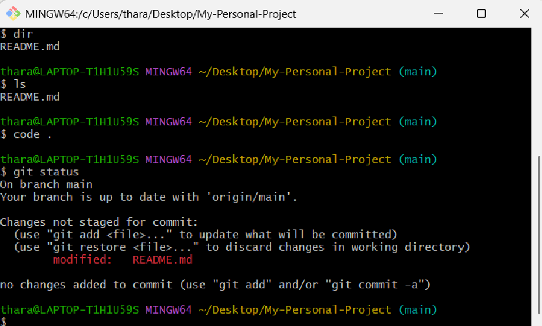
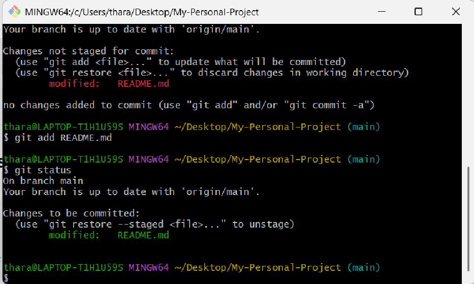
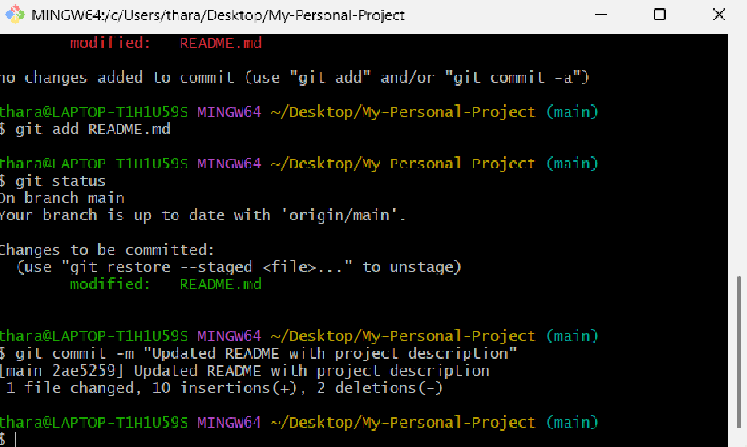
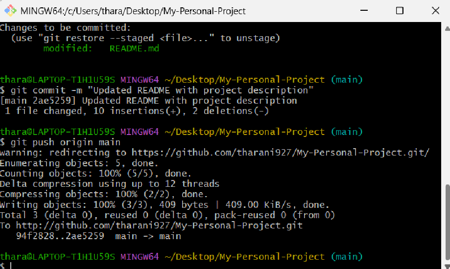
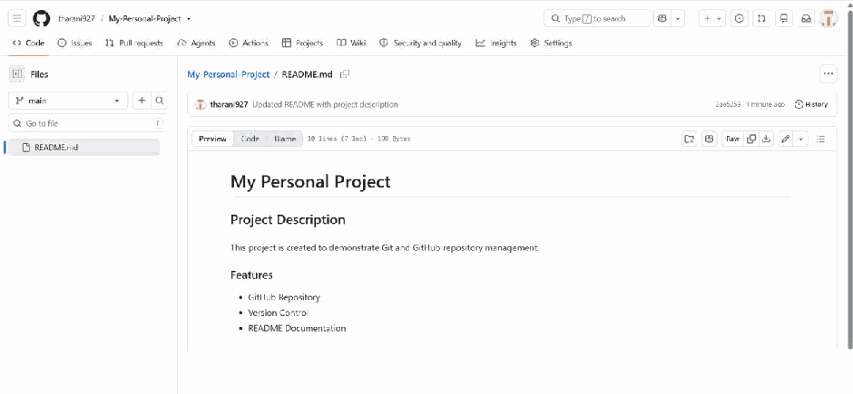

# Experiment 25: Creating A GitHub Repository And Pushing A Readme File

 

> **Course:** CSA10 - Software Engineering &nbsp;|&nbsp; **Tools used:** Git/GitHub &nbsp;|&nbsp; **Course outcome:** CO3

---

## Problem Statement


Create a new GitHub repository for a personal project. Initialize the repository with a README.md file. Then, clone the repository to your local machine, make some changes to the README.md (e.g., add a project description), and push the changes back to GitHub.

**Tasks:**

- Create a GitHub repository.
- Clone the repository to your local machine.
- Edit the README.md file.
- Stage, commit, and push your changes to GitHub.

## Aim


To create a new GitHub repository for a personal project, clone it, add a project description to the README.md file, and commit and push the changes to GitHub.


## Software / Tools Required

- Git (Git Bash)
- GitHub account
- Visual Studio Code

## Theory


Git stores the history of a project as a series of commits. Every file passes through three areas:

- **Working directory** – where files are edited.
- **Staging area (index)** – where changes are prepared with git add.
- **Repository** – where git commit permanently records the snapshot.

A remote (origin) is the copy of the repository on GitHub; git push uploads local commits to it.

| Command | Purpose |
|---|---|
| git clone <url> | Copy a remote repository locally |
| git status | Show the state of files |
| git add <file> | Stage changes |
| git commit -m "msg" | Record a snapshot |
| git push origin main | Upload commits to GitHub |

README.md is written in Markdown and is displayed on the repository home page.


## Diagram

<p align="center"><br><sub><em>Create, edit and push</em></sub></p>

<sub>Source: [`diagrams/git-flow.mmd`](diagrams/git-flow.mmd) (Mermaid)</sub>

## Procedure


### Step 1: Create a GitHub Repository

- Open the GitHub website and sign in to your GitHub account.
- Click New Repository and enter a suitable repository name.
- Select the repository visibility as Public or Private.
- Enable the Add a README.md file option.
- Click Create Repository to create the new repository.

<p align="center"><br><sub><em>Figure 25.1 – Create a GitHub Repository</em></sub></p>

### Step 2: Clone the Repository to the Local Machine

- Open the newly created repository on GitHub.
- Click the Code button and copy the HTTPS repository URL.
- Open Git Bash and clone the repository using the following command:

```bash
git clone https://github.com/username/My-Personal-Project.git
```

- Move into the repository folder using:

```bash
cd My-Personal-Project
```

<p align="center"><br><sub><em>Figure 25.2 – Clone the Repository to the Local Machine</em></sub></p>

<p align="center"><br><sub><em>Figure 25.3 – Clone the Repository to the Local Machine</em></sub></p>

### Step 3: Open and Edit the README File

- Open the project folder in Visual Studio Code using: code .
- Open the README.md file.
- Add a brief description of the project, including its purpose and features.
- Save the modified file.

<p align="center"><br><sub><em>Figure 25.4 – Open and Edit the README File</em></sub></p>

### Step 4: Check the Repository Status

- Verify the modified files using the following command:

```bash
git status
```

- Ensure that the README.md file is displayed as modified.

<p align="center"><br><sub><em>Figure 25.5 – Check the Repository Status</em></sub></p>

### Step 5: Stage the Changes

- Add the modified README file to the staging area using:

```bash
git add README.md
```

- Verify that the file has been staged successfully by executing:

```bash
git status
```

<p align="center"><br><sub><em>Figure 25.6 – Stage the Changes</em></sub></p>

### Step 6: Commit the Changes

- Commit the staged changes with a meaningful commit message using:

```bash
git commit -m "Updated README with project description"
```

- Verify that the commit has been created successfully.

<p align="center"><br><sub><em>Figure 25.7 – Commit the Changes</em></sub></p>

### Step 7: Push the Changes to GitHub

- Upload the committed changes to the remote GitHub repository using:

```bash
git push origin main
```

- Wait until the push operation completes successfully.

<p align="center"><br><sub><em>Figure 25.8 – Push the Changes to GitHub</em></sub></p>

### Step 8: Verify the Repository

- Refresh the GitHub repository page.
- Verify that the updated README.md file is displayed.

<p align="center"><br><sub><em>Figure 25.9 – Verify the Repository</em></sub></p>


## Output

Lab screenshots from the original run are in [`screenshots/`](screenshots/) (9 images, shown in the Procedure above).

### Expected Output

- Repository My-Personal-Project created on GitHub with a README.
- git commit shows “1 file changed” and git push shows main -> main.
- The GitHub page displays the updated README with the project description.

## Result


Thus a new GitHub repository was created, the README file was updated with the project description, and the changes were committed and pushed to GitHub successfully.


## Viva Voce Questions

1. **What is the staging area?**
   **Ans:** An intermediate area where changes are prepared before committing.

2. **What is origin?**
   **Ans:** The default name of the remote repository from which the project was cloned.

3. **What is Markdown?**
   **Ans:** A lightweight markup language used for README files (# for headings, - for lists).

4. **What is the difference between Git and GitHub?**
   **Ans:** Git is the version control tool; GitHub is a hosting service for Git repositories.

5. **How do you see commit history?**
   **Ans:** git log or git log --oneline.


---
[Back to all experiments](../README.md)
