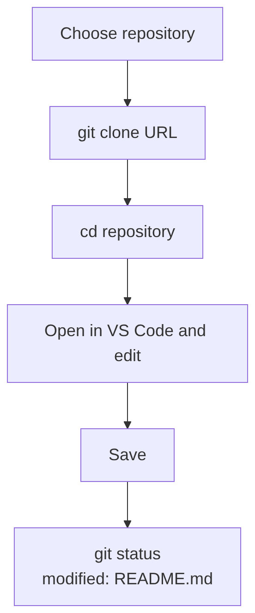
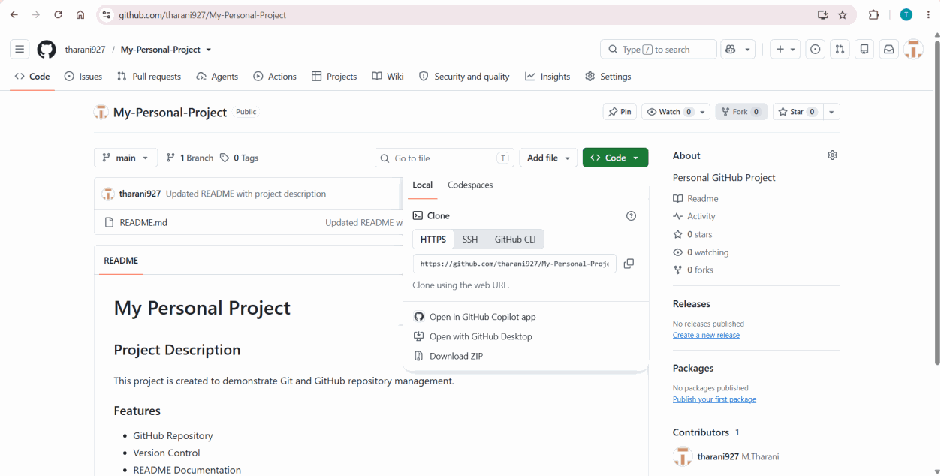
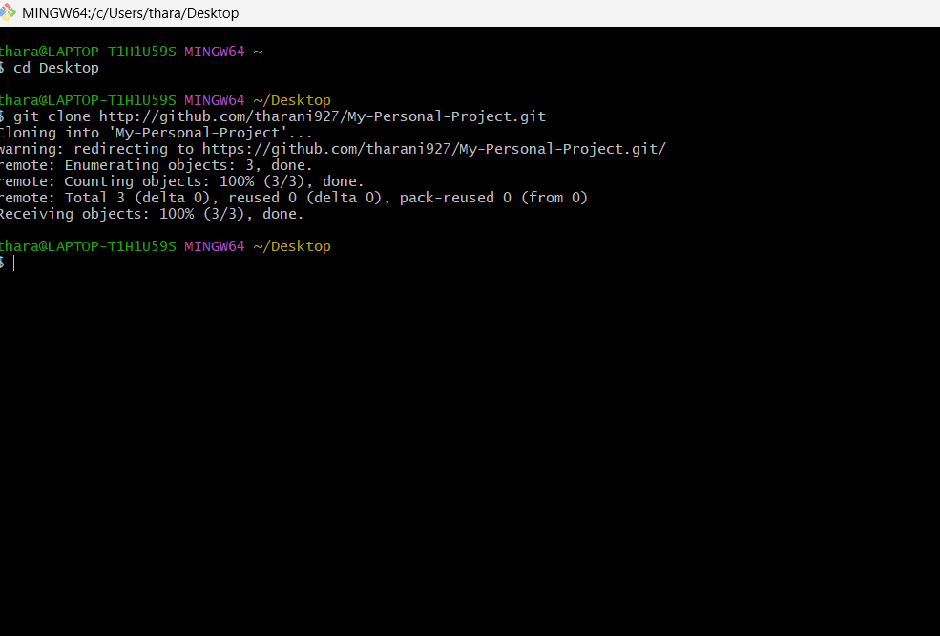
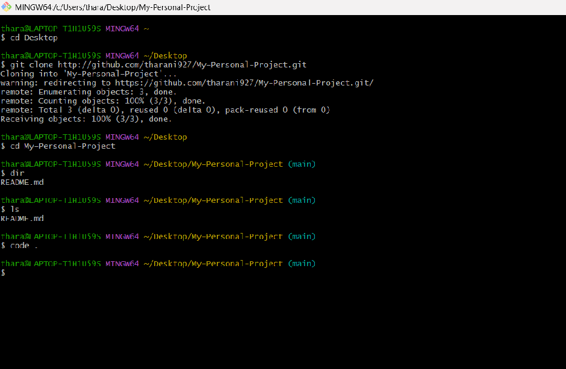
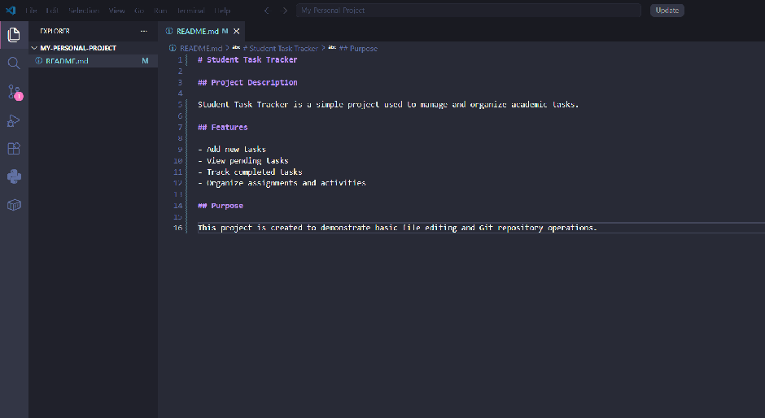
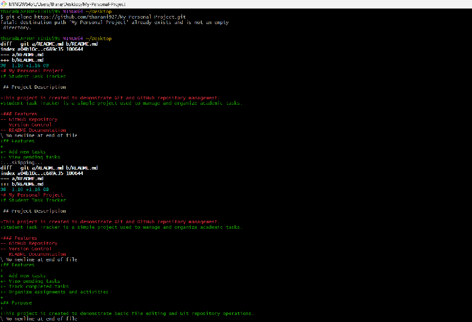

# Experiment 26: Cloning A GitHub Repository And Editing Files Locally

 

> **Course:** CSA10 - Software Engineering &nbsp;|&nbsp; **Tools used:** Git/GitHub &nbsp;|&nbsp; **Course outcome:** CO3

---

## Problem Statement


Clone an existing GitHub repository to your local machine and make a small change in one of the files.

**Tasks:**

- Choose an existing public GitHub repository (e.g., your own or a sample repository).
- Clone the repository to your local machine using git clone
- <repository_url>.
- Navigate into the cloned repository directory and open one of the files.
- Make a small edit, such as modifying a line of text or fixing a typo.
- Save your changes.

## Aim


To clone an existing GitHub repository to the local machine, navigate into it, open it in an editor and modify a file.


## Software / Tools Required

- Git (Git Bash)
- GitHub
- Visual Studio Code

## Theory


Cloning creates a full local copy of a remote repository, including all files, branches and the complete commit history. The cloned repository is automatically linked to the remote with the name origin.

- **HTTPS URL** – https://github.com/<user>/<repo>.git (uses username + personal access token).
- **SSH URL** – git@github.com:<user>/<repo>.git (uses SSH keys).

After editing, git status shows the file as modified (red) until it is staged. git diff shows the exact lines that were changed.


## Diagram

<p align="center"><br><sub><em>Clone and edit locally</em></sub></p>

<sub>Source: [`diagrams/git-flow.mmd`](diagrams/git-flow.mmd) (Mermaid)</sub>

## Procedure


### Step 1: Select a GitHub Repository

- Open the GitHub website and sign in to your account.
- Select an existing public repository (either your own repository or any public sample repository).
- Copy the HTTPS URL of the selected repository using the Code button.

<p align="center"><br><sub><em>Figure 26.1 – Select a GitHub Repository</em></sub></p>

### Step 2: Clone the Repository

- Open Git Bash or the terminal on your local machine.
- Clone the selected repository using the git clone command.
- Wait until the cloning process completes successfully.
- Verify that the repository has been downloaded to the local system.

```bash
git clone <repository_url>
```

<p align="center"><br><sub><em>Figure 26.2 – Clone the Repository</em></sub></p>

<p align="center"><br><sub><em>Figure 26.3 – Clone the Repository</em></sub></p>

### Step 3: Navigate to the Repository Directory

- Move into the cloned repository using the cd command.
- Verify that the repository files are available by listing the directory contents.

```bash
cd <repository_name>
```

### Step 4: Open the Repository and Modify the File

- Open the cloned repository in Visual Studio Code or any preferred code editor.
- Locate the file that needs to be modified, such as README.md or any source code file.

```bash
code .
```

- Open the selected file.
- Make a small modification, such as updating a line of text, correcting a spelling mistake, or adding a short description.
- Save the modified file.

<p align="center"><br><sub><em>Figure 26.4 – Open the Repository and Modify the File</em></sub></p>

### Step 5: Verify the Changes

- Return to Git Bash or the terminal.
- Check the repository status using the git status command.
- Verify that the modified file is displayed as changed.

```bash
git status
```

<p align="center"><br><sub><em>Figure 26.5 – Verify the Changes</em></sub></p>

### Step 6: Save the Updated File

- Ensure that all modifications have been saved successfully.
- Verify that the edited file is present in the local repository.

## Output

Lab screenshots from the original run are in [`screenshots/`](screenshots/) (5 images, shown in the Procedure above).

### Expected Output

- git clone reports “Cloning into 'My-Personal-Project'… done.”
- ls lists the repository files; README.md opens in VS Code.
- After editing and saving, git status shows modified: README.md.

## Result


Thus an existing GitHub repository was cloned to the local machine and a file was opened and modified successfully.


## Viva Voce Questions

1. **What does git clone copy?**
   **Ans:** All files, branches and the full history of the repository.

2. **What is git remote -v?**
   **Ans:** A command that lists the remote URLs for fetch and push.

3. **Which command shows the changes made to a file?**
   **Ans:** git diff.

4. **Differentiate HTTPS and SSH cloning.**
   **Ans:** HTTPS uses a token for authentication; SSH uses a key pair.

5. **Can you clone a private repository?**
   **Ans:** Yes, if you have access and authenticate.


---
[Back to all experiments](../README.md)
