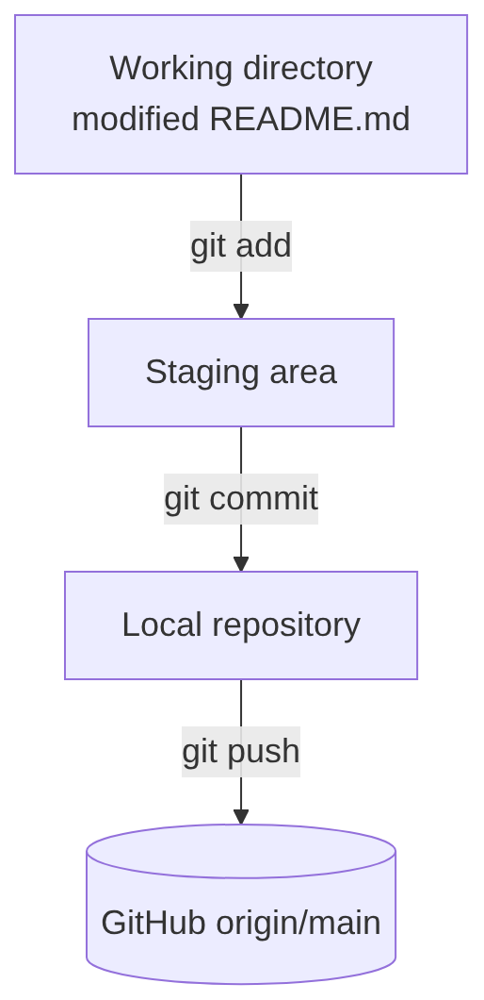
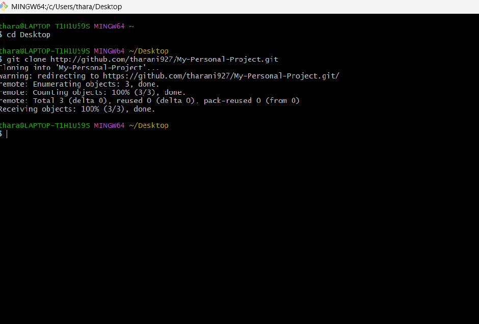
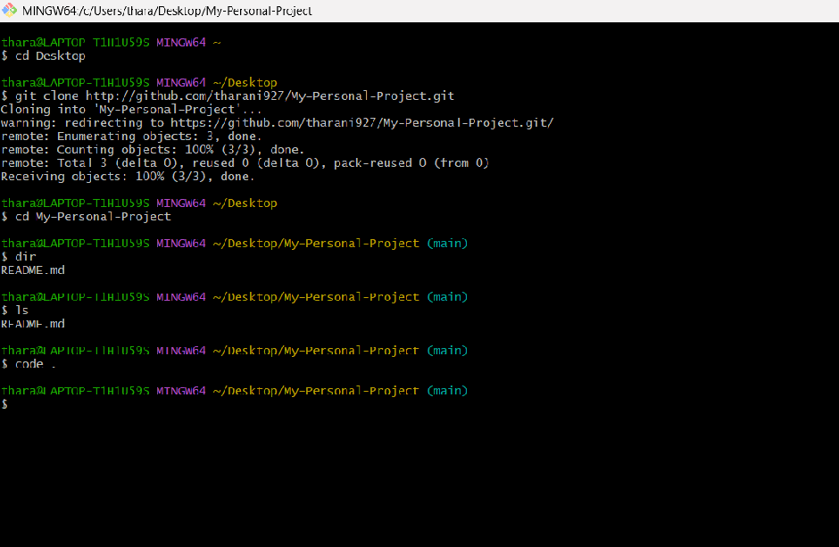
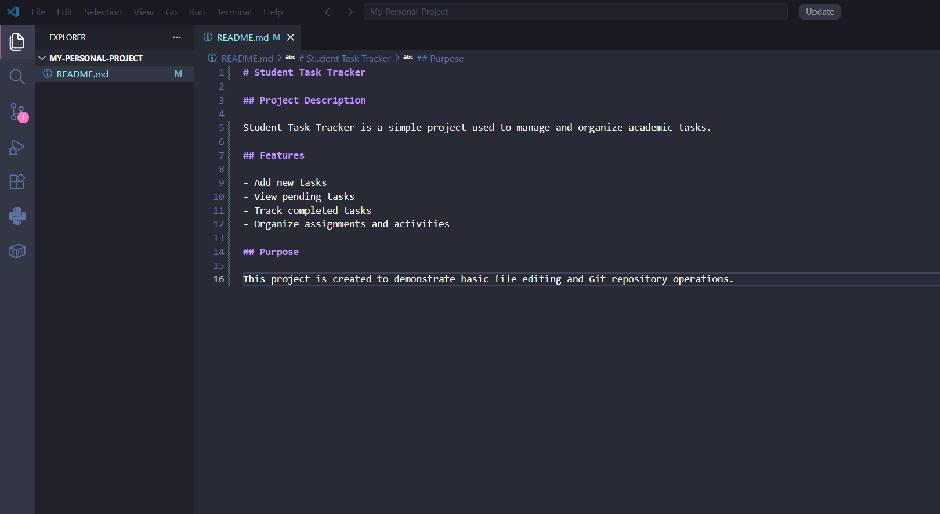
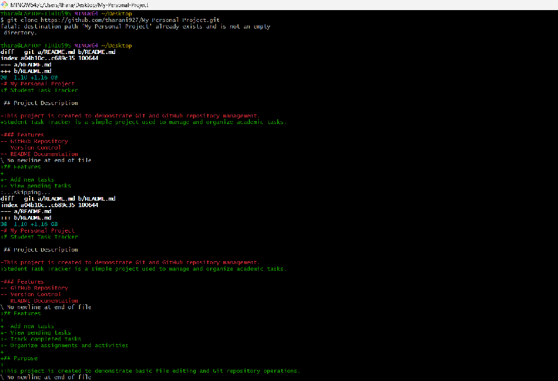
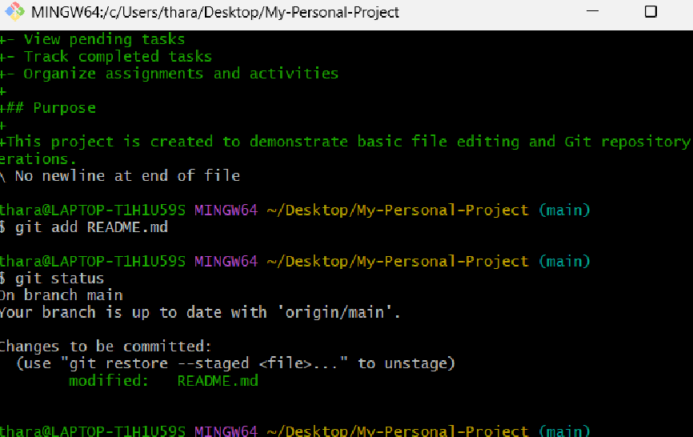
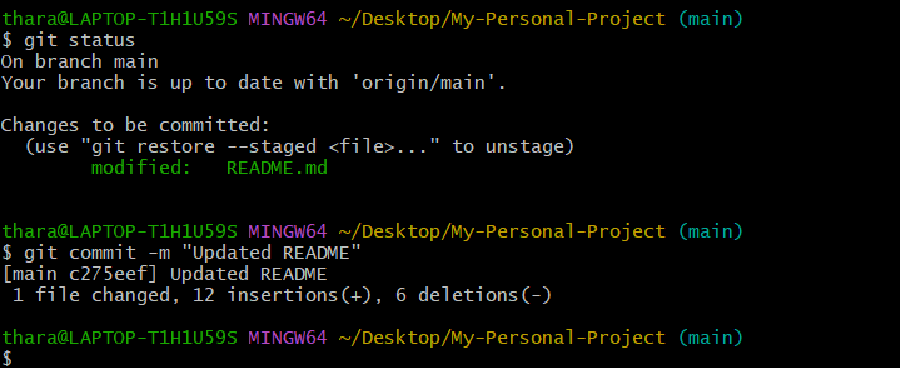
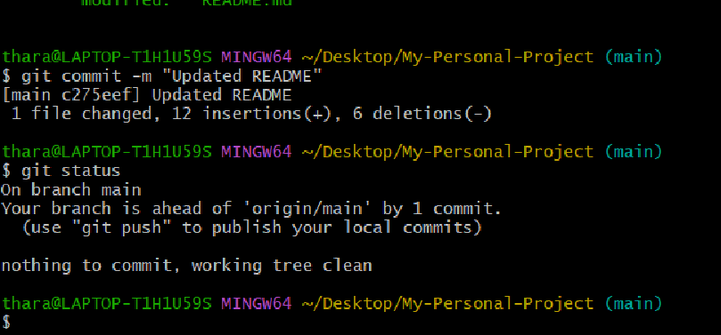
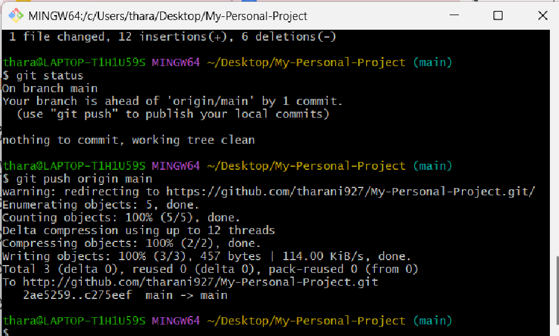
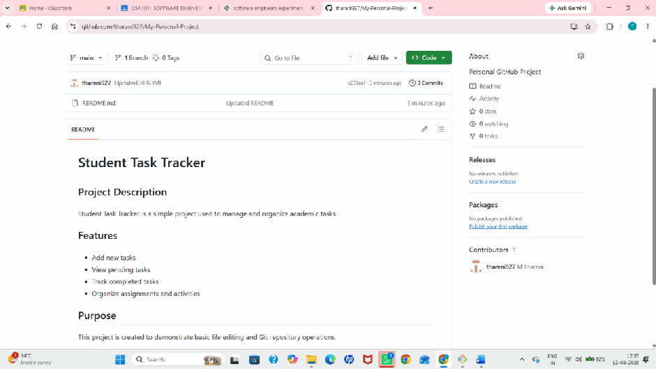

# Experiment 27: Committing And Pushing Changes To GitHub

 

> **Course:** CSA10 - Software Engineering &nbsp;|&nbsp; **Tools used:** Git/GitHub &nbsp;|&nbsp; **Course outcome:** CO4

---

## Problem Statement


After modifying a file in a cloned repository, commit the changes locally and push them to GitHub.

**Tasks:**

- Clone a repository (from question 1).
- Modify a file (e.g., README.md).
- Stage the changes with git add.
- Commit the changes with git commit -m "Updated README".
- Push the changes to GitHub using git push.

## Aim


To modify a file in a cloned repository, stage and commit the changes with a meaningful message, and push them to the remote GitHub repository.


## Software / Tools Required

- Git (Git Bash)
- GitHub
- Visual Studio Code

## Theory


A commit is a snapshot of the staged changes along with author, date and a message. Good commit messages are short, written in the imperative mood and explain why the change was made, for example “Update README with project goals”.

After committing, the local branch is “ahead of origin/main by 1 commit”. git push sends these commits to GitHub so that collaborators can see them.

| Status message | Meaning |
|---|---|
| Changes not staged for commit | File modified but not added |
| Changes to be committed | File staged, ready to commit |
| Your branch is ahead of 'origin/main' by 1 commit | Committed locally, not yet pushed |
| nothing to commit, working tree clean | Everything committed and in sync |


## Diagram

<p align="center"><br><sub><em>Commit and push</em></sub></p>

<sub>Source: [`diagrams/git-flow.mmd`](diagrams/git-flow.mmd) (Mermaid)</sub>

## Procedure


### Step 1: Clone the Repository

- Open Git Bash on the local machine.
- Navigate to the location where the repository needs to be stored.
- Clone the GitHub repository using the git clone command.
- Wait for the cloning process to complete successfully.

```bash
git clone <repository_url>
```

<p align="center"><br><sub><em>Figure 27.1 – Clone the Repository</em></sub></p>

<p align="center"><br><sub><em>Figure 27.2 – Clone the Repository</em></sub></p>

### Step 2: Navigate to the Repository

- Move into the cloned repository directory using the cd command.
- List the repository files to verify that the repository was cloned successfully.

```bash
cd <repository_name>
ls
```

### Step 3: Open the Repository and Modify the File

- Open the cloned repository in Visual Studio Code or any preferred code editor.
- Locate the file that needs to be modified, such as README.md or any source code file.

```bash
code .
```

- Open the selected file.
- Make a small modification, such as updating a line of text, correcting a spelling mistake, or adding a short description.
- Save the modified file.

<p align="center"><br><sub><em>Figure 27.3 – Open the Repository and Modify the File</em></sub></p>

### Step 4: Check the Repository Status

- Return to Git Bash.
- Check the status of the repository to identify the modified file.

```bash
git status
```

- Verify that README.md is displayed as a modified file.

<p align="center"><br><sub><em>Figure 27.4 – Check the Repository Status</em></sub></p>

### Step 5: Stage the Changes

- Add the modified file to the staging area using git add.
- Verify that the file has been staged successfully.

```bash
git add README.md
git status
```

<p align="center"><br><sub><em>Figure 27.5 – Stage the Changes</em></sub></p>

### Step 6: Commit the Changes

- Commit the staged changes to the local Git repository.
- Provide a meaningful commit message describing the modification.

```bash
git commit -m "Updated README"
```

<p align="center"><br><sub><em>Figure 27.6 – Commit the Changes</em></sub></p>

### Step 7: Push the Changes to GitHub

- Upload the committed changes from the local repository to the GitHub remote repository using git push.

```bash
git push origin main
```

- Wait for the push operation to complete successfully.

<p align="center"><br><sub><em>Figure 27.7 – Push the Changes to GitHub</em></sub></p>

<p align="center"><br><sub><em>Figure 27.8 – Push the Changes to GitHub</em></sub></p>

### Step 8: Verify the Changes

- Open the GitHub repository in a web browser.
- Refresh the repository page.
- Open README.md and verify that the updated content is displayed.
- Check the commit history to confirm that the new commit has been added successfully.

<p align="center"><br><sub><em>Figure 27.9 – Verify the Changes</em></sub></p>


## Output

Lab screenshots from the original run are in [`screenshots/`](screenshots/) (9 images, shown in the Procedure above).

### Expected Output

- git commit -m "Updated README" shows 1 file changed.
- git status shows the branch ahead of origin/main by 1 commit; after git push it is up to date.
- The updated README is visible on GitHub with the new commit message.

## Result


Thus the changes made to the cloned repository were staged, committed and pushed to GitHub successfully.


## Viva Voce Questions

1. **What is a commit?**
   **Ans:** A snapshot of staged changes with metadata and a message.

2. **How do you change the last commit message?**
   **Ans:** git commit --amend -m "new message" (before pushing).

3. **What does “ahead of origin/main by 1 commit” mean?**
   **Ans:** There is one local commit not yet pushed.

4. **How do you stage all changed files?**
   **Ans:** git add . or git add -A.

5. **What is HEAD?**
   **Ans:** A pointer to the current branch’s latest commit.


---
[Back to all experiments](../README.md)
