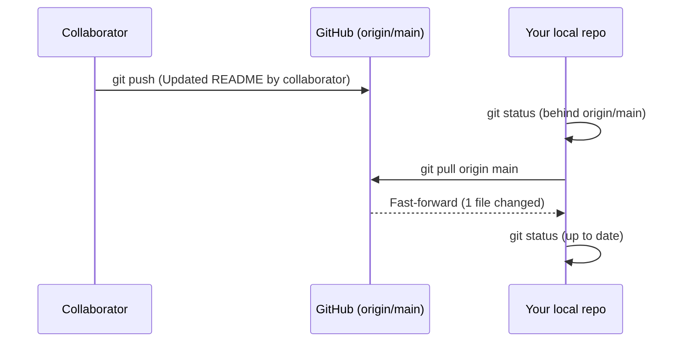
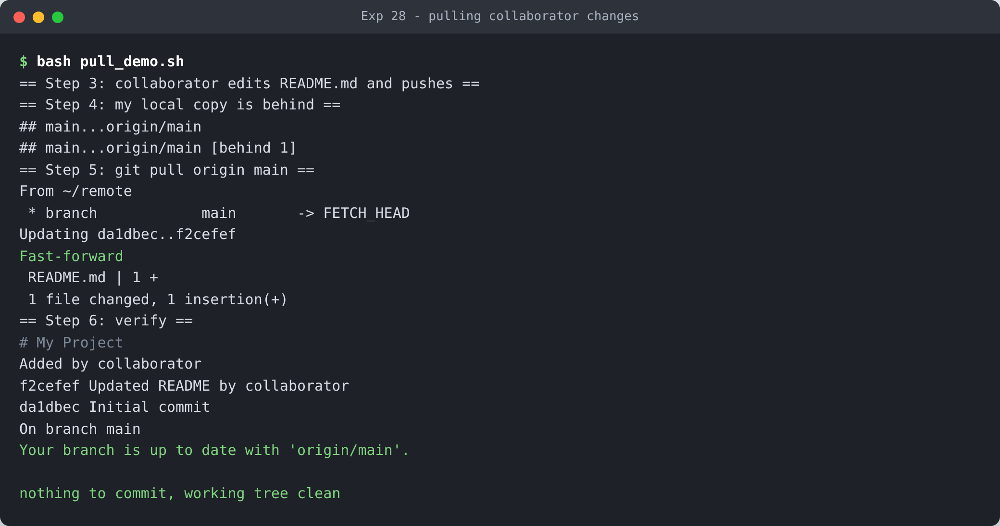

# Experiment 28: Pulling Collaborator Changes From GitHub

 

> **Course:** CSA10 - Software Engineering &nbsp;|&nbsp; **Tools used:** Git/GitHub &nbsp;|&nbsp; **Course outcome:** CO4

---

## Problem Statement


You cloned a repository earlier, and now another collaborator has made changes to it. You need to pull the latest changes from GitHub to keep your local copy up to date.

**Tasks:**

- Clone a repository (from previous questions).
- Ask a collaborator to make a change and push it to the GitHub repository.
- Use git pull origin main to pull the latest changes.
- Verify that the changes made by your collaborator appear in your local repository.

## Aim


To pull the latest changes made by a collaborator from the GitHub repository into the local repository and verify that the local copy is up to date.


## Software / Tools Required

- Git (Git Bash)
- GitHub (repository with a collaborator)
- Visual Studio Code

## Theory


When several people work on the same repository, the local copy becomes outdated as soon as someone else pushes. git pull brings the local branch up to date.

- **git fetch** – downloads new commits from the remote but does not change the working files.
- **git merge origin/main** – merges the fetched commits into the current branch.
- **git pull origin main** – fetch + merge in one step.

A collaborator is added on GitHub through Settings → Collaborators → Add people; the collaborator must accept the invitation before pushing. It is good practice to pull before starting new work and before pushing, to reduce conflicts.


## Diagram

<p align="center"><br><sub><em>Pull collaborator changes</em></sub></p>

<sub>Source: [`diagrams/git-pull-flow.mmd`](diagrams/git-pull-flow.mmd) (Mermaid)</sub>

## Procedure


### Step 1: Clone the Repository

- Open Git Bash and navigate to the desired location.
- Clone the existing GitHub repository using the git clone command.
- Wait for the cloning process to complete successfully.

```bash
git clone <repository_url>
```

### Step 2: Navigate to the Repository

- Move into the cloned repository directory.
- Verify that the repository files are available.

```bash
cd <repository_name>
ls
```

### Step 3: Ask the Collaborator to Make Changes

- Ask a collaborator to open the same GitHub repository.
- The collaborator makes a small change to a file, such as README.md.
- The collaborator stages and commits the change.

```bash
git add README.md
git commit -m "Updated README by collaborator"
```

- The collaborator pushes the changes to the main branch.

```bash
git push origin main
```

### Step 4: Check the Local Repository

- Return to your local Git Bash.
- Check the current status of your repository.

```bash
git status
```

- Verify that your local repository has not yet received the collaborator's changes.

### Step 5: Pull the Latest Changes

- Download and merge the latest changes from the GitHub main branch using:

```bash
git pull origin main
```

- Wait for Git to complete the pull operation successfully.

### Step 6: Verify the Pulled Changes

- Open the repository in Visual Studio Code:

```bash
code .
```

- Open the file modified by the collaborator.
- Verify that the collaborator's changes are now available in your local repository.

### Step 7: Confirm the Repository is Updated

- Run the following command:

```bash
git status
```

- Verify that the working tree is clean and the local repository is synchronized with the remote repository.

## Code

All source files for this experiment are in the [`code/`](code/) folder:

- [`pull_demo.sh`](code/pull_demo.sh)

## Output

Output captured by running the code in [`code/`](code/) (terminal text is also saved in [`output/`](output/)).

<p align="center"><br><sub><em>Collaborator change pulled with a Fast-forward (replayed locally)</em></sub></p>

### Expected Output

- Collaborator’s commit “Updated README by collaborator” is pushed to GitHub.
- git pull origin main shows Fast-forward, 1 file changed.
- README.md in VS Code shows the collaborator’s change; git status reports the branch is up to date.

## Result


Thus the latest changes made by the collaborator were pulled from GitHub and verified in the local repository.


## Viva Voce Questions

1. **Differentiate git pull and git fetch.**
   **Ans:** fetch only downloads; pull downloads and merges.

2. **What is a Fast-forward?**
   **Ans:** When the local branch has no new commits, Git simply moves the pointer to the remote commit.

3. **How do you add a collaborator?**
   **Ans:** Repository Settings → Collaborators → Add people.

4. **What happens if both of you changed the same line?**
   **Ans:** git pull reports a merge conflict that must be resolved manually.

5. **What is git pull --rebase?**
   **Ans:** It replays local commits on top of the fetched commits instead of creating a merge commit.


---
[Back to all experiments](../README.md)
