# Experiment 29: Feature Branch (Feature-Login) And Pull Request

 

> **Course:** CSA10 - Software Engineering &nbsp;|&nbsp; **Tools used:** Git/GitHub &nbsp;|&nbsp; **Course outcome:** CO4

---

## Problem Statement


In your GitHub repository, create a new branch called feature-login. Implement a simple login function in a login.py file. After completing the function, create a pull request to merge feature-login into the main branch.

**Tasks:**

- Create a new branch feature-login.
- Add a login.py file with a simple login function.
- Commit the changes and push them to GitHub.
- Create a pull request from feature-login to main and merge it.

## Aim


To create a feature branch named feature-login, implement a simple login function in login.py, commit and push it, and create and merge a pull request into the main branch.


## Software / Tools Required

- Git (Git Bash)
- GitHub
- Visual Studio Code
- Python 3

## Theory


A feature branch isolates the development of one feature from the main code. Once the feature is complete and reviewed, it is merged into main through a pull request.

Branch life cycle: create (git checkout -b feature-login) → develop and commit → push (git push -u origin feature-login) → open PR → review → merge → delete branch.

The -u (--set-upstream) option links the local branch with the remote branch, so later a plain git push or git pull works without naming the branch.


## Diagram

<p align="center">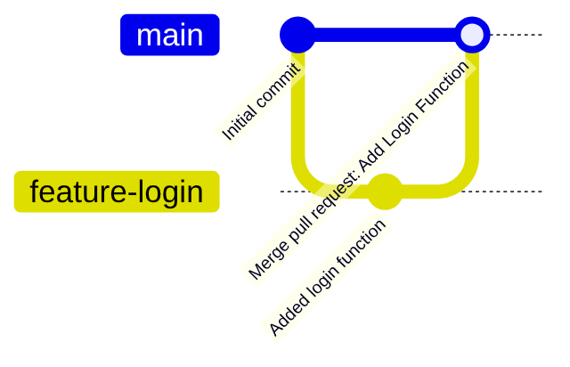<br><sub><em>Feature branch and pull request</em></sub></p>

<sub>Source: [`diagrams/feature-branch.mmd`](diagrams/feature-branch.mmd) (Mermaid)</sub>

## Procedure


### Step 1: Open the GitHub Repository

- Open the GitHub repository in which the login feature needs to be developed.
- Open Git Bash and navigate to the local repository directory.
- Verify that the repository is up to date with the main branch.

```bash
cd ~/Desktop/My-Personal-Project
git status
```

<p align="center">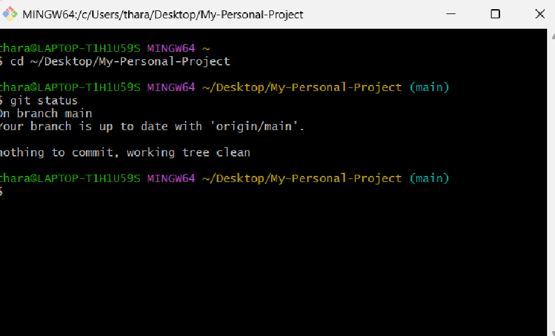<br><sub><em>Figure 29.1 – Open the GitHub Repository</em></sub></p>

### Step 2: Create the Feature Branch

- Create a new branch named feature-login.
- Switch to the newly created branch using the following command.

```bash
git checkout -b feature-login
```

- Verify that the feature branch is active.

```bash
git branch
```

<p align="center">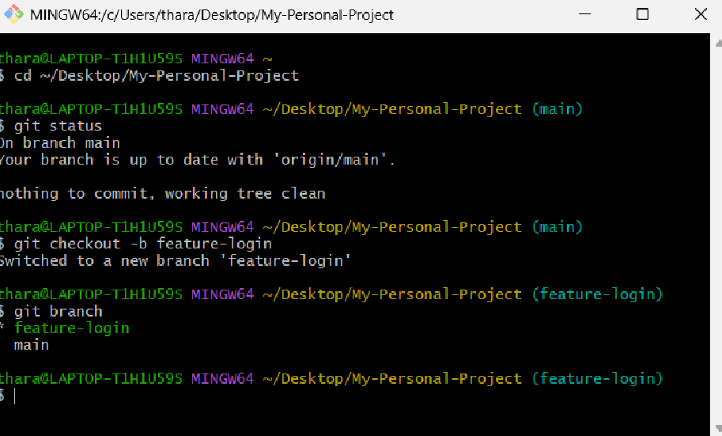<br><sub><em>Figure 29.2 – Create the Feature Branch</em></sub></p>

### Step 3: Create the Login File

- Open the project in Visual Studio Code.

```bash
code .
```

- Create a new Python file named login.py.
- Add a simple login function that accepts a username and password and validates the credentials.
- Example:

**`login.py`**

```python
def login(username, password):
    if username == "admin" and password == "1234":
        return "Login successful"
    else:
        return "Invalid username or password"
```

- Save the login.py file.

<p align="center">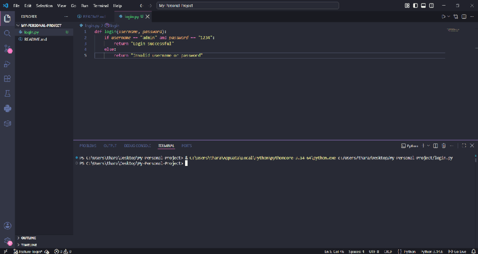<br><sub><em>Figure 29.3 – Create the Login File</em></sub></p>

### Step 4: Check the Changes

- Return to Git Bash.
- Check the repository status to verify that login.py is detected as a new file.

```bash
git status
```

<p align="center">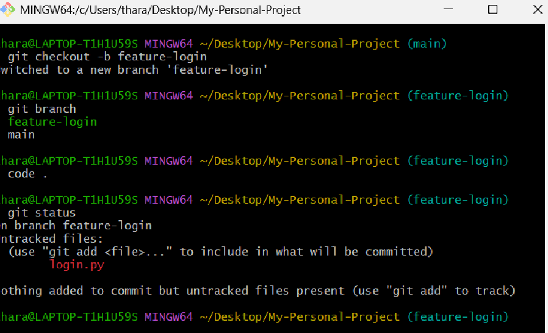<br><sub><em>Figure 29.4 – Check the Changes</em></sub></p>

### Step 5: Stage and Commit the Changes

- Add the new login.py file to the staging area.

```bash
git add login.py
```

- Commit the changes with a meaningful commit message.

```bash
git commit -m "Added login function"
```

<p align="center">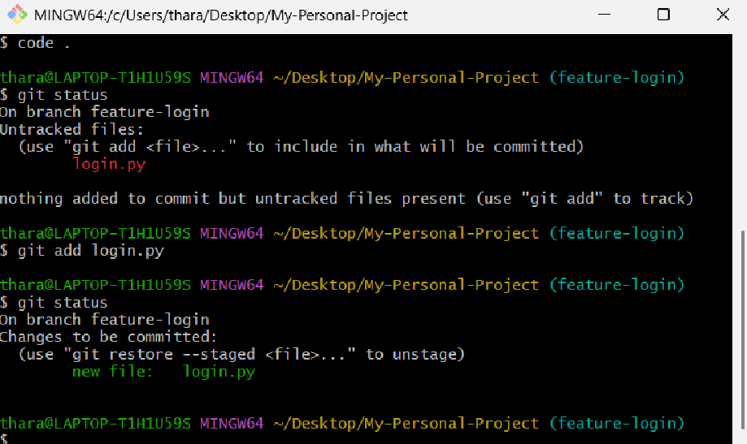<br><sub><em>Figure 29.5 – Stage and Commit the Changes</em></sub></p>

<p align="center">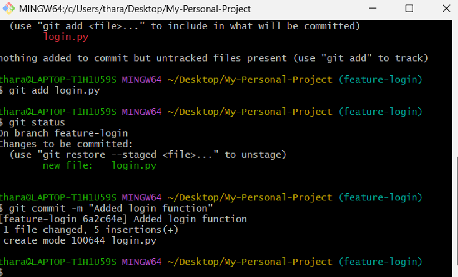<br><sub><em>Figure 29.6 – Stage and Commit the Changes</em></sub></p>

### Step 6: Push the Feature Branch

- Push the feature-login branch to the GitHub repository.

```bash
git push -u origin feature-login
```

- Verify that the feature branch is available on GitHub.

<p align="center">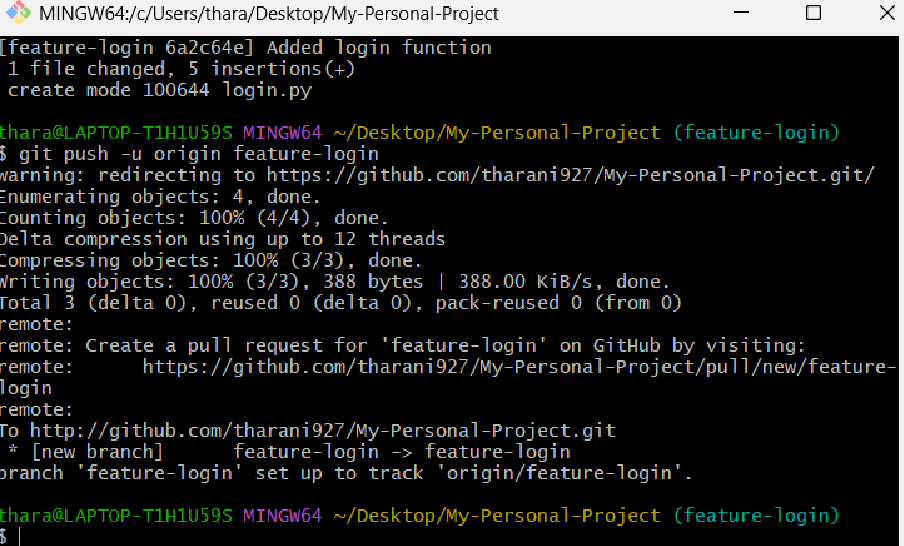<br><sub><em>Figure 29.7 – Push the Feature Branch</em></sub></p>

### Step 7: Create a Pull Request

- Open the GitHub repository.
- Select the feature-login branch.
- Click Compare & pull request.
- Set the base branch as main and the compare branch as feature-login.
- Enter a suitable title such as Add Login Function.
- Add a brief description of the changes.
- Click Create pull request.

<p align="center">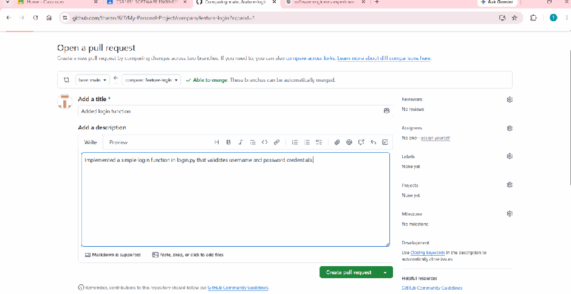<br><sub><em>Figure 29.8 – Create a Pull Request</em></sub></p>

### Step 8: Review and Merge the Pull Request

- Review the changes included in the Pull Request.
- Verify that login.py contains the required login function.
- Click Merge pull request.
- Confirm the merge operation.
- Verify that the feature-login changes are now available in the main branch.

<p align="center">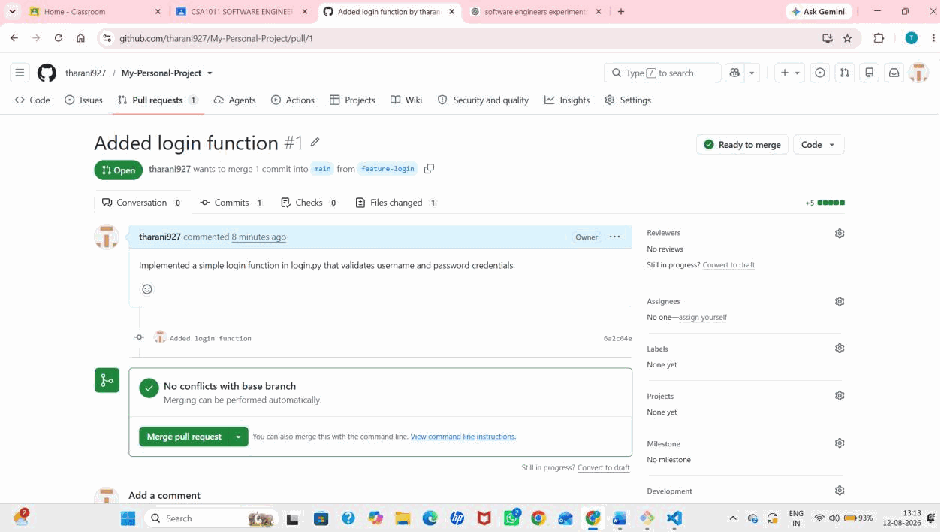<br><sub><em>Figure 29.9 – Review and Merge the Pull Request</em></sub></p>

<p align="center">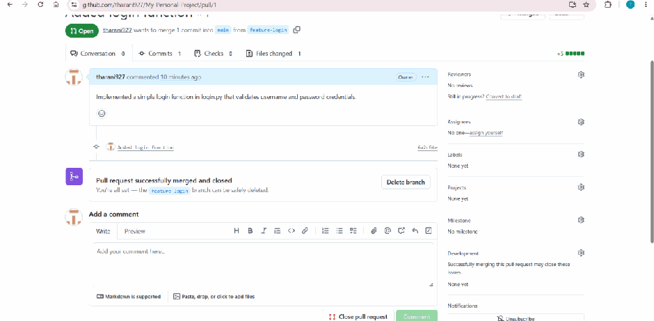<br><sub><em>Figure 29.10 – Review and Merge the Pull Request</em></sub></p>

### Step 9: Verify the Merged Feature

- Switch to the main branch locally.

```bash
git checkout main
```

- Pull the latest changes from GitHub.

```bash
git pull origin main
```

- Verify that login.py is present in the project.

```bash
ls
```

<p align="center">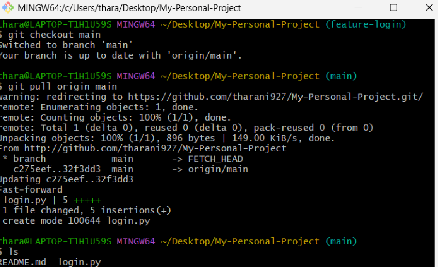<br><sub><em>Figure 29.11 – Verify the Merged Feature</em></sub></p>

<p align="center">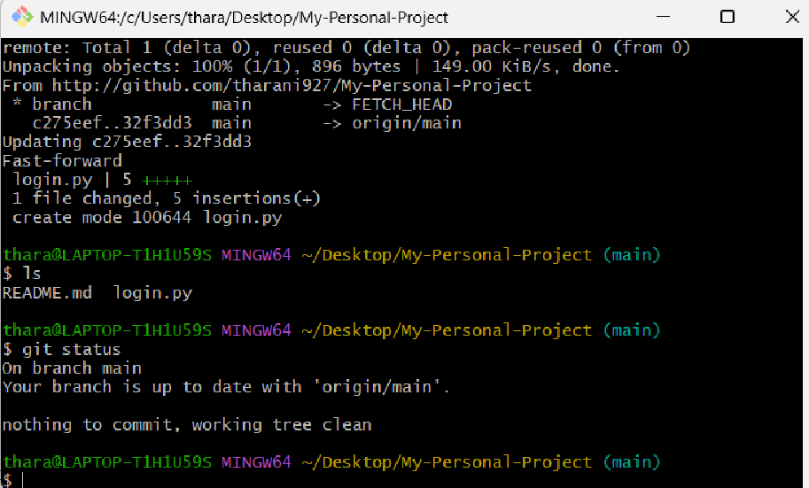<br><sub><em>Figure 29.12 – Verify the Merged Feature</em></sub></p>

<p align="center">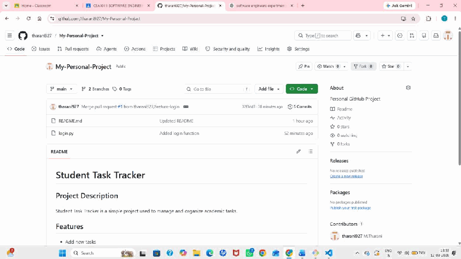<br><sub><em>Figure 29.13 – Verify the Merged Feature</em></sub></p>


## Code

All source files for this experiment are in the [`code/`](code/) folder:

- [`login.py`](code/login.py)
- [`test_login.py`](code/test_login.py)

## Output

Output captured by running the code in [`code/`](code/) (terminal text is also saved in [`output/`](output/)).

<p align="center">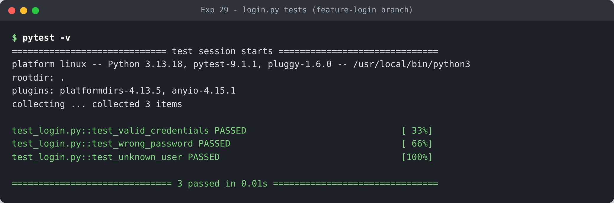<br><sub><em><code>login.py</code> tests pass</em></sub></p>

Lab screenshots from the original run are in [`screenshots/`](screenshots/) (13 images, shown in the Procedure above).

### Expected Output

- Branch feature-login created; login.py added and committed (“Added login function”).
- Pull request “Add Login Function” created from feature-login to main and merged.
- After git checkout main and git pull, login.py is present in main.

## Result


Thus a feature-login branch was created, a login function was implemented, pushed and merged into the main branch through a pull request.


## Viva Voce Questions

1. **What does git checkout -b do?**
   **Ans:** Creates a new branch and switches to it.

2. **What does -u in git push -u do?**
   **Ans:** Sets the upstream (tracking) branch.

3. **How do you delete a branch locally?**
   **Ans:** git branch -d feature-login.

4. **What is git switch?**
   **Ans:** A newer command to change branches (git switch -c creates one).

5. **Why should a feature be merged through a PR?**
   **Ans:** To allow code review and checks before it reaches main.


---
[Back to all experiments](../README.md)
