# Experiment 30: Forking, Feature Branch And Pull Request To The Original Repository

 

> **Course:** CSA10 - Software Engineering &nbsp;|&nbsp; **Tools used:** Git/GitHub &nbsp;|&nbsp; **Course outcome:** CO4

---

## Problem Statement


You and your team are working on a project. One team member adds a new feature to the project. You need to fetch the latest changes, create a new branch, and implement your feature without affecting the existing code.

**Tasks:**

- Fork a repository (you can use an existing repository or a partner’s repository).
- Clone the repository to your local machine.
- Create a new branch for your feature.
- Implement your changes and push them to your forked repository.
- Submit a pull request to the original repository.

## Aim


To fork a team member’s repository, clone it, create a feature branch, implement a feature without affecting existing code, push it to the fork and submit a pull request to the original repository.


## Software / Tools Required

- Git (Git Bash)
- GitHub
- Visual Studio Code

## Theory


When you do not have write access to a repository, you contribute through a fork. Your fork is linked to the original repository (called **upstream** ).

- git remote add upstream <original-url> – adds the original repository as a second remote.
- git fetch upstream / git merge upstream/main – keeps the fork up to date with the team’s latest changes.
- A pull request is opened from your-fork:feature-update to original:main.

Working on a separate branch ensures the existing code on main is not affected until the change is reviewed and accepted.


## Diagram

<p align="center">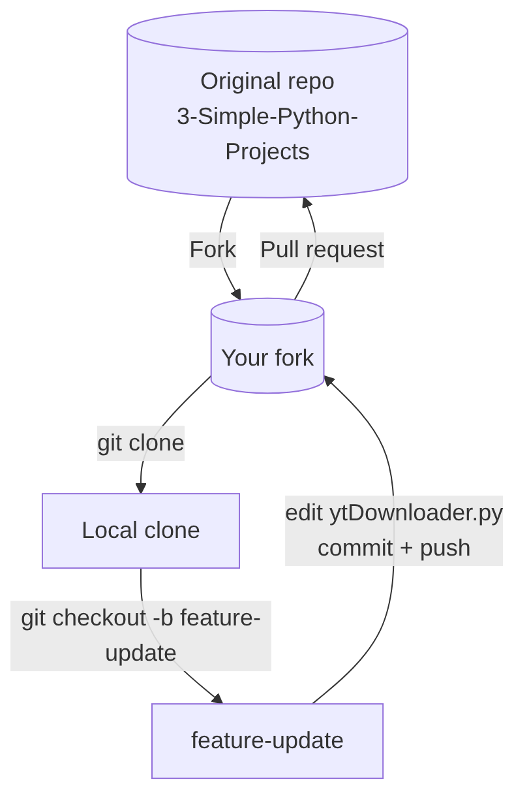<br><sub><em>Fork, feature branch and pull request</em></sub></p>

<sub>Source: [`diagrams/fork-feature-flow.mmd`](diagrams/fork-feature-flow.mmd) (Mermaid)</sub>

## Procedure


### Step 1: Fork the Repository

- Open the original GitHub repository in a web browser.
- Sign in to your GitHub account.
- Click the Fork button.
- Select your GitHub account as the owner of the fork.
- Enter a suitable repository name if required.
- Click Create fork.
- Verify that the forked repository is available in your GitHub account.

<p align="center">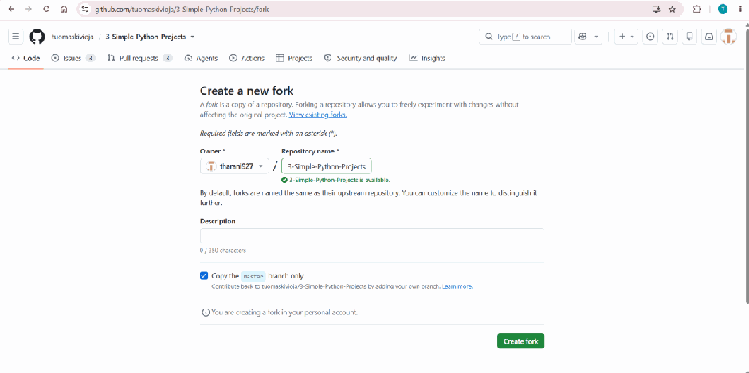<br><sub><em>Figure 30.1 – Fork the Repository</em></sub></p>

### Step 2: Clone the Forked Repository

- Open Git Bash on the local machine.
- Navigate to the folder where the project needs to be stored.
- Copy the HTTPS URL of the forked repository from the Code button.
- Clone the repository using the git clone command.

```bash
git clone <forked_repository_url>
```

- Navigate into the cloned repository.

```bash
cd <repository_name>
```

- List the files to verify that the repository was cloned successfully.

```bash
ls
```

<p align="center">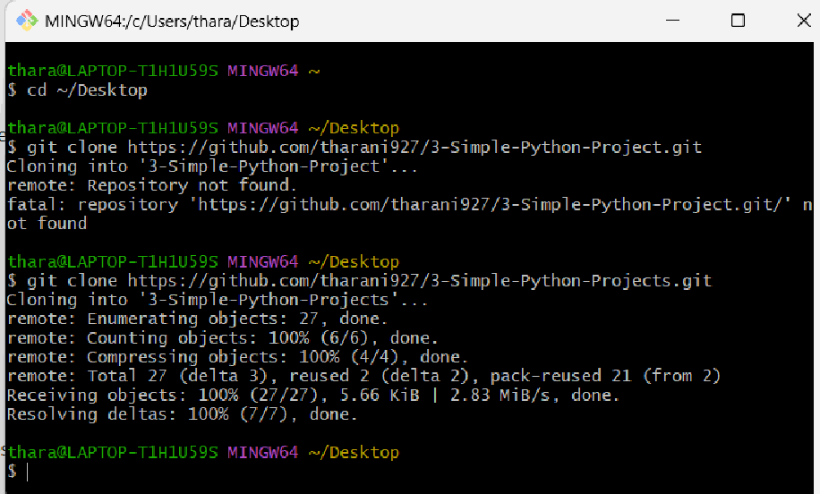<br><sub><em>Figure 30.2 – Clone the Forked Repository</em></sub></p>

<p align="center">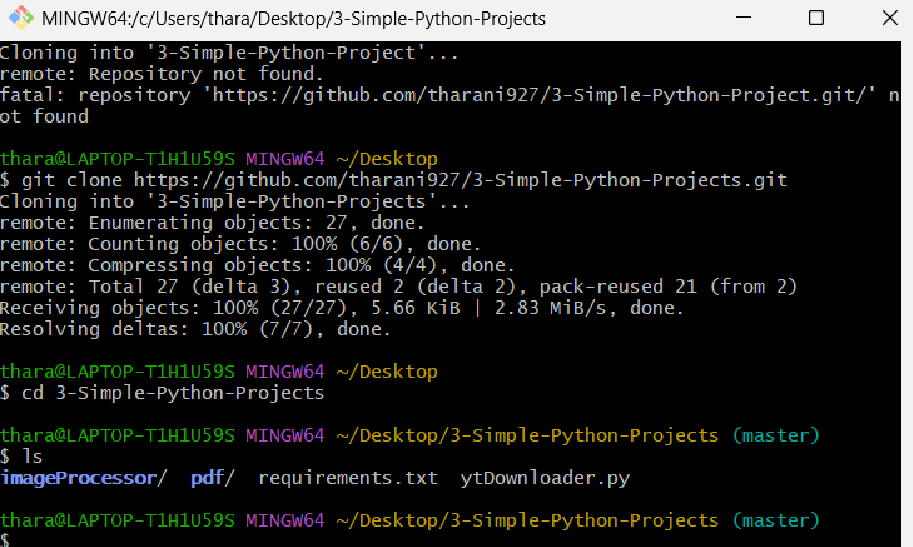<br><sub><em>Figure 30.3 – Clone the Forked Repository</em></sub></p>

### Step 3: Create a Feature Branch

- Create a separate branch for implementing the new feature.
- Switch to the newly created branch.

```bash
git checkout -b feature-update
```

- Verify that the feature branch is active.

```bash
git branch
```

<p align="center">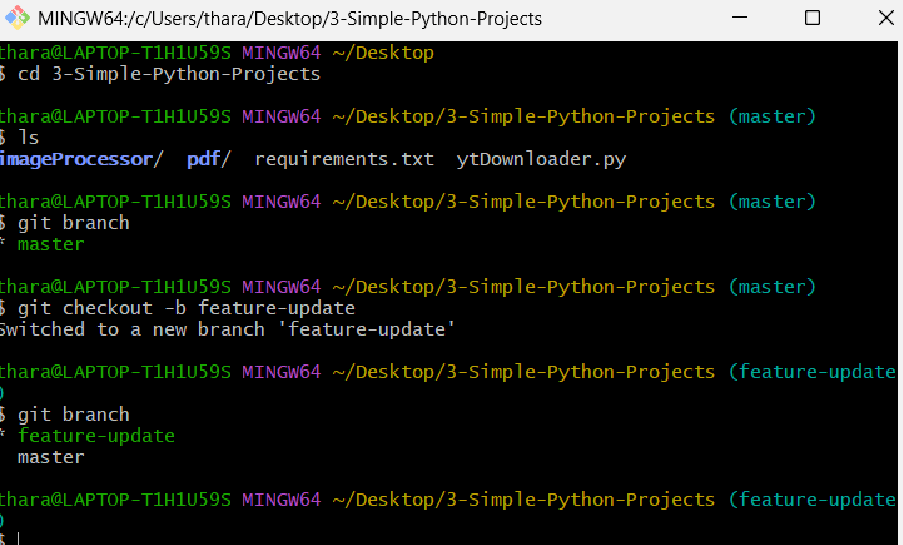<br><sub><em>Figure 30.4 – Create a Feature Branch</em></sub></p>

### Step 4: Implement the Feature

- Open the project in Visual Studio Code or another code editor.

```bash
code .
```

- Select the appropriate project file.
- Add or modify the required feature without changing unrelated parts of the project.
- Save all changes.

<p align="center">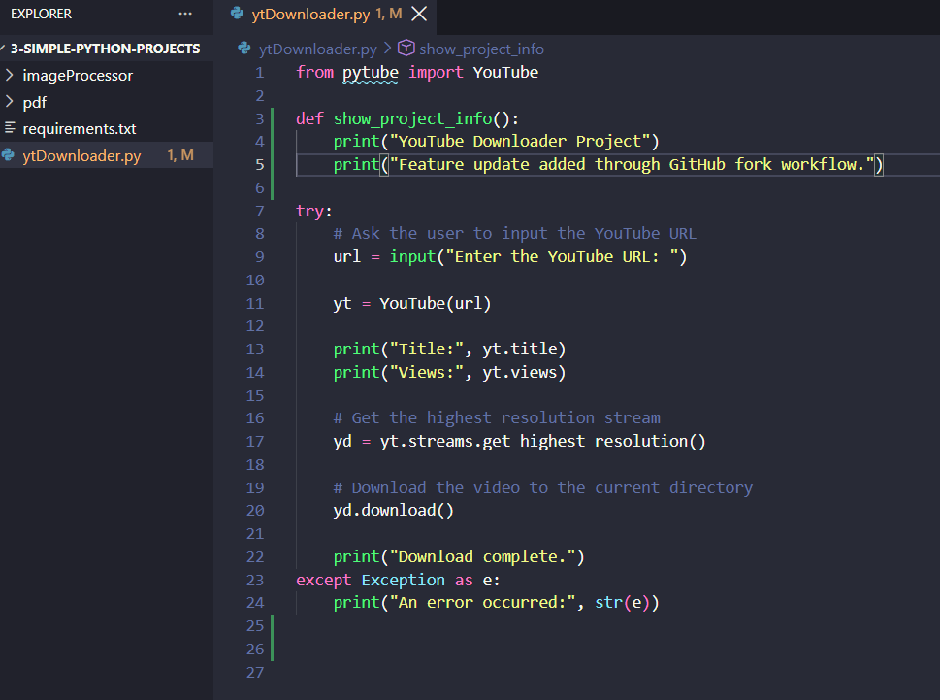<br><sub><em>Figure 30.5 – Implement the Feature</em></sub></p>

### Step 5: Verify the Changes

- Return to Git Bash.
- Check the repository status.

```bash
git status
```

- Verify that the modified or newly created files are displayed.

<p align="center">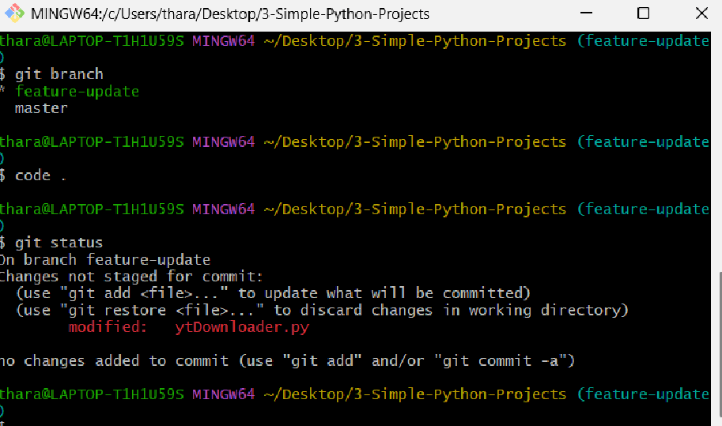<br><sub><em>Figure 30.6 – Verify the Changes</em></sub></p>

### Step 6: Stage and Commit the Changes

- Add the modified files to the staging area.

```bash
git add .
```

- Commit the changes with a meaningful commit message.

```bash
git commit -m "Added new feature"
```

<p align="center">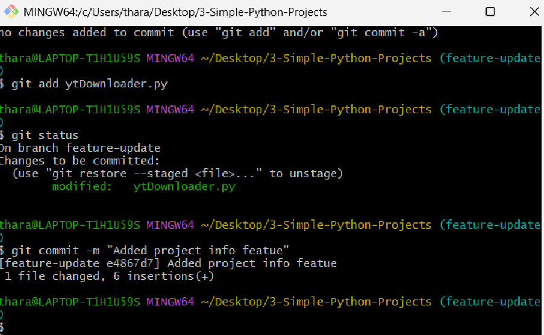<br><sub><em>Figure 30.7 – Stage and Commit the Changes</em></sub></p>

### Step 7: Push the Feature Branch

- Push the feature branch to your forked GitHub repository.

```bash
git push -u origin feature-update
```

- Verify that the feature-update branch is available in your forked repository.

<p align="center">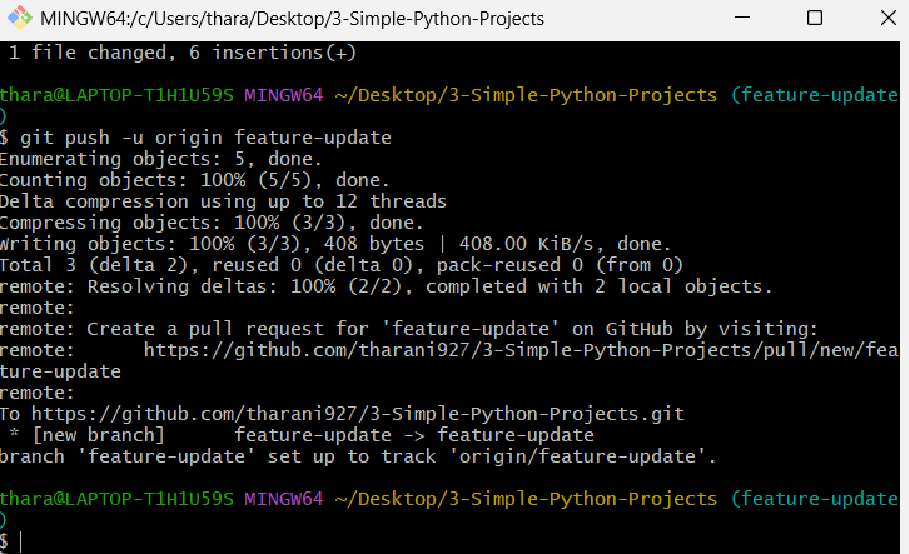<br><sub><em>Figure 30.8 – Push the Feature Branch</em></sub></p>

### Step 8: Create a Pull Request

- Open your forked repository on GitHub.
- Click Compare & pull request or open Pull requests → New pull request.
- Set the original repository as the base repository.
- Select the main branch as the base branch.
- Select your forked repository and feature-update as the compare branch.
- Enter a suitable title and description for the pull request.
- Click Create pull request.

<p align="center">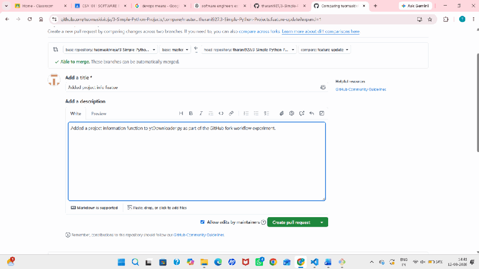<br><sub><em>Figure 30.9 – Create a Pull Request</em></sub></p>

### Step 9: Verify the Pull Request

- Open the Pull Request page.
- Verify that the feature changes are displayed correctly.
- Check that the Pull Request is directed from your fork to the original repository.
- Submit the Pull Request for review.

<p align="center">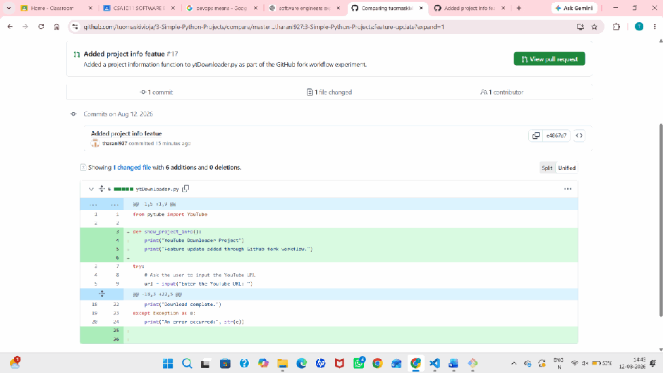<br><sub><em>Figure 30.10 – Verify the Pull Request</em></sub></p>


## Code

All source files for this experiment are in the [`code/`](code/) folder:

- [`requirements.txt`](code/requirements.txt)
- [`ytDownloader.py`](code/ytDownloader.py)

## Output

Lab screenshots from the original run are in [`screenshots/`](screenshots/) (10 images, shown in the Procedure above).

### Expected Output

- Fork of 3-Simple-Python-Projects created and cloned.
- Branch feature-update created; ytDownloader.py modified, committed (“Added project info feature”) and pushed.
- Pull request from the fork’s feature-update branch to the original repository’s main branch is opened.

## Result


Thus the repository was forked and cloned, a feature was implemented on a separate branch, pushed to the fork and a pull request was submitted to the original repository.


## Viva Voce Questions

1. **What is upstream?**
   **Ans:** The original repository from which a fork was created.

2. **How do you keep a fork in sync?**
   **Ans:** git fetch upstream and git merge upstream/main (or Sync fork on GitHub).

3. **Can you push directly to the original repository?**
   **Ans:** Not without write access; you use a pull request instead.

4. **Why implement the feature on a new branch?**
   **Ans:** So existing code on main is not affected.

5. **What is shown in the Files changed tab of a PR?**
   **Ans:** The line-by-line diff of all modified files.


---
[Back to all experiments](../README.md)
